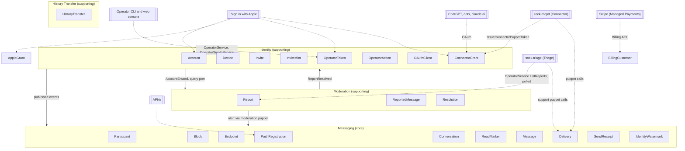
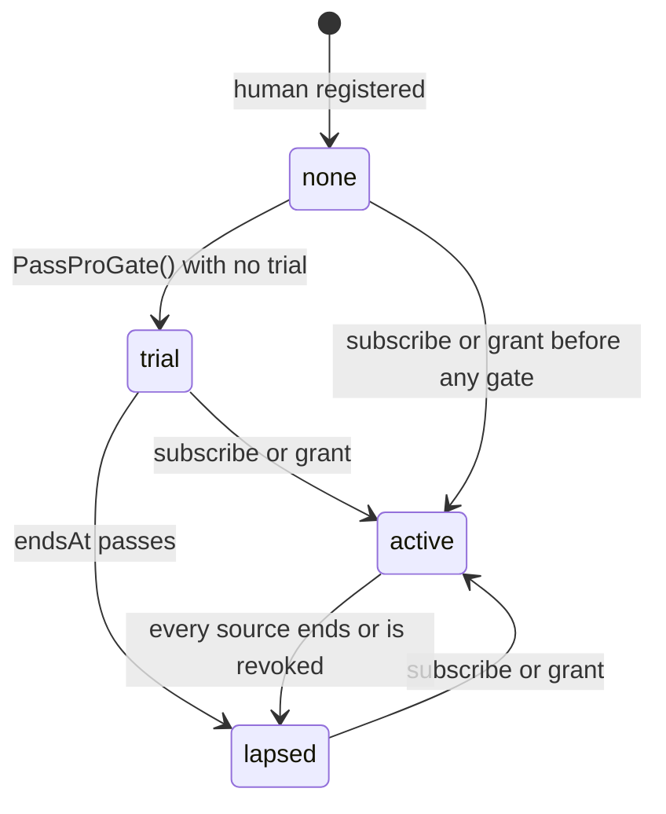
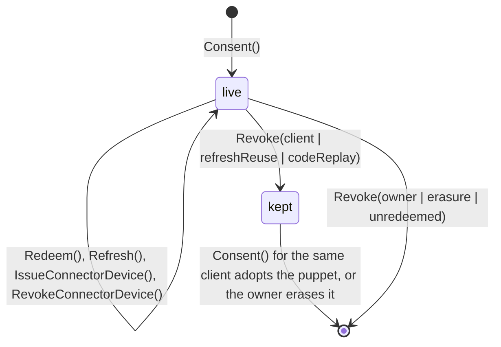
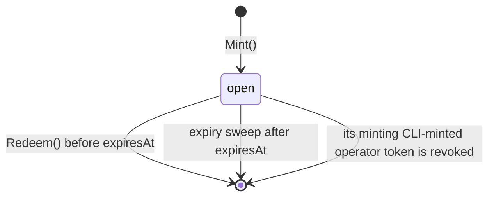
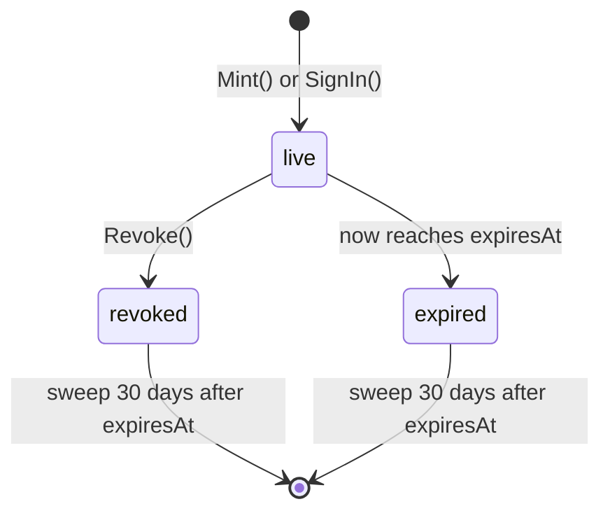
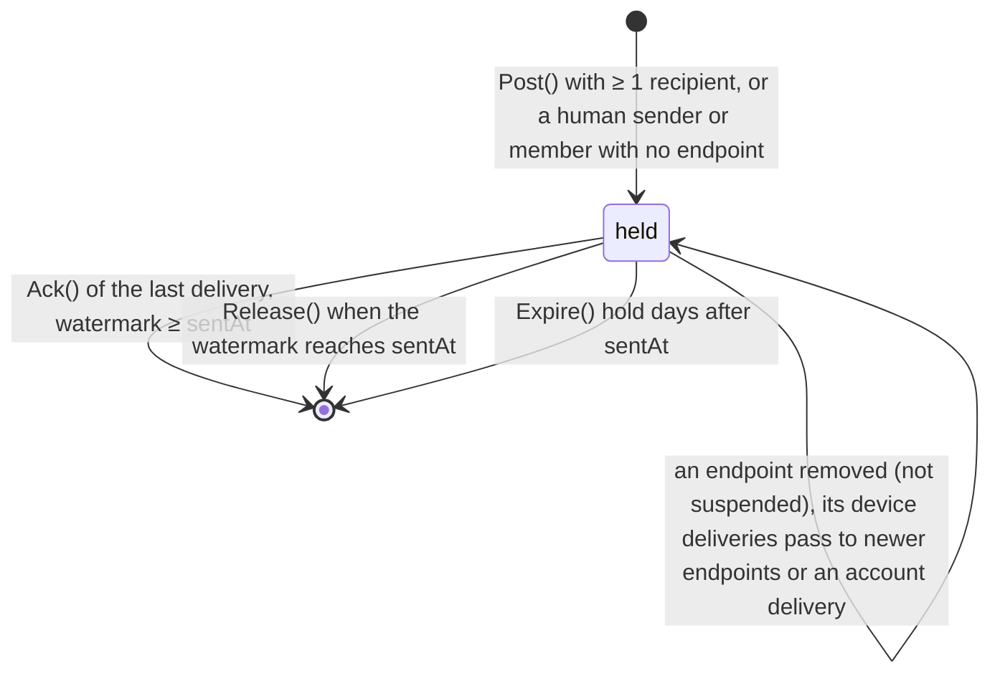
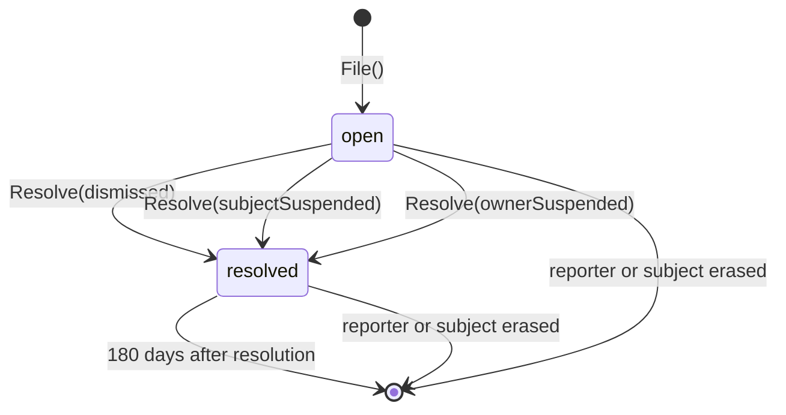
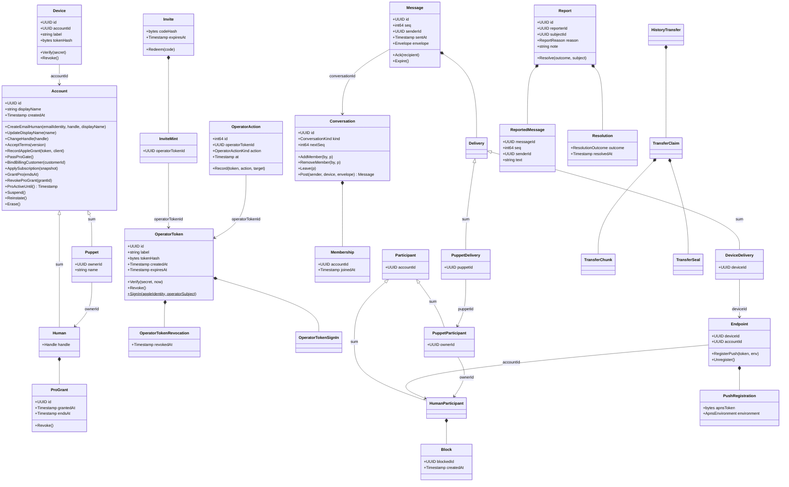

# sock v1 domain model

Pass 10: feature flags. Pass 9: History Transfer. Pass 8. Language: [context map](context-map.md).

## Contexts



Only ids and the facts in [events](events.md) cross from Identity to Messaging. Messaging holds no names, handles or Apple identifiers.

---

# Identity

## Account

Entity, aggregate root. A human or a puppet; a sum, never both.

### Fields

| Field | Type | Meaning |
|---|---|---|
| `id` | UUID | Server-generated (`uuidv7`) |
| `displayName` | string | 1 to 64 characters, any script, emoji allowed |
| `createdAt` | Timestamp | Server clock |
| `kind` | `Human` \| `Puppet` | The variant. Exactly one |

Erasure is not a field. An erased account is deleted outright (minimal retention); `AccountErased` is the only trace and it carries only the id.

### Behaviors

- `RegisterHuman(appleSubject, handle, displayName)` (factory)
- `CreateEmailHuman(emailIdentity, handle, displayName)` (factory, operator only): [email sign-in](email-sign-in.md)
- `RegisterEmailHuman(emailIdentity, handle, displayName)` (factory, `RegisterWithEmail`) and `AddEmailIdentity(signedInEmail)` (`AddEmailSignIn`, a signed-in human adding email sign-in): [email sign-in, pass 2](email-sign-in-pass-2.md)
- `CreatePuppet(owner Human, name, displayName)` (factory, on the owner)
- `UpdateDisplayName(name)`
- `ChangeHandle(handle)` (humans)
- `AcceptTerms(version)` (humans): refuses any version but the current one; records a `TermsAcceptance`
- `RecordAppleGrant(refreshToken, client)` (humans): replaces the stored `AppleGrant`, queuing the old one for revocation as the client it was issued to
- `Suspend()`: records a `Suspension`, revokes every device of the account and of its puppets, and queues a `BillingCancellation` for a human's `BillingCustomer`, since a suspended human cannot sign in to cancel. `Reinstate()` drops one not yet done. Emits `AccountSuspensionChanged` when it writes the suspension
- `Reinstate()`: deletes the `Suspension`; idempotent (`ReinstateAccount`, `sockd accounts reinstate`). Emits `AccountSuspensionChanged` when it deletes one
- `PassProGate()` (humans): the Sock Pro gate's check, run by every gated human action (`CreatePuppet`, `MintPuppetToken`, `MintMachineKey`, consent's Allow, `IssueConnectorPuppetToken` for the grant's owner). Passes when Pro is active. Otherwise, when the human has never had a trial, starts one (`ProTrial` now to now + 7 days, and its `TrialReminder`) and passes. Otherwise refuses `SUBSCRIPTION_REQUIRED`. While `SOCK_PRO_REQUIRED` is off it passes and starts nothing
- `BindBillingCustomer(customerId)` (humans, `StartCheckout` the first time): records the human's `BillingCustomer`. Refuses a second one
- `ApplySubscription(snapshot)` (humans, the Stripe webhook): records what one fetch of a subscription says, `ProSubscription.activeUntil` from the snapshot. Writes the latest fetch, whatever was stored: the snapshot is Stripe's current state, not an increment
- `GrantPro(endsAt)` (humans, `GrantPro`): adds a `ProGrant`. Refuses `endsAt` not after now or more than 10 years ahead
- `RevokeProGrant(grantId)` (humans, `RevokeProGrant`): records a `ProGrantRevocation`. Idempotent for a grant already revoked
- `ProActiveUntil()` (humans): the latest of the trial's `endsAt`, every subscription's `activeUntil` and every unrevoked grant's `endsAt`. Sock Pro is active, for the human and through them for their puppets, while it is after now
- `Erase()` (`EraseAccount`, `ErasePuppet`, and the operator's `EraseHuman` for a human owning no system puppet): deletes the account, its devices and, for a human, every puppet it owns; requests revocation of its `AppleGrant` if one exists; queues a `BillingCustomerDeletion` for its `BillingCustomer` if one exists; deletes every `OperatorAction` targeting any of them

### Invariants

- Exactly one variant, set at creation, never changed.
- A puppet's owner is a human, never a puppet.
- Erasing a human erases its puppets in the same transaction.
- A suspended account authenticates nothing: no device survives `Suspend`, and sign-in is refused while the suspension exists.
- A human registers only by accepting the current terms version.
- A human registers by redeeming an invite, by the operator's waiver, or while registration is open ([feature flags](feature-flags.md)).
- At most one trial per human, ever. Erasing the human erases it, and a new account is a new human.
- At most one billing customer per human, and a billing customer belongs to one human.
- A subscription belongs to the human whose billing customer Stripe names on it. The hub never reads an account id from Stripe metadata.
- Every change to `ProActiveUntil()` emits `ProEntitlementChanged` in the same transaction.

### Relationships

| With | Kind | Cardinality |
|---|---|---|
| `Human` / `Puppet` | is-a (sum) | 1 to 1 |
| `Device` | referenced by | 1 to n, n ≥ 0 |
| `Account` (puppets, if human) | referenced by | 1 to n, n ≥ 0 |
| `TermsAcceptance` | has-a (humans) | 1 to n, n ≥ 1 for humans registered after pass 2 |
| `Suspension` | has-a | 1 to 0..1 |
| `AppleGrant` | has-a (humans) | 1 to 0..1 |
| `ProTrial` | has-a (humans) | 1 to 0..1 |
| `BillingCustomer` | has-a (humans) | 1 to 0..1 |
| `ProSubscription` | has-a (humans), through `BillingCustomer` | 1 to n, n ≥ 0 |
| `ProGrant` | has-a (humans) | 1 to n, n ≥ 0 |

### Sock Pro states



Derived from the sources, not stored. Anything not drawn is refused: `lapsed` never returns to `trial`.

## TermsAcceptance

Value object, owned by `Account` (humans). A fact: this human agreed to this terms version.

| Field | Type | Meaning |
|---|---|---|
| `version` | string | The terms version, 1 to 32 characters, as configured on the server (`2026-10-11`) |
| `acceptedAt` | Timestamp | Server clock |

Terms are current for a human when an acceptance exists at the configured version. A puppet's terms are its owner's.

## Suspension

Value object, owned by `Account`. A fact: the operator has barred this account. Its existence is the state; reinstating deletes it.

| Field | Type | Meaning |
|---|---|---|
| `suspendedAt` | Timestamp | Server clock |

Why an account was suspended is the `Resolution` in Moderation that caused it, or the operator's own CLI action; Identity does not repeat it.

## AppleGrant

Value object, owned by `Account` (humans). The refresh token Apple issued for this human's Sign in with Apple, kept only so erasure can revoke it.

| Field | Type | Meaning |
|---|---|---|
| `refreshToken` | string | Apple's opaque refresh token, 1 to 4096 characters |
| `client` | `AppleClient` | The client the code was issued to and exchanged as. Apple revokes a token only for that client's id |
| `issuedAt` | Timestamp | When the authorization code was exchanged |

Every sign-in replaces it with the newest grant, from either client. Accounts that signed in only before pass 2 have none.

## ProTrial

Value object, owned by `Account` (humans), 0 or 1. The human's one free 7-day Sock Pro period, no card ([Sock Pro billing](sock-pro-billing.md)).

| Field | Type | Meaning |
|---|---|---|
| `startedAt` | Timestamp | When `PassProGate` started it |
| `endsAt` | Timestamp | `startedAt` + 7 days |

Kept after it ends: its existence is what refuses a second trial.

## TrialReminder

Value object, owned by `ProTrial`, a queue row. Deleted once handled.

| Field | Type | Meaning |
|---|---|---|
| `availableAt` | Timestamp | When the worker may next lease it: 2 days before `endsAt` at first, pushed out by each lease and by backoff |
| `attempts` | int | Leases taken |

Handling: when the human's `ProActiveUntil()` is after the trial's `endsAt` (they subscribed or were granted Pro), or the human has no email identity, the row is deleted and nothing is sent. Otherwise the worker reads the address from WorkOS (the email identity's user) and sends "Your Sock Pro trial ends in 2 days" from `SOCK_BILLING_MAIL_FROM` (an address on `joinsock.com`) through Cloudflare Email Service, with `SOCK_CLOUDFLARE_ACCOUNT_ID` and `SOCK_CLOUDFLARE_EMAIL_TOKEN`, then deletes the row. `SOCK_BILLING_MAIL_FROM` unset: reminders wait in their queue. A timeout, 5xx or throttle from either service backs off (1 s doubling to 1 h, or `Retry-After`); a refusal for good (a bounce, a deleted WorkOS user) deletes the row and logs.

## BillingCustomer

Value object, owned by `Account` (humans), 0 or 1. The Stripe customer the hub created for the human.

| Field | Type | Meaning |
|---|---|---|
| `customerId` | string | Stripe's customer id, `cus_` and 1 to 64 of `[A-Za-z0-9]` |
| `createdAt` | Timestamp | When the hub created it |

Created by the hub with the Stripe idempotency key `customer-<account id>`, so a retried `StartCheckout` makes one customer. The hub sends Stripe no name, email or account id: Checkout collects the email.

## ProSubscription

Value object, owned by `Account` through its `BillingCustomer`, one per Stripe subscription, as the hub last fetched it.

| Field | Type | Meaning |
|---|---|---|
| `subscriptionId` | string | Stripe's subscription id, `sub_` and 1 to 64 of `[A-Za-z0-9]` |
| `activeUntil` | Timestamp | How long this subscription keeps Pro active, as of `fetchedAt` |
| `fetchedAt` | Timestamp | When the hub last fetched it from Stripe |

`activeUntil` from a snapshot, by Stripe status:

| Status | `activeUntil` |
|---|---|
| `active`, `trialing` | The latest `current_period_end` of its items (API version `2025-03-31.basil` and later carry the period on the items) |
| `past_due` | The latest item `current_period_start` + 7 days: a grace period while Stripe retries the card |
| `canceled`, `unpaid`, `incomplete`, `incomplete_expired`, `paused` | `fetchedAt`: ended |

A subscription set to cancel at period end stays `active` until then, so it keeps Pro until the period it was paid for ends. A Stripe refund does not by itself end Pro; a cancellation does.

## BillingCustomerDeletion

Value object, a queue row with no owner: it outlives the erased account, as the email identity deletion does ([email sign-in, pass 2](email-sign-in-pass-2.md)).

| Field | Type | Meaning |
|---|---|---|
| `customerId` | string | The Stripe customer to delete |
| `requestedAt` | Timestamp | The erasure time |
| `availableAt` | Timestamp | When the worker may next lease it |
| `attempts` | int | Leases taken |

Deleted once Stripe answers `2xx` or `404`. Deleting the customer cancels its subscriptions, so an erased human is never charged again.

## BillingCancellation

Value object, a queue row owned by `Account` through its `BillingCustomer`, 0 or 1. The worker expires the customer's open Checkout sessions and cancels every subscription Stripe still lists for it, at once, with no proration and no refund. What Stripe cancelled stays cancelled after `Reinstate()`.

| Field | Type | Meaning |
|---|---|---|
| `customerId` | string | The Stripe customer whose billing stops |
| `requestedAt` | Timestamp | The suspension, or the webhook that applied a subscription while the human was suspended |
| `availableAt` | Timestamp | When the worker may next lease it |
| `attempts` | int | Leases taken |

Deleted once Stripe lists nothing left or the customer is gone (`404`). No attempt cap: a live subscription keeps charging the card.

## ProGrant

Entity, owned by `Account` (humans). Free Sock Pro the operator gave a human until a date. Identity persists across revocation.

| Field | Type | Meaning |
|---|---|---|
| `id` | UUID | Server-generated (`uuidv7`) |
| `grantedAt` | Timestamp | Server clock |
| `endsAt` | Timestamp | Pro active until this time, unless revoked. After `grantedAt`, at most 10 years after it |

Behaviors: `Revoke()`, through `Account.RevokeProGrant`.

## ProGrantRevocation

Value object, owned by `ProGrant`, 0 or 1. Its existence ends the grant.

| Field | Type | Meaning |
|---|---|---|
| `revokedAt` | Timestamp | Server clock |

## Billing (anti-corruption layer)

Stripe as Identity sees it. Only `internal/stripe` imports `stripe-go`; no Stripe type crosses this interface.

```go
type Billing interface {
	// CreateCustomer makes the human's Stripe customer, keyed for
	// idempotency by the account id.
	CreateCustomer(ctx context.Context, accountID uuid.UUID) (customerID string, err error)
	// CheckoutURL starts a Managed Payments Checkout Session for one price.
	CheckoutURL(ctx context.Context, customerID string, plan ProPlan) (string, error)
	// PortalURL starts a Customer Portal session.
	PortalURL(ctx context.Context, customerID string) (string, error)
	// Subscription fetches one subscription's current state.
	Subscription(ctx context.Context, subscriptionID string) (SubscriptionSnapshot, error)
	// VerifyEvent checks a webhook's signature and returns what it is about.
	VerifyEvent(payload []byte, signature string, now time.Time) (BillingEvent, error)
	// DeleteCustomer deletes a customer, cancelling its subscriptions; one
	// already gone is success.
	DeleteCustomer(ctx context.Context, customerID string) error
}

type ProPlan int // Monthly, Yearly: Stripe prices by lookup key pro_monthly, pro_yearly

type SubscriptionSnapshot struct {
	ID, CustomerID         string
	Status                 SubscriptionStatus // the closed set in ProSubscription's table
	PeriodStart, PeriodEnd time.Time          // latest across items
}

// BillingEvent is a verified webhook reduced to what the hub acts on.
type BillingEvent struct {
	Kind           BillingEventKind // SubscriptionChanged, CustomerDeleted, Ignored
	SubscriptionID string           // SubscriptionChanged
	CustomerID     string           // CustomerDeleted
}
```

Errors: a timeout, 5xx or `429` is `ErrUnavailable` carrying `Retry-After` when sent; any other 4xx is `ErrRefused` with Stripe's error code, never its message. `VerifyEvent` refuses a missing or malformed `Stripe-Signature`, a `t` more than 5 minutes from now, and a body whose `v1` HMAC-SHA256 over `t.payload` under `SOCK_STRIPE_WEBHOOK_SECRET` does not match, compared in constant time. Checkout sessions set `managed_payments[enabled]=true`, `mode=subscription`, the customer, the price found by lookup key, `success_url` and `cancel_url` from `SOCK_BILLING_RETURN_URL`. In the Stripe dashboard: Managed Payments on; product Sock Pro, tax code `txcd_10103001`, prices `pro_monthly` ($14.99) and `pro_yearly` ($149.99) tax-inclusive; Customer Portal with cancel, switch plans (a shorter interval at period end), payment method and invoices.

## Human

Value object, variant of `Account`.

| Field | Type | Meaning |
|---|---|---|
| `handle` | `Handle` | Unique among humans |


A human signs in with one or more `SignInIdentity`: an Apple identity (Apple's `sub`) or an email identity (a WorkOS user id), at most one of each, never none. See [email sign-in](email-sign-in.md).

## Puppet

Value object, variant of `Account`.

| Field | Type | Meaning |
|---|---|---|
| `ownerId` | UUID | `Account.id` of a human. Immutable |
| `name` | string | 1 to 64 characters. Unique per owner, so the owner can tell puppets apart |

Creation by a machine key is not a field. A puppet a machine key created has a `PuppetCreator` row (`puppetId`, `deviceId`); one created by a session has none. The row dies with the puppet and with the key, after which the puppet is the owner's alone. A machine key may mint tokens for, list, archive, unarchive and erase only puppets whose `PuppetCreator` names it.

Archived is not a field. A puppet whose agent session ended has a `PuppetArchive` row (value object, 0 or 1, owned by the puppet): `puppetId` UUID, `archivedAt` timestamp, when the session ended. No row: unarchived. `Account.ArchivePuppet()` writes it if absent and `Account.UnarchivePuppet()` deletes it if present, each a no-op otherwise; both refuse a system puppet and are called by the owner or the creating machine key, never by a puppet token. Archiving changes no delivery and revokes no token, and the owner alone sees it, except that an archived puppet is not active: a conversation left with no active puppet is read-only for humans (`RecipientPolicy`). An owner may have any number of puppets.

A system puppet is one the server operates: the moderation puppet, named by `SOCK_MODERATION_PUPPET_ID`, and the support puppet, named by `SOCK_SUPPORT_PUPPET_ID`. System is configuration, not a stored field; the API surfaces it as `Puppet.system`. A system puppet is not erasable (`Erase`), counts toward no limit and is never added to a group by a caller (`StartGroup`, `AddMember` refuse it with `SYSTEM_PUPPET`). Conversations that already include it keep it. The moderation puppet gets no tokens (`Device.Issue`) and `StartDirect` refuses it too; `ModerationAlert` opens its direct conversation with the operator internally, past that refusal. The support puppet's owner may mint tokens for it (`MintPuppetToken`, never a machine key), so the operator's agents answer as it; at 10 live tokens it refuses `LIMIT_REACHED` instead of evicting the oldest. A human may open a direct with it (`StartDirect`).

## Handle

Value object. Lowercase `[a-z0-9_]`, 3 to 20 characters. The constructor lowercases input and refuses anything else. Exact-match lookup only.

## Device

Entity, aggregate root. One credential. Kind follows from the account: a human's device is an Apple sign-in session, a puppet's is a token.

### Fields

| Field | Type | Meaning |
|---|---|---|
| `id` | UUID | Server-generated (`gen_random_uuid`, random so ids leak no timing). Embedded in the token |
| `accountId` | UUID | Owning account. Immutable |
| `label` | string | 1 to 64 characters. Device model for app sessions, `sock CLI on <hostname>` (or the person's own) for CLI sessions, owner-chosen for puppet tokens ("ci", "laptop"), the host for machine keys |
| `kind` | `DeviceKind` | `session` (an Apple sign-in session of a human), `puppetToken` (a puppet's token), `machineKey` (a human's key that may only create and erase its own puppets). Fixed at issue; the token prefix follows it |
| `tokenHash` | 32 bytes | SHA-256 of the secret. The secret is never stored |
| `createdAt` | Timestamp | |

Revocation is not a field. Revoking or signing out deletes the device.

### Behaviors

- `Issue(account, label)` (factory): returns the device and its `Token`, once; a human's sign-in at 10 live sessions evicts the oldest `session` device first, never a machine key
- `IssueMachineKey(human, label)` (factory): a `machineKey` device, at most 10 live per human
- `Verify(secret)`: constant-time compare against `tokenHash`
- `Revoke()`

### Invariants

- A token is shown exactly once, at issue.
- A revoked device cannot authenticate: it no longer exists.
- The token's prefix and the device's `kind` agree; a mismatch never authenticates.

### Relationships

| With | Kind | Cardinality |
|---|---|---|
| `Account` | references | n to 1 |

## TerminalSignIn

Entity, aggregate root ([terminal sign-in](terminal-sign-in.md)). One `sock login` between `Start` and `Finish` or expiry: the terminal holds a secret, the person types a code in a browser on any device, the browser signs in through AuthKit, the terminal collects the result.

### Fields

| Field | Type | Meaning |
|---|---|---|
| `id` | UUID | In the terminal token. Made by `Start`, as a registration ticket's is |
| `secretHash` | 32 bytes | SHA-256 of the terminal token's secret, shown once |
| `userCode` | 8 letters of `BCDFGHJKLMNPQRSTVWXZ` | Shown as `XXXX-XXXX`; unique among live sign-ins |
| `deviceLabel` | string | 1 to 64 characters; the label `Finish` issues the session with |
| `createdAt`, `expiresAt` | Timestamp | 10 minutes apart |
| `polledAt` | Timestamp | The last `Finish`; a call within the poll interval is refused |
| `claim` | optional | The browser that entered the code: `browserHash` (SHA-256 of its cookie), `claimedAt` |
| `answer` | optional, only with a claim | AuthKit's answer: `SignedInEmail` (WorkOS user, verified, method), `approveTokenHash` (SHA-256 of the approve form's token), `answeredAt` |
| `approval` | optional, only with an answer | The person's yes on the hub's page: `approvedAt` |

### Behaviors

- `Start(label)` (factory): a fresh secret and code; returns the sign-in and its token, once
- `Claim(browserHash)`: binds the browser; refused once answered or expired; a later claim replaces an earlier one and what it earned
- `Answer(browserHash, signedIn, approveTokenHash)`: records who AuthKit signed in when the hash matches the claim's in constant time; refused without a claim, for another browser, once answered, or expired
- `Approve(browserHash, approveToken)`: the person's yes from the claiming browser with the answer's token; refused without an answer, for another browser, a wrong token, once approved, or expired
- `Finish(secret, now)`: pending without an approval; with one, `Device.Issue` or `RegistrationTicket.Issue` for the approval's user and the sign-in is deleted, in one transaction

### Invariants

- The token is shown once; the secret is never stored.
- Finished at most once: `Finish` deletes the sign-in.
- An answer exists only with a claim, from the claiming browser; an approval only with an answer, from that browser, with its token.
- No two live sign-ins share a code.

### Relationships

| With | Kind | Cardinality |
|---|---|---|
| WorkOS user | names (not a row) | n to 1 |
| `Device`, `RegistrationTicket` | `Finish` invokes their factories | 1 to 0 or 1 |

## Token

Value object. `sock_st_<device id>_<secret>` for a human session, `sock_pt_<device id>_<secret>` for a puppet, `sock_ot_<operator token id>_<secret>` for the operator, `sock_rt_<refresh token id>_<secret>` for a connector grant's refresh token and `sock_ct_<connector service token id>_<secret>` for `sock-mcpd`; `sock_rg_<ticket id>_<secret>` is a registration ticket and `sock_tl_<sign-in id>_<secret>` a terminal sign-in's claim, the same shape, each parsed by its own aggregate. Secret is 32 random bytes, base64url without padding. The prefix lets secret scanners find leaked tokens and tells the server which table holds the hash; the id lets it find the hash without scanning. The constructor refuses any other prefix, an id that is not a UUID and a secret that does not decode to 32 bytes.

## OAuthClient

Entity. An agent platform that may ask a human for a connector grant. Known either by its client metadata document (CIMD: the `client_id` is the document's `https` URL) or by dynamic registration (DCR: a server-generated id).

### Fields

| Field | Type | Meaning |
|---|---|---|
| `id` | string | The metadata document URL (`cimd`) or an opaque server-generated id (`dcr`). 1 to 512 characters |
| `kind` | `OAuthClientKind` | `cimd` or `dcr` |
| `displayName` | string | 1 to 128 characters, from the document or the registration; shown on the consent page |
| `redirectUris` | set of string | Exact URIs, 1 to 2048 characters each, at least one. Loopback (`http://localhost`, `http://127.0.0.1`) matches at any port |
| `seenAt` | Timestamp | `cimd`: last fetched; `dcr`: registered or last used. A `dcr` client unused for 30 days is deleted |

### Behaviors

- `FromMetadataDocument(url, document)` (factory): refuses a non-`https` URL, a document over 64 KiB, a document without `redirect_uris`, and any `token_endpoint_auth_method` other than `none`
- `Register(registration)` (factory): same refusals; assigns the id
- `AllowsRedirect(uri)`: exact match, or loopback host match ignoring port
- `Refresh(document)`: replaces name and redirect URIs from a re-fetched document

### Invariants

- Every client is public: no secret is ever stored or accepted.
- A redirect URI not in the set is never used, and a change to the set only comes from the document or a new registration.

### Relationships

| With | Kind | Cardinality |
|---|---|---|
| `AuthorizationRequest` | referenced by | 1 to n, n ≥ 0 |
| `ConnectorGrant` | referenced by | 1 to n, n ≥ 0 |

## AuthorizationRequest

Entity, short-lived. One `/oauth/authorize` call awaiting consent. Exists from the authorize request until the redirect back or 10 minutes, whichever first.

### Fields

| Field | Type | Meaning |
|---|---|---|
| `id` | 32 bytes | Random; Apple's `state` on the consent flow. Single use |
| `clientId` | string | `OAuthClient.id` |
| `redirectUri` | string | One of the client's; where the code or the error goes |
| `codeChallenge` | string | 43 base64url characters, S256 only |
| `state` | string | The client's, up to 4096 characters, echoed back |
| `resource` | string | Must equal the configured connector resource |
| `nonceHash` | 32 bytes | SHA-256 of `sock-connector-consent <hub host> <raw nonce>`; the raw nonce is discarded after the authorize link is built |
| `browserHash` | 32 bytes | SHA-256 of the `__Host-sock-consent` cookie set at authorize; the callback and the consent must present it |
| `createdAt` | Timestamp | |

The verified human is not a field. After Apple's callback the request has an `AuthorizationRequestIdentity` row (`requestId`, `humanId`, `consentTokenHash`); a request without one cannot be allowed.

### Behaviors

- `Open(client, redirectUri, codeChallenge, state, resource, scope)` (factory): refuses an unknown client, a redirect URI the client does not allow, a `response_type` other than `code`, a challenge method other than `S256`, a `resource` other than the configured one, a scope other than `sock`
- `RecordIdentity(human, consentTokenHash)`: after the id_token verified with `nonceHash` and the cookie matched `browserHash`; refuses a suspended human
- `Consume(consentToken)`: requires the identity row and the token's hash; deletes the row; the consent transaction's first step

### Invariants

- A request is consumed at most once, by a consent presenting the cookie and the single-use consent token, after the Apple callback carrying its id recorded the human.
- Nothing about the request is logged but the client id and the outcome.

### Relationships

| With | Kind | Cardinality |
|---|---|---|
| `OAuthClient` | references | n to 1 |

## ConnectorGrant

Entity, aggregate root. A human's consent for one `OAuthClient` to act in sock as one puppet. The unit of revocation.

### Fields

| Field | Type | Meaning |
|---|---|---|
| `id` | UUID | Server-generated. The `sub` of every access token |
| `ownerId` | UUID | `Account.id` of the consenting human. Immutable |
| `clientId` | string | `OAuthClient.id`. Immutable |
| `puppetId` | UUID | `Account.id` of the connector puppet, created in the consent transaction. Immutable; one puppet belongs to at most one grant |
| `resource` | string | The resource the grant was made for; every access token's `aud` |
| `createdAt` | Timestamp | |

Revocation is not a field. A revoked grant is named by a `ConnectorGrantRevocation` record, a table of its own that outlives the grant row; a grant no record names, whose puppet exists, is live. The connector device is not a field. A grant whose token was issued to `sock-mcpd` has a `ConnectorPuppetDevice` row.

### Behaviors

- `Consent(request, consentToken, human, puppetName | keptPuppet)` (factory, one transaction): consumes the request, refuses a suspended human, `Account.CreatePuppet(puppetName)` for the human (Sock Pro gate and the 100-puppet limit apply and refuse the consent) or adopts the kept puppet of a revoked grant for the same client (deleting that grant row), creates the grant and its first `AuthorizationCode`
- `Redeem(code, codeVerifier, redirectUri, resource, clientId)`: refuses an owner under suspension, a code older than 60 seconds or whose challenge is not `S256(codeVerifier)`, or whose redirect URI, resource or client differ; records the `AuthorizationCodeRedemption`, and a code already redeemed calls `Revoke(codeReplay)`; issues an access token and a `RefreshToken`
- `Refresh(refreshToken, clientId)`: refuses a client other than the grant's and an owner under suspension; a live token is rotated (a `RefreshTokenRotation` names the successor) and an access token issued; a rotated token whose successor was never used, presented within 60 s of its first rotation, is a retry, so the successor is voided (a tombstone, `refresh_token_voids`) and the token rotated again, keeping its first `rotatedAt`; a rotated token whose successor was itself used, or that is presented past the 60 s, is reuse and calls `Revoke(refreshReuse)`, as does presenting a voided successor (the puppet is kept); an unknown token is `invalid_grant`
- `IssueAccessToken()`: ES256 JWT, `iss` the hub, `aud` = `resource`, `sub` = `id`, `scope` `sock`, `jti`, `exp` one hour out
- `IssueConnectorDevice()`: refuses an owner under suspension; `Device.Issue(puppet, "connector")` (kind `puppetToken`) and a `ConnectorPuppetDevice` row; refused with `ALREADY_ISSUED` while a row exists
- `RevokeConnectorDevice()`: deletes the connector device and its row, so `IssueConnectorDevice()` may run again
- `Revoke(cause)`: writes the `ConnectorGrantRevocation` record, deletes codes, refresh tokens and the connector device; for `owner`, `erasure` and `unredeemed` runs `Account.Erase` on the puppet (which emits `AccountErased`) and the grant row goes with it; for `client`, `refreshReuse` and `codeReplay` keeps the puppet and the grant row for a later consent to adopt

### Invariants

- A grant is created only by a consent that consumed a pending request with a verified human, and always with its puppet in the same transaction.
- A code is redeemed at most once, within 60 seconds, by the client and redirect URI it was issued to, with the matching PKCE verifier; a second redemption revokes the grant's tokens.
- One refresh chain per grant; a used token's successor is the only live one, and use of a token whose successor was used revokes the grant's tokens.
- At most one connector device per grant at a time.
- Nothing is issued, redeemed or refreshed while the owner is suspended.
- A revoked grant issues nothing; its puppet exists only for the causes that keep it.

### States



Anything not drawn is refused by the aggregate.

### Relationships

| With | Kind | Cardinality |
|---|---|---|
| `Human` (owner) | references | n to 1 |
| `OAuthClient` | references | n to 1 |
| `Puppet` | has-a (owned: created and erased with the grant) | 1 to 1 |
| `AuthorizationCode` | has-a | 1 to n, n ≥ 0 |
| `RefreshToken` | has-a | 1 to n, n ≥ 0 |
| `ConnectorPuppetDevice` | has-a | 1 to 0..1 |
| `ConnectorGrantRevocation` | has-a | 1 to 0..1 |

## AuthorizationCode

Value object, owned by `ConnectorGrant`. Stored by hash.

| Field | Type | Meaning |
|---|---|---|
| `codeHash` | 32 bytes | SHA-256 of the code; the code itself is 32 random bytes base64url, shown once in the redirect |
| `grantId` | UUID | |
| `codeChallenge` | string | Copied from the request, checked at redemption |
| `redirectUri` | string | Copied from the request, checked at redemption |
| `createdAt` | Timestamp | Redeemable 60 seconds; the row is kept one hour so a replay is seen |

Redemption is not a field. A redeemed code has an `AuthorizationCodeRedemption` row (`codeHash`, `redeemedAt`); inserting a second one is the replay that revokes the grant's tokens.

## RefreshToken

Entity, owned by `ConnectorGrant`. `sock_rt_<id>_<secret>`, stored by hash.

| Field | Type | Meaning |
|---|---|---|
| `id` | UUID | Embedded in the token |
| `grantId` | UUID | |
| `tokenHash` | 32 bytes | SHA-256 of the secret |
| `createdAt` | Timestamp | |

Rotation is not a field. A token that has been used and replaced has a `RefreshTokenRotation` row (`tokenId`, `successorId`, `rotatedAt`); a token without one is live.

## RefreshTokenRotation

Value object, owned by `RefreshToken`, 0 or 1. The fact that this token was used and replaced by `successorId` at `rotatedAt`. A used token whose successor has no rotation of its own, presented within 60 s of the first rotation, was lost in transit: the successor is kept as a void tombstone and the token rotated again. Presented later, or after the successor was used, or a voided successor presented at all: reuse. A used token whose successor was itself used has two holders: reuse.

## ConnectorGrantRevocation

Value object, a record of its own: it names a grant and outlives the grant row and the puppet, kept 365 days.

| Field | Type | Meaning |
|---|---|---|
| `grantId` | UUID | |
| `ownerId` | UUID | Copied at revocation |
| `clientId` | string | Copied at revocation |
| `puppetId` | UUID | Copied at revocation |
| `cause` | `ConnectorGrantRevocationCause` | `owner` (the human erased the puppet), `client` (`/oauth/revoke` or client deletion), `refreshReuse`, `codeReplay`, `erasure` (the owner's account erased), `unredeemed` (the code expired without redemption). The first, fifth and sixth erase the puppet; the others keep it |
| `revokedAt` | Timestamp | |

## ConnectorPuppetDevice

Value object, owned by `ConnectorGrant`, 0 or 1. The fact that the connector puppet's one device was issued to `sock-mcpd` (`grantId`, `deviceId`). Its row dies with the device, which lets `IssueConnectorDevice()` run again after a revocation of that device.

## ConnectorServiceToken

Entity, aggregate root. `sock-mcpd`'s own credential, `sock_ct_<id>_<secret>`, minted by `sockd connector token mint`, good only for `IssueConnectorPuppetToken` and `RevokeConnectorDevice`. Same shape and rules as `OperatorToken` (hash at rest, constant-time compare, fixed refusal) with `label`, `createdAt`, `expiresAt` (at most 365 days) and revocation by deletion.

## FeatureFlag

Entity, aggregate root. One per declared key, created by the migration that declares it, never deleted while any build reads it ([feature flags](feature-flags.md)).

### Fields

| Field | Type | Meaning |
|---|---|---|
| `key` | `FeatureFlagKey` | Identity. The closed set, today `open_registration` |
| `enabled` | bool | The platform-wide value |

`description` is not a field: it is the key's, declared in code beside it.

### Behaviors

- `Set(enabled)` (`SetFeatureFlag`): writes the value, records `OperatorAction(setFeatureFlag, FlagSet(key, enabled))` in the same transaction and notifies `feature_flags`. Setting the current value succeeds and is recorded.
- `Enabled(accountId)`: the value, read from the hub's memory. `accountId` is zero for an anonymous caller. Today the answer ignores it.

### Invariants

- `key` is declared, and exactly one row exists per declared key. `SetFeatureFlag` for an undeclared key is `FIELD_INVALID`.
- No state machine: a bool with no transition rules.

### Relationships

| With | Kind | Cardinality |
|---|---|---|
| `OperatorAction` (`setFeatureFlag`) | referenced by, through `FlagSet` | 1 to n |

## FeatureFlagKey

Enumeration, declared in the hub: `open_registration`. Adding a key is a code change and a migration, not an operator action.

## RegistrationPolicy

Enumeration, derived, not stored: `open` when `FeatureFlag(open_registration).Enabled(0)`, else `invite_only`. Read by every registration and by `GetRegistrationPolicy`.

## Admission

Value object, built by each registration from the invite code, the policy and, for Apple, the verified subject. A non-empty code is always redeemed (`Invite.Redeem`), whatever the policy; a stale code while open is `INVITE_INVALID`. An empty code is admitted when the policy is `open` or the Apple subject is the operator's; otherwise `INVITE_INVALID`. The zero value admits no one.

## Invite

Entity, aggregate root. One registration, once.

### Fields

| Field | Type | Meaning |
|---|---|---|
| `codeHash` | 32 bytes | SHA-256 of the code. Identity of the invite |
| `expiresAt` | Timestamp | Mint time plus 7 days; for an invite minted by a CLI-minted operator token, no later than that token's `expiresAt`. A sign-in token's invites keep the flat 7 days |
| `createdAt` | Timestamp | |
| `mint` | `InviteMint` | Owned, 0 or 1. Present when minted over the network; absent when minted by `sockd invite mint`, which has no token |

In-app minting by humans would add its own fact then.

### Behaviors

- `Mint(operatorTokenId?)` (factory; `MintInvite` with the verified token, or `sockd invite mint` without): returns the code once. With a token it records an `InviteMint`; it expires at the earlier of mint time plus 7 days and the token's `expiresAt` when the token is CLI-minted, and at mint time plus 7 days when the token has an `OperatorTokenSignIn` or there is no token
- `Redeem(code)`: valid only before `expiresAt`; deletes the invite in the transaction that registers the human

### States



Anything not drawn is refused.

### Relationships

| With | Kind | Cardinality |
|---|---|---|
| `InviteMint` | has-a | 1 to 0..1 |

## InviteMint

Value object, owned by `Invite`. A fact: this invite was minted over the network by this operator token.

| Field | Type | Meaning |
|---|---|---|
| `operatorTokenId` | UUID | The minting `OperatorToken`, referenced by id |

Deleted with its invite. A live invite never outlasts its token's row: a CLI token's invite expires no later than the token and is deleted on revoke; a sign-in token's invite expires 7 days after mint, within the token's 12 hours plus 30 days before its sweep. The sweep skips a token still named here, as a safety net.

## OperatorToken

Entity, aggregate root. The operator's credential. The operator is not an account and has no other representation: holding a live operator token is what being the operator means. Two ways in: the bootstrap CLI, and the console's Apple sign-in for the configured Apple subject.

### Fields

| Field | Type | Meaning |
|---|---|---|
| `id` | UUID | Server-generated (`gen_random_uuid`, random so ids leak no timing). Embedded in the token |
| `label` | string | 1 to 64 characters, chosen at a CLI mint ("console", "laptop"), or `console sign-in` or `sock-admin sign-in` from `SignIn`. Not unique |
| `tokenHash` | 32 bytes | SHA-256 of the secret. The secret is never stored |
| `createdAt` | Timestamp | Database clock at mint |
| `expiresAt` | Timestamp | `createdAt` plus the TTL: 1 to 90 days given at a CLI mint (default 30), exactly 12 hours from `SignIn` |
| `revocation` | `OperatorTokenRevocation` | Owned, 0 or 1. Absent means not revoked |
| `signIn` | `OperatorTokenSignIn` | Owned, 0 or 1. Present means minted by `SignIn`; absent means minted by the CLI or `MintTriage` |
| `scope` | `full`, `read` or `triage` | Fixed at mint. `triage` only from `MintTriage` ([triage tokens](triage-tokens.md)) |
| `derivation` | `TokenDerivation` | Owned, 0 or 1. Present exactly for a `triage` token: the `full` token that minted it |

### Behaviors

- `Mint(label, ttl)` (factory, bootstrap CLI only: `sockd operator token mint`): returns the token and its `Token`, once. No RPC an operator token can call mints one
- `SignIn(appleIdentity, operatorSubject)` (factory, `SignInOperatorWithApple`): takes a verified Apple identity token (Services ID audience, nonce bound to `client`, the console or `sock-admin`); refuses unless `operatorSubject` (`SOCK_OPERATOR_APPLE_SUB`) is configured and equals the identity's `sub`; label `console sign-in` or `sock-admin sign-in` by `client`, expires 12 hours after mint, records its `OperatorTokenSignIn`; returns the token and its `Token`, once. The caller records `OperatorAction(signInWithApple)` in the same transaction
- `MintTriage(parent)` (factory, `MintTriageToken`): under a live `full` parent, a `triage` token expiring at the earlier of the parent's `expiresAt` and 12 hours after mint, with its `TokenDerivation`; the caller records `OperatorAction(mintTriageToken)` naming the parent, with the child as its target, in the same transaction
- `Verify(secret, now)`: true only when no revocation exists, `now` is before `expiresAt` and the secret matches `tokenHash` in constant time. An unknown id is compared against a fixed hash, so the time taken does not say which check failed
- `Revoke()`: records the `OperatorTokenRevocation` and, for a CLI-minted token, deletes every unredeemed `Invite` whose `InviteMint` names this token, in one transaction (a deliberate two-aggregate write: a revoked CLI token's invites must never redeem). A sign-in token's invites survive it. Every triage token derived from it is revoked in the same transaction; revoking a triage token leaves its parent alone. `RevokeOperatorToken` revokes the presenting token; `sockd operator token revoke <id>` any token

### Invariants

- A token is shown exactly once, at mint.
- `createdAt < expiresAt ≤ createdAt + 90 days`; a CLI mint is 1 to 90 days, a `SignIn` exactly 12 hours, a `MintTriage` at most 12 hours and never past its parent's `expiresAt`.
- A `triage` token has exactly one parent, a `full` token, and is revoked with it.
- Only the configured Apple subject signs in; an unset subject matches no one.
- A revoked or expired token authenticates nothing.
- Revoked at most once.
- An operator token authorizes `OperatorService` and nothing else; no other RPC accepts it, and no operator RPC accepts anything else.
- A CLI-minted token's products never outlive it: every invite it minted expires no later than it does, and its revocation deletes those still unredeemed. A sign-in token's invites expire 7 days after mint and survive its revocation and expiry.

### States

`expired` is derived from `expiresAt`, not stored.



Anything not drawn is refused: a revoked token is never revoked again or restored, and an expired one is never revoked or extended.

### Relationships

| With | Kind | Cardinality |
|---|---|---|
| `OperatorTokenRevocation` | has-a | 1 to 0..1 |
| `OperatorTokenSignIn` | has-a | 1 to 0..1 |
| `TokenDerivation` | has-a (as child); referenced by (as parent) | 1 to 0..1; 1 to n, n ≥ 0 |
| `InviteMint` | referenced by | 1 to n, n ≥ 0 |
| `OperatorAction` | referenced by (id only, outlives the token) | 1 to n, n ≥ 0 |

## OperatorTokenSignIn

Value object, owned by `OperatorToken`, no fields. A fact: this token was minted by Apple sign-in, from the console or `sock-admin`. Its existence selects the invite rules (flat 7 days, survives revocation); created in `SignIn`, deleted with the token.

## TokenDerivation

Value object, owned by the `triage` `OperatorToken` it derives. A fact: this token was minted by `MintTriage` under that `full` token (`parentId`). It exists so the parent's revocation can cascade; deleted with either token.

## OperatorTokenRevocation

Value object, owned by `OperatorToken`. A fact: this token was revoked. Its existence is the state.

| Field | Type | Meaning |
|---|---|---|
| `revokedAt` | Timestamp | Server clock |

## OperatorAction

Entity, aggregate root, append-only. A record that the operator did something over the network. Written in the transaction of the action it records (a deliberate two-aggregate write: the audit and the action cannot diverge), never changed.

### Fields

| Field | Type | Meaning |
|---|---|---|
| `id` | int64 | Database-generated |
| `operatorTokenId` | UUID | The verified token that made the call. Kept after the token is swept |
| `action` | `OperatorActionKind` | What it did. `signInWithApple`: this token was minted by the console's Apple sign-in |
| `target` | `OperatorActionTarget` | Sum by action: `ResolvedReport(reportId, subjectId)` for `resolveReport`, `ReinstatedAccount(accountId)` for `reinstateAccount`, `DecidedInviteRequest(requestId)` for `approveInviteRequest` and `declineInviteRequest` (the id outlives the request's retention delete, [invite-requests](invite-requests.md)), `ProGrantTarget(grantId)` for `grantPro` and `revokeProGrant`, `FlagSet(key, enabled)` for `setFeatureFlag`, none for `mintInvite` (the invite is gone once redeemed), `revokeOperatorToken` and `signInWithApple` (the token is the actor) and `eraseAccount` (the erased person leaves no trace) |
| `at` | Timestamp | Database clock |

### Behaviors

- `Record(token, action, target)` (factory, called by each operator RPC on success, no-ops included, and by `SignInOperatorWithApple` for the token it mints)

### Invariants

- The target matches the action: exactly the variant the action names, and none for the four that have none.
- Never updated. Deleted only by the 365-day sweep, or by `Account.Erase` when its target is the erased account or one of its puppets.
- Not part of `ExportIdentityData`: it records the operator's actions, as reports about a person do. A person asks support.

### Relationships

| With | Kind | Cardinality |
|---|---|---|
| `OperatorToken` | references, by id only, no lifetime tie | n to 1 |
| `Report` (Moderation) | references, by id across contexts (`resolveReport`) | n to 1 |
| `Account` | references, by id (`resolveReport` subject, `reinstateAccount`) | n to 1 |
| `ProGrant` | references (`grantPro`, `revokeProGrant`); erasing the human deletes the action | n to 1 |

---

# Messaging

## Participant

Entity, aggregate root. Messaging's copy of an account: id, and owner if a puppet. Built from `HumanRegistered`, `PuppetCreated` and `AccountErased`. Also holds three facts projected from Identity, each its own row, read by `RecipientPolicy`:

- `ProEntitlement(activeUntil)` (humans), from `ProEntitlementChanged`. No row: no Pro.
- `Suspension` (any account), from `AccountSuspensionChanged`. The row exists while the account is suspended.
- `PuppetArchive` (puppets), from `PuppetArchiveChanged`. The row exists while the puppet is archived.

### Fields

| Field | Type | Meaning |
|---|---|---|
| `accountId` | UUID | Identity's account id |
| `kind` | `Human` \| `Puppet(ownerId)` | Sum. Puppet carries the owning participant's id |

### Behaviors

- `Block(other)` (humans): refuses itself and its own puppets; idempotent
- `Unblock(other)`: idempotent
- `Erase()`: see the `Erasure` domain service below.

### Invariants

- Only a human holds blocks.
- A participant never blocks itself or a puppet it owns.

### Relationships

| With | Kind | Cardinality |
|---|---|---|
| `Participant` (owner) | references (puppets only) | n to 1 |
| `Endpoint` | referenced by (humans only) | 1 to n, n ≥ 0 |
| `Block` | has-a (humans only) | 1 to n, n ≥ 0 |
| `ProEntitlement` | has-a, projected (humans only) | 1 to 0..1 |
| `Suspension` | has-a, projected | 1 to 0..1 |
| `PuppetArchive` | has-a, projected (puppets only) | 1 to 0..1 |

## Block

Value object, owned by the blocking human `Participant`.

| Field | Type | Meaning |
|---|---|---|
| `blockedId` | UUID | The blocked participant, human or puppet |
| `createdAt` | Timestamp | |

A block of a human covers that human's puppets too; a block of a puppet covers that puppet only.

## Backfill

Domain service in Messaging, run by `Endpoint.Create` inside its transaction, whether from the `DeviceAdded` projection or caller self-ensure. Completes the recipients of messages posted before an endpoint existed in Messaging for a device Identity had already issued.

- Locks the human's conversations in `Conversation.Post`'s lock order (conversation, then endpoint), so a concurrent `Post` either commits first and is found, or runs after and reads the new endpoint.
- For every held message in those conversations with `sentAt >= issuedAt`, inserts a device delivery for the endpoint unless `RecipientPolicy` shields it from the sender. Idempotent through the delivery key.
- Never changes who else holds a delivery.

## IdentityWatermark

Value in Messaging, one row: the `created_at` of the last Identity outbox event Messaging has applied, or the idle heartbeat's `clock_timestamp()`. Advances only forward, in the transaction that applies an Identity event. Every Identity event written after it has a later `created_at` (the Identity outbox is commit-ordered, events.md). `Message` consults it so that a message is not forgotten while a device issued before the post is still unprojected.

## RecipientPolicy

Domain service, consulted by `Conversation.Post` and the membership factories. Answers, inside the posting transaction:

- whether a recipient is shielded from a sender: the recipient (or, for a puppet recipient, its owner) has blocked the sender, or has blocked the human who owns a puppet sender.
- whether a conversation has an active puppet: some puppet member is the moderation or support puppet, or is not archived, neither it nor its owner is suspended, and the owner's `ProEntitlement.activeUntil` is after now (always true while `SOCK_PRO_REQUIRED` is off). The store answers it as it loads each puppet member, marking the `Participant` active, so `Conversation` decides from its members alone. `ListConversations` reads the same answer as `humans_can_post`.

## Endpoint

Entity, aggregate root. A human's device as a delivery target. Puppets have no endpoints: their deliveries target the puppet.

### Fields

| Field | Type | Meaning |
|---|---|---|
| `deviceId` | UUID | Identity's device id |
| `accountId` | UUID | Owning human participant |
| `issuedAt` | Timestamp | Identity's device `created_at`, which equals `DeviceAdded.issued_at`. Messages sent at or after it are owed to this device |

### Behaviors

- `Create(deviceId, accountId, issuedAt)`: from `DeviceAdded` or caller self-ensure; runs `Backfill`
- `RegisterPush(apnsToken, environment)`: replaces any existing registration; takes the token from any other endpoint holding it (an APNs token addresses one app install)
- `Unregister()`: on APNs `410 Unregistered`

### Relationships

| With | Kind | Cardinality |
|---|---|---|
| `Participant` | references | n to 1 |
| `PushRegistration` | has-a | 1 to 0..1 |

## PushRegistration

Value object, owned by `Endpoint`. Exists exactly when the endpoint can be woken by push.

| Field | Type | Meaning |
|---|---|---|
| `apnsToken` | bytes | APNs device token |
| `environment` | `ApnsEnvironment` | Which APNs host to use |
| `registeredAt` | Timestamp | |

## Conversation

Entity, aggregate root. Where messages go, and the issuer of their order.

### Fields

| Field | Type | Meaning |
|---|---|---|
| `id` | UUID | Server-generated (`uuidv7`) |
| `kind` | `ConversationKind` | Fixed at creation |
| `members` | set of `Membership` | Owned |
| `nextSeq` | int64 | The seq the next message gets. Starts at 1 |
| `createdAt` | Timestamp | |

### Behaviors

- `StartDirect(a, b)` (factory): refuses unless `b` is `a`'s own puppet or the support puppet (a direct with no owner present). Never two humans; one that exists stays listed and is read-only, since it has no puppet. Returns the existing direct conversation for the pair if one exists
- `StartGroup(creator, members)` (factory): refuses `NO_ACTIVE_PUPPET` unless `RecipientPolicy` finds an active puppet among the members
- `AddMember(by, participant)`, `RemoveMember(by, participant)`, `Leave(participant)`. Blocks never refuse membership: refusing would tell the blocked account; deliveries are filtered instead
- `Post(sender, senderDevice, envelope)` (factory for `Message`): issues `nextSeq`, increments it. A human sender is refused `NO_ACTIVE_PUPPET` unless `RecipientPolicy` finds an active puppet among the members; a puppet sender is not checked here, its token already gated on its owner's Pro

### Invariants

- Direct: exactly 2 members, fixed for life. At most one direct conversation per pair of participants.
- Group: 1 to 20 members. Removing the last member deletes the conversation.
- A puppet is a member only while its owner is, except the support puppet in a direct, where its owner is not a member. Removing or erasing the owner removes the owner's puppets.
- Only members post, add or remove. Any member may add; a member may remove only a puppet they own (`RemoveMember`) and removes themselves with `Leave`; the group has no admin in v1.
- `nextSeq` only increases; seqs are gapless per conversation.
- A human posts only into a conversation with an active puppet. Membership changes are never refused for it (`Leave` is a safety exit path): a conversation that loses its last active puppet stays, read-only, and becomes writable again when one returns (the owner's Pro is active again, a puppet is unarchived or added).
- A puppet's post into the direct with its own owner draws the puppet's and the owner's owner-direct buckets, both or neither, or is refused `RATE_LIMITED`. System puppets are exempt. A post the owner solicited, within 15 minutes of the owner's last post into that direct and fewer than 20 posts after it, draws neither.

### Relationships

| With | Kind | Cardinality |
|---|---|---|
| `Membership` | has-a | 1 to n; direct n = 2, group 1 ≤ n ≤ 20 |
| `Message` | referenced by | 1 to n, n ≥ 0 |

## Membership

Value object, owned by `Conversation`.

| Field | Type | Meaning |
|---|---|---|
| `accountId` | UUID | Member participant |
| `joinedAt` | Timestamp | |

## ReadMarker

Entity, aggregate root. A human's read position in one conversation (fields, invariants, `ReadMarking` domain service and contracts in [read markers](read-markers.md)).

### Fields

| Field | Type | Meaning |
|---|---|---|
| `accountId` | UUID | The human. Never a puppet |
| `conversationId` | UUID | The conversation read |
| `readThroughSeq` | int64 | Highest `seq` read on any device, 1 or more. Only rises |

### Behaviors

- `Advance(seq)`: `max(current, seq)`; creates the marker if none. Idempotent and commutative.

### Invariants

- `readThroughSeq` never decreases and never exceeds the conversation's issued `seq`.
- Only a member, and only a human, has a marker; it is deleted with the membership.

### Relationships

| With | Kind | Cardinality |
|---|---|---|
| `Participant` (human) | references | n to 1 |
| `Conversation` | references | n to 1; at most one per member |
| `Membership` | derived-from | 0 or 1 to 1 |

## Message

Entity, aggregate root. One send, held until every recipient has acked and the Identity watermark has reached its `sentAt`, or the message hold passes (default 30 days, the operator's setting). A human member with no endpoint at post gets an account delivery, which `Backfill` converts for their next endpoint: [email sign-in, pass 2](email-sign-in-pass-2.md).

### Fields

| Field | Type | Meaning |
|---|---|---|
| `id` | UUID | Server-generated (`uuidv7`) |
| `conversationId` | UUID | Immutable |
| `seq` | int64 | Issued by the conversation |
| `senderId` | UUID | Sending participant |
| `sentAt` | Timestamp | Written `clock_timestamp()` by the insert (the column default is `now()`). The display time, and the time the Identity watermark and `Backfill` compare against |
| `envelope` | `Envelope` | |
| `deliveries` | set of `Delivery` | Owned. 0 to n: none when every recipient has acked, while the message is held for the watermark |

### Behaviors

- `Ack(recipient)`: deletes that delivery; deletes the message with its last delivery when the watermark has reached `sentAt`, else the message stays held with no deliveries
- `Release(watermark)`: deletes a held message with no deliveries once the watermark has reached its `sentAt` (run by `IdentityWatermark.Advance`, which also looks back ten minutes before the previous watermark: an ack and a release can overlap, or a message can commit after the watermark passed its `sentAt`, and the next release then deletes it)
- `Expire(hold)`: deletes message and deliveries `hold` days after `sentAt` (`MessageHold`, default 30)

### Invariants

- Recipients are fixed at post: one device delivery per endpoint of every human member except the sending device, and one puppet delivery per puppet member other than a sending puppet, minus every recipient `RecipientPolicy` shields from the sender.
- A message with no recipients is not stored, unless a device Identity has issued may not be projected yet: a human member has no endpoint, or the sender is a human (their own other devices). Then it is stored held with no deliveries, so `Backfill` can still reach that device, and `Release` deletes it once the Identity watermark passes its `sentAt`. It carries no push and wakes no subscriber. A message every recipient of which `RecipientPolicy` shields is never stored. `Post` issues and returns a seq either way.
- A message exists only while it has at least one delivery, or the Identity watermark has not reached its `sentAt` (a device issued before the post may not be projected yet).
- `Backfill` gives an endpoint created later a delivery for every held message in its human's conversations with `sentAt >= issuedAt`, so recipients fixed at post are completed, never changed, for devices that exist but are not yet projected.

### States



Anything not drawn is refused.

### Relationships

| With | Kind | Cardinality |
|---|---|---|
| `Conversation` | references | n to 1 |
| `Participant` (sender) | references | n to 1 |
| `Delivery` | has-a | 0 to n; a message is held until the Identity watermark passes even with no delivery |

## Envelope

Value object. What a message carries, opaque to everything except its scheme's codec.

| Field | Type | Meaning |
|---|---|---|
| `scheme` | `EnvelopeScheme` | How to read `bytes` |
| `bytes` | bytes | 1 to 65536 bytes |

## Delivery

Value object, owned by `Message`. A sum:

- `DeviceDelivery(deviceId)`: waits for one human endpoint.
- `AccountDelivery(accountId)`: waits for a human who has no endpoint; never fetched or acked, `Backfill` converts it.
- `PuppetDelivery(puppetId)`: waits for the puppet; any of its tokens may fetch and ack, first ack wins.

No fields beyond the target. Delivered means deleted.

## SendReceipt

Entity. The result of one send, kept 24 hours so a retried send with the same key returns it instead of posting twice. Written only when the send carries a key; a keyless send (bare `curl`) has no receipt and no deduplication.

| Field | Type | Meaning |
|---|---|---|
| `deviceId` | UUID | Sending device (a session or a puppet token) |
| `idempotencyKey` | string | 1 to 128 characters, client-chosen |
| `requestHash` | 32 bytes | SHA-256 of conversation id and text, so a reused key with a different request is refused |
| `messageId`, `conversationId`, `seq`, `sentAt` | | The original response. Copied deliberately: the message row may already be gone |
| `createdAt` | Timestamp | Swept after 24 hours |

## Erasure

Domain service. Reacts to `AccountErased` across Participant, Conversation and Message:

1. The erased participant's puppets are erased with it.
2. Direct conversations containing any of them are deleted.
3. Their group memberships are removed with their read markers; groups left empty are deleted.
4. Messages they sent and deliveries addressed to them or their endpoints are deleted.
5. Blocks held by or naming any of them are deleted.
6. Send receipts of their human devices are deleted with the endpoints. Receipts of their puppets' tokens expire with the 24-hour sweep: Messaging holds no row naming those tokens, and receipts carry only ids, seq and timestamps.

---

# History Transfer

One move of a phone's local history to a desktop of the same human, through the hub, sealed to a key only the desktop holds. Supporting subdomain, its own Postgres schema `transfer`. It shares no data with Messaging or Identity: no account or device id is stored, and a message here is an opaque byte stream the hub cannot read. Fields, invariants, states, cryptography, merge rules and the data contract are in [history transfer](history-transfer.md).

## HistoryTransfer

Entity, aggregate root. Identity is the binding tag. Owns its claim, chunks and seal outright; references nothing.

### Fields

| Field | Type | Meaning |
|---|---|---|
| `bindingTag` | 32 bytes | `HMAC-SHA-256(key = transfer secret, msg = "sock history transfer v1" ‖ human account id as 16 UUID bytes)`. Unique: two humans, or two secrets, never produce the same tag |
| `recipientKey` | bytes, 1216 | The desktop's one-time HPKE public key, as sent. The hub checks only its length |
| `openedAt` | Timestamp | Database clock at open. Every deadline derives from it |

### Behaviors

- `Open(secret, human, recipientKey)`: factory. Computes the tag and creates the transfer. The same secret and key returns the existing one; the same secret with a different key is refused
- `Admits(secret, human)`: recomputes the tag from the authenticated human and the presented secret and looks it up by primary key. The tag is hub-derived, never supplied by the client, so there is no client value to compare. Every other call starts here; a transfer that does not admit the caller does not exist for that caller
- `Claim(encapsulatedKey)`: creates the claim. The same key is a no-op, a different key is refused, and it is refused after the claim deadline
- `Append(index, ciphertext, final)`: stores a chunk. `index` must equal the stored count or name a stored chunk with byte-identical ciphertext (a no-op). `final` creates the seal. Refused before a claim, after the seal and at 128 chunks
- `Close()`: deletes the transfer and everything it owns. Idempotent

### Invariants

- No account id, device id, transfer secret or plaintext is ever stored
- The tag is computed by the hub from the authenticated caller, never accepted from a client
- Chunks are gapless from 0, at most one seal, and the seal's `chunkCount` equals the number of chunks
- Chunks and seal exist only under a claim
- A transfer lives at most 10 minutes unclaimed and 60 minutes in total from `openedAt`

States derive from which rows exist: no claim is opened, a claim and no seal is claimed, a seal is sealed.

### Relationships

`HistoryTransfer` has 0..1 `TransferClaim`; a claim has 0..128 `TransferChunk` and 0..1 `TransferSeal`. All three are value objects owned through the root: `TransferClaim` (`encapsulatedKey`, 1120 bytes), `TransferChunk` (`index` 0 to 127, `ciphertext` 17 bytes to 1 MiB + 16) and `TransferSeal` (`chunkCount` 1 to 128).

---

# Moderation

## Report

Entity, aggregate root. One complaint about one account.

### Fields

| Field | Type | Meaning |
|---|---|---|
| `id` | UUID | Server-generated (`uuidv7`) |
| `reporterId` | UUID | The human who filed it |
| `subjectId` | UUID | The account it is about, human or puppet |
| `reason` | `ReportReason` | |
| `note` | string | The reporter's own words, 0 to 1000 characters. Empty means they wrote none |
| `evidence` | list of `ReportedMessage` | Owned. 0 to 20 |
| `createdAt` | Timestamp | |

### Behaviors

- `File(reporter, subject, reason, note, evidence)` (factory): verifies each evidence message's tag
- `Resolve(outcome, subject)` (`ResolveReport`, `sockd reports resolve`): records the `Resolution`; refuses a second one, and refuses `ownerSuspended` unless the subject is a puppet. A same-outcome retry over the network reads the existing resolution and never reaches `Resolve` again

### Invariants

- The reporter is a human and is not the subject.
- The subject exists when the report is filed.
- Every evidence message was sent by the subject, or by a puppet the subject owns, and carries a valid evidence tag: the server delivered exactly that message.
- Resolved at most once.
- `ownerSuspended` only for a puppet subject.

### States



Anything not drawn is refused.

### Relationships

| With | Kind | Cardinality |
|---|---|---|
| `ReportedMessage` | has-a | 1 to n, 0 ≤ n ≤ 20 |
| `Resolution` | has-a | 1 to 0..1 |
| Account (reporter, subject) | references, by id across contexts | n to 1 each |

## ReportedMessage

Value object, owned by `Report`. A message as the reporter's device holds it. The server no longer has the message; the evidence tag it attached at post proves these fields and this text are what it delivered.

| Field | Type | Meaning |
|---|---|---|
| `messageId` | UUID | The message's id |
| `conversationId` | UUID | |
| `seq` | int64 | Position in its conversation |
| `senderId` | UUID | Its sender, the subject or the subject's puppet |
| `sentAt` | Timestamp | Its server send time |
| `text` | string | Its text as the reporter received it, 1 to 65536 bytes |
| `evidenceTag` | 32 bytes | `Message.evidence_tag`, verified at filing |

## Resolution

Value object, owned by `Report`. The operator's decision.

| Field | Type | Meaning |
|---|---|---|
| `outcome` | `ResolutionOutcome` | |
| `resolvedAt` | Timestamp | |

## ModerationAlert

Domain service. Reacts to `ReportFiled`: reads the reporter's and subject's handles or puppet names through Identity's query port, then starts (or reuses) the direct conversation between the operator and the moderation puppet and posts a short alert there: report id, the two names, the reason and the evidence count. The note and evidence stay in Moderation, read with `ListReports` (the console) or `sockd reports show`. Spans Report (Moderation), Account (Identity, read) and Conversation (Messaging).

## Enumerations

`ReportReason`: `spam`, `harassment`, `hate`, `sexualContent`, `violence`, `selfHarm`, `impersonation`, `other`.

`ResolutionOutcome`: `dismissed`, `subjectSuspended`, `ownerSuspended` (the subject is a puppet; its owner is suspended, and with it every puppet the owner has).

`ConversationKind`: `direct`, `group`.

`EnvelopeScheme`: `text/v1` (UTF-8 Markdown). End-to-end adds a ciphertext scheme.

`ApnsEnvironment`: `sandbox`, `production`.

`AppleClient`: `app` (client id = bundle id `ai.aeryx.sock`), `web` (client id = the Services ID; `sock login`). Which Sign in with Apple client issued an identity token, code or grant.

`DeviceKind`: `session`, `puppetToken`, `machineKey`.

`OAuthClientKind`: `cimd` (known by its client metadata document), `dcr` (dynamically registered).

`ConnectorGrantRevocationCause`: `owner`, `client`, `refreshReuse`, `codeReplay`, `erasure`, `unredeemed`.

`OperatorActionKind`: `mintInvite`, `resolveReport`, `reinstateAccount`, `revokeOperatorToken`, `signInWithApple`, `eraseAccount`, `approveInviteRequest`, `declineInviteRequest` ([invite-requests](invite-requests.md)), `setMessageHold` ([email sign-in, pass 2](email-sign-in-pass-2.md)), `grantPro`, `revokeProGrant` ([Sock Pro billing](sock-pro-billing.md)), `setFeatureFlag` ([feature flags](feature-flags.md)).

`ProPlan`: `monthly` ($14.99), `yearly` ($149.99), tax included.

`ProSource`: `trial`, `subscription`, `grant`. Which source keeps a human's Pro active longest, as `GetMe` and `GetHuman` report it; none when no source is active.

`DeviceRemovalCause`: `signOut`, `revoked`, `evicted`, `suspended`.

## Everything at once

```mermaid
erDiagram
    ACCOUNT ||--o| HUMAN : "is"
    ACCOUNT ||--o| PUPPET : "is"
    HUMAN ||--o{ PUPPET : owns
    ACCOUNT ||--o{ DEVICE : "proves with"
    INVITE
    ACCOUNT ||--o{ TERMS_ACCEPTANCE : "agreed to"
    ACCOUNT ||--o| SUSPENSION : "barred by"
    ACCOUNT ||--o| APPLE_GRANT : "granted"
    ACCOUNT ||--o| PRO_TRIAL : "trialed"
    PRO_TRIAL ||--o| TRIAL_REMINDER : "reminded by"
    ACCOUNT ||--o| BILLING_CUSTOMER : "billed as"
    BILLING_CUSTOMER ||--o{ PRO_SUBSCRIPTION : "subscribed"
    ACCOUNT ||--o{ PRO_GRANT : "granted Pro"
    PRO_GRANT ||--o| PRO_GRANT_REVOCATION : "revoked by"
    BILLING_CUSTOMER_DELETION
    OPERATOR_TOKEN ||--o| OPERATOR_TOKEN_REVOCATION : "revoked by"
    OPERATOR_TOKEN ||--o| OPERATOR_TOKEN_SIGN_IN : "signed in as"
    INVITE ||--o| INVITE_MINT : "minted via"
    OPERATOR_TOKEN ||--o{ INVITE_MINT : "minted"
    OPERATOR_TOKEN ||--o{ OPERATOR_ACTION : "acted (by id)"
    OAUTH_CLIENT ||--|{ OAUTH_CLIENT_REDIRECT_URI : allows
    OAUTH_CLIENT ||--o{ AUTHORIZATION_REQUEST : "asked by"
    OAUTH_CLIENT ||--o{ CONNECTOR_GRANT : "granted to"
    HUMAN ||--o{ CONNECTOR_GRANT : consents
    CONNECTOR_GRANT ||--|| PUPPET : "acts as"
    CONNECTOR_GRANT ||--o{ AUTHORIZATION_CODE : issues
    CONNECTOR_GRANT ||--o{ REFRESH_TOKEN : issues
    REFRESH_TOKEN ||--o| REFRESH_TOKEN_ROTATION : "replaced by"
    CONNECTOR_GRANT ||--o| CONNECTOR_GRANT_REVOCATION : "revoked by"
    CONNECTOR_GRANT ||--o| CONNECTOR_PUPPET_DEVICE : "token held by sock-mcpd"
    CONNECTOR_PUPPET_DEVICE ||--|| DEVICE : is

    PARTICIPANT ||--o{ PARTICIPANT : "owns (puppets)"
    PARTICIPANT ||--o{ ENDPOINT : "receives at"
    ENDPOINT ||--o| PUSH_REGISTRATION : "woken by"
    CONVERSATION ||--|{ MEMBERSHIP : has
    PARTICIPANT ||--o{ MEMBERSHIP : "member via"
    CONVERSATION ||--o{ MESSAGE : orders
    PARTICIPANT ||--o{ MESSAGE : sends
    MESSAGE ||--|{ DELIVERY : "waits on"
    ENDPOINT ||--o{ DELIVERY : "device target"
    PARTICIPANT ||--o{ DELIVERY : "puppet target"
    SEND_RECEIPT
    PARTICIPANT ||--o{ BLOCK : holds
    PARTICIPANT ||--o| PRO_ENTITLEMENT : "projected"
    PARTICIPANT ||--o| MESSAGING_SUSPENSION : "projected"
    PARTICIPANT ||--o| MESSAGING_PUPPET_ARCHIVE : "projected"
    REPORT ||--o{ REPORTED_MESSAGE : "evidenced by"
    REPORT ||--o| RESOLUTION : "resolved by"
    HISTORY_TRANSFER ||--o| TRANSFER_CLAIM : "has 0 or 1"
    TRANSFER_CLAIM ||--o{ TRANSFER_CHUNK : "has 0 to 128"
    TRANSFER_CLAIM ||--o| TRANSFER_SEAL : "has 0 or 1"
```





## Open, not assumed

- Group admin roles: v1 lets any member add anyone and remove only themselves or their own puppets. Unconfirmed.
- Report retention of 180 days after resolution: chosen, not confirmed against counsel.
- Whether a blocked account creating a direct conversation with its blocker should be hidden from the blocker's `ListConversations` (v1: it appears, empty, since every message in it is filtered).
- How a suspended human deletes their account: by request to support, and the operator erases it with `EraseHuman`.
- Whether a group has a title. v1 shows members.
- Two-party consent for a puppet to talk to non-owners (v1.1).
- Operator action retention of 365 days: chosen, not confirmed against counsel.
- Whether to record which Apple `sub` signed in on each `signInWithApple` action (v1: no; `SOCK_OPERATOR_APPLE_SUB` holds one value, and the action names the token).
