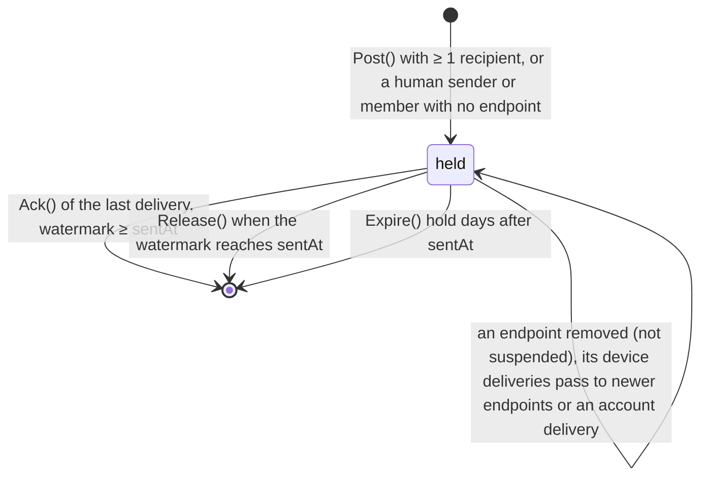
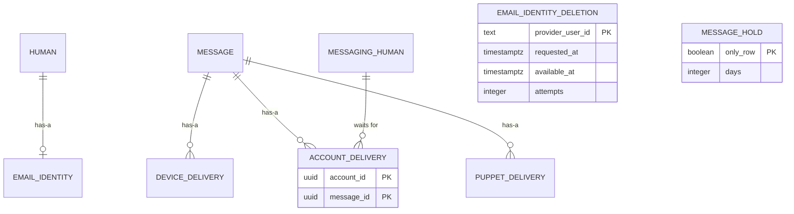

# Email sign-in, pass 2

Pass 2, approved. Pass 1 was approved; pass 2 replaces automatic email identities for Apple humans with opt-in from Settings, and hands a removed endpoint's undelivered messages to the human's newer endpoints. Contexts: Identity, Messaging. Builds on [email sign-in](email-sign-in.md) (phase 1), which stays in force except where this spec says otherwise.

What changes:

- The iOS and Mac apps sign in and register with email through AuthKit's hosted page, with email the primary action and Sign in with Apple beside it. AuthKit's hosted page carries sign-up with email verification and password reset; the hub stores none of it.
- A human signed in with Apple adds email sign-in from Settings: AuthKit proves the address, the Apple session proves the person. No account gets an email identity it did not set up.
- A human with no device receives what was sent while they had none: an account delivery waits for their first device.
- How long the hub holds an undelivered message is one operator setting, default 30 days, set in the console.
- The operator seeds an App Review account from the operator's host before review.

## Ubiquitous language

| Term | Meaning | Stored or derived |
|---|---|---|
| App email sign-in | The app opens AuthKit's hosted page with its own PKCE verifier, AuthKit returns a code to the hub's app callback URL, the app hands code and verifier to the hub, and the hub redeems them | Not stored: the session it issues is the trace |
| Email registration | App email sign-in on AuthKit's sign-up screen, then invite, handle and terms at the hub | Not stored beyond the human it creates |
| Adding email sign-in | A signed-in human running AuthKit and handing its code to the hub, which binds that WorkOS user to them | Not stored beyond the email identity it adds |
| Account delivery | A message owed to a human who had no device when it was posted; becomes a device delivery for their next device | Stored |
| Message hold | How many days the hub keeps a message any recipient has not received | Stored, one value |
| Review seed | Puppets, conversations and messages the operator gives an App Review account before review | Not stored as such: ordinary puppets, conversations and messages |

An account delivery also covers a human's sign-out. When the last device of a human is removed by sign-out, `RevokeDevice` or sign-in eviction, the messages it had not received become account deliveries again, so signing out and back in loses nothing still within the hold. Removal by `Suspend` drops them as today: a reinstated human gets no backlog from the suspension.

## Domain model

Changes to [domain-model](domain-model.md). Unchanged objects are not repeated.

### Identity

#### Account (changed behaviors and invariants)

Entity, aggregate root.

New factory:

- `RegisterEmailHuman(emailIdentity, handle, displayName)` (`RegisterWithEmail`): creates the account, its `Human` and its email identity; the caller redeems the invite and records the terms acceptance in the same transaction, as `RegisterHuman` does for Apple. Refuses an email identity whose WorkOS user is not email-verified.

New behavior:

- `AddEmailIdentity(signedInEmail)` (`AddEmailSignIn`): adds an email identity to a human who has none. Refuses a WorkOS user whose address is not verified, one that already belongs to a human (this one or another), and one an erasure has queued for deletion.

Changed behavior:

- `Erase()`: also queues an `EmailIdentityDeletion` for the human's email identity, if any, so the WorkOS user is deleted after the account is.

Changed invariant:

- Was (pass 1): "an email human created by the operator holds no acceptance until they accept at consent". Now also: a human who registers with email (`RegisterEmailHuman`) does so only by accepting the current terms version, as with Apple.

#### EmailIdentityDeletion

Value object, a queue row with no owner: it outlives the erased account, as `AppleRevocation` does.

| Field | Type | Meaning |
|---|---|---|
| `providerUserId` | string | The WorkOS user to delete |
| `requestedAt` | Timestamp | The erasure time |
| `availableAt` | Timestamp | When the worker may next lease it: the erasure time at first, pushed out by each lease and by backoff or `Retry-After` |
| `attempts` | int | Leases taken |

Deleted once WorkOS answers `2xx` or `404`.

#### EmailSignIn (anti-corruption layer, changed)

```go
// EmailSignIn is AuthKit as Identity sees it.
type EmailSignIn interface {
	// AuthorizeURL is the hosted sign-in page for one pending consent request (pass 1).
	AuthorizeURL(requestID string) string
	// Redeem exchanges a code with its verifier for the email identity it signed in.
	// Consent derives the verifier from the request id; the app supplies its own.
	Redeem(ctx context.Context, code, verifier string) (SignedInEmail, error)
	// CreateUser makes a verified WorkOS user with a password (operator only, pass 1).
	CreateUser(ctx context.Context, email, password string) (EmailIdentity, error)
	// DeleteUser removes a WorkOS user; one already gone is success.
	DeleteUser(ctx context.Context, providerUserID string) error
}

// SignedInEmail is what one redemption proves.
type SignedInEmail struct {
	Identity EmailIdentity
	Verified bool // WorkOS's user.email_verified
}
```

`Redeem` refuses an impersonated session (`ErrImpersonated`), maps a 4xx to `ErrCodeRefused` and a timeout or 5xx to `ErrUnavailable`, as in pass 1. `CreateUser` maps WorkOS's duplicate (`400` `user_creation_error` with `errors[].code` `email_not_available`) to `ErrEmailTaken` and any other 4xx to `ErrEmailRefused`. The adapter's fake answers duplicates the way production does.

### Messaging

#### Message (changed)

Entity, aggregate root. One send, held until every recipient has received it and the Identity watermark has reached its `sentAt`, or the message hold passes.

Changed field:

| Field | Type | Meaning |
|---|---|---|
| `deliveries` | set of `Delivery` | Owned. 0 to n: none when every recipient has acked, while the message is held for the watermark |

Changed behaviors:

- `Post`: a human member other than the sender who has no endpoint, and whom `RecipientPolicy` does not shield from the sender, gets an `AccountDelivery`. A message with only account deliveries is stored, carries no push and wakes no subscriber.
- `Expire(hold)`: deletes message and deliveries `hold` days after `sentAt`. Was a fixed 30 days.

Changed invariants:

- Recipients are fixed at post: one device delivery per endpoint of every human member except the sending device, one account delivery per human member with no endpoint, and one puppet delivery per puppet member other than a sending puppet, minus every recipient `RecipientPolicy` shields from the sender.
- An account delivery becomes device deliveries, never disappears unreceived: it is converted by `Backfill` for that human's next endpoint, or deleted by `Expire`, or with the human on erasure.

States:



Anything not drawn is refused.

#### Delivery (changed)

Value object, owned by `Message`. A sum:

- `DeviceDelivery(deviceId)`: waits for one human endpoint.
- `AccountDelivery(accountId)`: waits for a human who has no endpoint. Never fetched or acked: `Backfill` turns it into a device delivery.
- `PuppetDelivery(puppetId)`: waits for the puppet; any of its tokens may fetch and ack, first ack wins.

No fields beyond the target. Delivered means deleted.

#### Backfill (changed)

Domain service in Messaging, run by `Endpoint.Create` in its transaction. Locks as today (conversations in `Post`'s order, then the human's endpoint lock exclusive). Then:

- Converts every account delivery of the endpoint's human into a device delivery for the new endpoint, whatever its `sentAt`, unless `RecipientPolicy` now shields the recipient from the sender. The account delivery is deleted in the same statement.
- As today, inserts a device delivery for every held message in the human's conversations with `sentAt >= issuedAt`. Idempotent through the delivery key.

Two endpoints created for a device-less human race through the exclusive endpoint lock: the first converts every account delivery, and the second receives what its own `issuedAt` admits.

#### Endpoint (changed behavior)

- `Delete(cause)` (from `DeviceRemoved`): unless `cause` is `suspended`, each device delivery it holds passes on before the endpoint goes: to every other endpoint of the human issued after the message's `sentAt` (a device that did not exist at post and so holds no delivery of its own), or, when the human has no other endpoint, to an account delivery. A human signed out everywhere still receives on their next device, and a sign-in that creates its endpoint before the old one's removal is applied loses nothing. Endpoints issued before `sentAt` already hold their own delivery. With `suspended`, its device deliveries go with it.

#### MessageHold

Entity, one per hub: the hold policy. Owned by Messaging, set by the operator.

| Field | Type | Meaning |
|---|---|---|
| `days` | int | Days a message is kept after `sentAt` while any recipient has not received it. 1 to 3650. Default 30 |

Behaviors:

- `Set(days)` (`SetMessageHold`): refuses `days < 1` and `days > 3650` (ten years: the bound keeps the sweep's deadline inside the timestamp range). Takes effect at the sweeper's next pass, which the change wakes: lowering it deletes, at once, held messages older than the new value.

Invariants:

- Exactly one exists.
- `1 ≤ days ≤ 3650`.

The hold bounds every undelivered message, device, account and puppet deliveries alike, as the fixed 30 days does today: one setting, not one per delivery kind. The console labels it so: "Days the hub keeps a message any recipient has not received (devices, accounts with no device, and puppets)".

### Diagrams



## Configuration

| Variable or setting | Meaning |
|---|---|
| `SOCK_WORKOS_CLIENT_ID`, `SOCK_WORKOS_API_KEY` | As pass 1. With them, `SignInWithEmail`, `RegisterWithEmail` and `AddEmailSignIn` are served; without them the three answer `unavailable` |
| WorkOS dashboard, per environment | Redirect URIs: `https://<hub host>/workos/oauth-callback` (pass 1) and `https://<hub host>/workos/app-callback`. Self sign-up on. Email and password the only authentication method. Email verification is always on in hosted AuthKit |
| Apple app entitlements | Associated domain `webcredentials:<hub host>` for each hub host the app signs in against, so `ASWebAuthenticationSession` completes on `https://<hub host>/workos/app-callback` |

`SOCK_MESSAGE_TTL` does not exist: the hold is the database setting, seeded at 30.

## Caller classes

Changed: Anonymous, Human device. New: App's authentication session.

| Class | Authenticates with | Trusted to assert | Never trusted to assert |
|---|---|---|---|
| Anonymous (changed) | Nothing. Reaches the sign-in RPCs, now five (`SignInWithApple`, `RegisterWithApple`, `SignInWithEmail`, `RegisterWithEmail`, `SignInOperatorWithApple`), rate limited per client network in the one anonymous bucket; `RequestInvite`; the web sign-in routes; the discovery routes, now with `/.well-known/apple-app-site-association` | That it holds an AuthKit code and the verifier whose challenge AuthKit was given; an invite code, handle, display name and terms version | Any WorkOS user id, an email address, whether the email is verified (only the redemption says), any account or device id |
| Human device (changed) | As today: a `sock_st_` session | As today, plus that it holds an AuthKit code and its verifier for the address it is adding | As today, plus any WorkOS user id or address, and whether the address is verified |
| App's authentication session | Nothing: `ASWebAuthenticationSession` loading AuthKit's redirect | Nothing: the route only answers so a browser outside the session sees a page | Anything |

The operator caller (`sock_ot_` bearer, `full` scope) reaches two new RPCs. The operator's host reaches one new command.

## API

### Identity RPCs (IdentityService)

| RPC | Caller | Authentication | Authorization | Request | Response | Errors | Idempotency | Domain behavior |
|---|---|---|---|---|---|---|---|---|
| `SignInWithEmail` | Anonymous | None. The code and verifier are redeemed server to server (5 seconds) | The redeemed WorkOS user is an email identity of a human, the session is not impersonated, the human is not suspended | `code` (1 to 512 printable ASCII), `code_verifier` (43 to 128 of `[A-Za-z0-9._~-]`, RFC 7636), `device_label` (1 to 64) | `Session` | `EMAIL_CODE_INVALID` (WorkOS refused the code or the verifier, or the session is impersonated), `NOT_REGISTERED` (a WorkOS user with no human; the app offers registration), `ACCOUNT_SUSPENDED`, `FIELD_INVALID`, `RATE_LIMITED`, `unavailable` (WorkOS unreachable, or email sign-in not configured) | Not idempotent: each call issues a new device. The code is single use at WorkOS | `Device.Issue(account, label)` (kind `session`; at 10 live sessions the oldest session is evicted first). Emits `DeviceAdded`, and `DeviceRemoved` for an evicted session |
| `RegisterWithEmail` | Anonymous | As `SignInWithEmail` | A valid unexpired invite, a free handle and `accepted_terms_version` equal to the current version, all checked before the code is redeemed; then the WorkOS user is email-verified and holds no human | `code`, `code_verifier`, `device_label` as above; `invite_code`, `handle`, `display_name` (1 to 64), `accepted_terms_version` | `Session` | `EMAIL_CODE_INVALID`, `EMAIL_NOT_VERIFIED`, `ALREADY_REGISTERED` (the WorkOS user already holds a human; the app signs in instead), `INVITE_INVALID`, `HANDLE_TAKEN`, `TERMS_NOT_ACCEPTED`, `FIELD_INVALID`, `RATE_LIMITED`, `unavailable` | Not safe to retry with the same code (WorkOS spends it). A failure before redemption leaves the code usable; after it, the app starts AuthKit again | `Invite.Redeem`, `Account.RegisterEmailHuman`, `Account.AcceptTerms`, `Device.Issue`. Emits `HumanRegistered`, `DeviceAdded` |
| `AddEmailSignIn` | Human device | `sock_st_` session; then the code and verifier redeemed server to server (5 seconds) | The caller is a human holding no email identity; the redeemed WorkOS user is email-verified, not impersonated, belongs to no human and is not queued for deletion | `code`, `code_verifier` as `SignInWithEmail` | empty | `EMAIL_ALREADY_ADDED` (the caller already has email sign-in; checked before redemption), `EMAIL_CODE_INVALID`, `EMAIL_NOT_VERIFIED`, `ALREADY_REGISTERED` (the WorkOS user belongs to a human), `CALLER_NOT_ALLOWED` (a puppet or machine key), `FIELD_INVALID`, `unavailable` | Not safe to retry with the same code; a retry after success is `EMAIL_ALREADY_ADDED` | `Account.AddEmailIdentity`. Emits none: Identity's own row |

`SignInWithEmail` and `RegisterWithEmail`: `device_label` is the app's device label as for Apple. For all three, a failure after redemption is the error only; nothing is written.

`ERROR_REASON_EMAIL_CODE_INVALID = 3`, `ERROR_REASON_EMAIL_NOT_VERIFIED = 15` and `ERROR_REASON_EMAIL_ALREADY_ADDED = 63` (Connect `unauthenticated`, `failed_precondition` and `already_exists`) join the taxonomy.

### Operator RPCs (OperatorService)

| RPC | Caller | Authentication | Authorization | Request | Response | Errors | Idempotency | Domain behavior |
|---|---|---|---|---|---|---|---|---|
| `GetMessageHold` | Operator | `sock_ot_` bearer | `full` or `read` scope | empty | `days` int32 | `CALLER_NOT_ALLOWED` | Read; writes no action | none: a read |
| `SetMessageHold` | Operator | `sock_ot_` bearer | `full` scope | `days` int32 (1 to 3650) | `days` int32, the stored value | `CALLER_NOT_ALLOWED`, `FIELD_INVALID` (`days`) | Idempotent: setting the current value succeeds and still records an action | `MessageHold.Set(days)`, with `OperatorAction(setMessageHold)` in the same transaction |

`OperatorActionKind` gains `setMessageHold`, its target `MessageHoldChange(days)`: the value set.

### Routes

| Route | Caller | Authentication | Authorization | Request | Response | Errors | Idempotency | Domain behavior |
|---|---|---|---|---|---|---|---|---|
| `GET /workos/app-callback` | App's authentication session | None | None | Any query; never read, logged or echoed | `200`, fixed page: "Return to the sock app to finish signing in." `Cache-Control: no-store`, `Referrer-Policy: no-referrer`, CSP `default-src 'none'` | `404` when email sign-in is not configured | Safe | none: `ASWebAuthenticationSession` takes the URL before the page loads; the page is only for a browser outside it |
| `GET /.well-known/apple-app-site-association` | Anonymous (Apple's CDN) | None | None | none | `200` `application/json`: `{"webcredentials":{"apps":["<team id>.ai.aeryx.sock"]}}` | `404` when email sign-in is not configured | Safe | none |

### Operator's host

| Command | Caller | Authentication | Request | Result | Errors | Idempotency | Domain behavior |
|---|---|---|---|---|---|---|---|
| `sockd review seed --reviewer <handle> --contact <handle> --script <file>` | Operator's host | `SOCK_DATABASE_URL` | Two existing humans; a script file naming the reviewer's puppets, the conversations (a direct with the contact, groups of the reviewer, the contact and named puppets) and the messages, each with its sender (the contact or a puppet) and text | Creates what is absent, then posts every message in order; prints a summary | Refuses when the reviewer has any live session (the seed would go to that device, not the reviewer's), or either handle is unknown, or the script is malformed; nothing written then | Puppets and conversations are created once (matched by puppet name and by membership); messages post again on every run | `Account.CreatePuppet`, `Conversation.CreateDirect`, `Conversation.CreateGroup`, `Conversation.Post`. Emits `PuppetCreated`, and what `Post` emits for each message |

## Domain events

| Event | Emitting aggregate | Transition | Payload | Consumers | Delivery | Boundary | Domain service |
|---|---|---|---|---|---|---|---|
| `HumanRegistered` (existing, one more emitter) | Account | `RegisterHuman`, `CreateEmailHuman` and now `RegisterEmailHuman` | `account_id` UUID, unchanged | Messaging: create `Participant(Human)` | Outbox, at least once, as today | Published | none: single aggregate |
| `DeviceRemoved` (existing, changed payload and reaction) | Device | Unchanged: `Revoke` of a `session` device | `device_id` UUID, and new `cause` `DeviceRemovalCause`: `signOut` (`SignOut`), `revoked` (`RevokeDevice`), `evicted` (sign-in at 10 sessions), `suspended` (`Account.Suspend`). An event written before this field reads as `revoked` | Messaging: `Endpoint.Delete(cause)`, which converts a last endpoint's device deliveries to account deliveries unless `cause` is `suspended` | Unchanged | Published: the field is additive, consumers that ignore it keep working | none: one `Message` per converted delivery, each the message's own change |

No new event. The deletion worker reacts to a row, not an event: `Account.Erase` inserts the deletion and notifies `email_identity_deletions` in the same transaction; the worker wakes on the notification, at startup and at the earliest `available_at`, and leases a due row as `identity.apple_revocations` does: one short transaction takes it `FOR UPDATE SKIP LOCKED`, increments `attempts` and pushes `available_at` out by the lease, then commits before WorkOS is called, so no transaction is held across the call. The outcome is a second short transaction. A timeout or 5xx sets `available_at` by exponential backoff (1 s doubling to 1 h, or `Retry-After` when WorkOS sends one), so a restart resumes the schedule instead of retrying everything at once, and one failing row never holds the others. `SetMessageHold` notifies `message_hold`, and the sweeper recomputes its next deadline.

## Data layer

Migration `00026_email_pass_2.sql`.

### `identity.email_identity_deletions`

Owning aggregate: none (outlives the account, as `identity.apple_revocations`).

| Column | Type | Null |
|---|---|---|
| `provider_user_id` | `text` | NOT NULL |
| `requested_at` | `timestamptz` | NOT NULL, default `now()` |
| `available_at` | `timestamptz` | NOT NULL, default `now()`: when the row may next be leased; pushed out by the lease and by backoff |
| `attempts` | `integer` | NOT NULL, default `0`: leases taken |

- Primary key `provider_user_id`: one WorkOS user is deleted once.
- No foreign key: the account is erased in the transaction that queues this row.
- Check `provider_user_id ~ '^user_[A-Za-z0-9]{1,64}$'`.
- Check `attempts >= 0`. No cap: unlike an Apple revocation, a WorkOS user left behind keeps the person's address, so the row is retried at the 1 h ceiling until WorkOS answers `2xx` or `404`, and a 4xx other than `404` is logged for the operator on every attempt.
- Index `email_identity_deletions_lease_idx (available_at, provider_user_id)`: serves the lease, `WHERE available_at <= now() ORDER BY available_at FOR UPDATE SKIP LOCKED`, and the worker's sleep until the earliest `available_at`.

### `messaging.account_deliveries`

Owning aggregate: Message.

| Column | Type | Null |
|---|---|---|
| `account_id` | `uuid` | NOT NULL |
| `message_id` | `uuid` | NOT NULL |

- Primary key `(account_id, message_id)`: serves `Backfill`'s conversion by account.
- Foreign key `account_id` → `messaging.humans (account_id)` ON DELETE CASCADE.
- Foreign key `message_id` → `messaging.messages (id)` ON DELETE CASCADE.
- Index `account_deliveries_message_idx (message_id)`: serves `deleteUndelivered` and erasure by message.
- Store-enforced, recorded here: a human with an endpoint holds no account deliveries. `Post` writes one only for a member with no endpoint row, `Backfill` converts them all when an endpoint is created and `Endpoint.Delete` writes them only when the human has no other endpoint, each under the human's endpoint lock, which serializes the three.

### `messaging.message_hold`

Owning aggregate: MessageHold.

| Column | Type | Null |
|---|---|---|
| `only_row` | `boolean` | NOT NULL, default `true` |
| `days` | `integer` | NOT NULL |

- Primary key `only_row`, check `only_row`: exactly one row, the shape of `messaging.identity_watermark`.
- Check `days BETWEEN 1 AND 3650`.
- Seeded `(true, 30)` by the migration.

### `identity.operator_action_message_holds`

Owning aggregate: OperatorAction. The target of `setMessageHold`, as `identity.operator_action_reinstatements` is for `reinstateAccount`.

| Column | Type | Null |
|---|---|---|
| `action_id` | `bigint` | NOT NULL |
| `days` | `integer` | NOT NULL |

- Primary key `action_id`; foreign key → `identity.operator_actions (id)` ON DELETE CASCADE.
- Check `days BETWEEN 1 AND 3650`.
- Append-only by the existing operator action trigger; the action/target match function gains `setMessageHold`.
- `identity.operator_action_kinds` gains `setMessageHold`.

### Changed

- `messaging.messages`: the 30-day comment on `messages_sent_at_idx` becomes "serves the hold sweep"; the stale comment that `Post` never inserts a message without recipients is corrected.
- `deleteUndelivered` and `MessageTargets` consider `account_deliveries`: a message with only account deliveries is not undelivered and wakes no one.

### Normal form

Every new table is 5NF: one fact per row, keyed by what it is about, each column readable alone, no nullable column. The hub stores no email address.

## Apps

- Sign-in screen: "Continue with email" primary, "Sign in with Apple" beside it. Both lead to sign-in; a `NOT_REGISTERED` answer offers "Create an account".
- Create an account: invite, handle, display name and terms first, then AuthKit's sign-up screen (`screen_hint=sign-up`), then `RegisterWithEmail`. Collecting the hub's fields first means a refusal for them never spends a code.
- The app makes the verifier (32 random bytes, base64url) and `state` (32 random bytes), sends the S256 challenge, `provider=authkit`, `redirect_uri=https://<hub host>/workos/app-callback` and `client_id` to AuthKit in `ASWebAuthenticationSession` with an HTTPS callback for that host and path, and refuses a callback whose `state` differs. The verifier lives in memory for the one session.
- Password reset is AuthKit's hosted "Forgot password".
- Settings, for a human with no email sign-in: "Add email sign-in" runs AuthKit (sign-up, with sign-in a link away for an address that already has a WorkOS user) and then `AddEmailSignIn`. A human with email sign-in sees the address WorkOS holds is theirs only through AuthKit; the app shows "Email sign-in is on".
- Sign in with Apple requests no scopes, as before pass 2.

## Review seed

Procedure, for each submission:

1. `sockd humans create` the reviewer and a contact human, once. The reviewer's email and password go in App Review Information as the demo account, `demoAccountRequired: true`.
2. Never sign in as the reviewer. `sockd review seed` refuses if anyone has.
3. Run `sockd review seed` with the script kept beside the app's App Store metadata. Every message lands as an account delivery and reaches the reviewer's first device, within the hold.
4. Revoke the reviewer's sessions and seed again before the next submission.

The script is plain text, one statement per line; blank lines and lines starting with `#` are ignored. `puppet <name>` declares a reviewer puppet (a name with no spaces, not `contact`); `direct` opens the reviewer's direct with the contact; `group <puppet> [<puppet>...]` opens the group of the reviewer, the contact and those declared puppets; `<sender>: <text>` posts into the conversation opened above it, the sender `contact` or, in a group, one of its puppets. `sockd review seed --help` carries the same description and an example.

## Cross-check

| Transition | API | Event | DDL |
|---|---|---|---|
| `Account.RegisterEmailHuman` | `RegisterWithEmail` | `HumanRegistered` | `identity.accounts`, `identity.humans`, `identity.email_identities`, `identity.terms_acceptances`, invite delete |
| `Account.AddEmailIdentity` | `AddEmailSignIn` | none: Identity's own row, no other context cares | `identity.email_identities` insert |
| `Account.Erase` (queues the WorkOS deletion) | unchanged | `AccountErased` | `identity.email_identity_deletions` insert |
| `Device.Issue` (email) | `SignInWithEmail`, `RegisterWithEmail` | `DeviceAdded` | `identity.devices` |
| `Message.Post` (account deliveries) | `Send`, `sockd review seed` | `MessagePosted` only when a device or puppet delivery exists, as today | `messaging.account_deliveries` |
| `Backfill` (conversion) | none: `DeviceAdded` and caller self-ensure | consumes `DeviceAdded` | `messaging.account_deliveries` delete, `messaging.device_deliveries` insert |
| `Endpoint.Delete(cause)` (not suspended) | none: `DeviceRemoved` | consumes `DeviceRemoved`, whose `cause` is set by `SignOut`, `RevokeDevice`, sign-in eviction and `Account.Suspend` (`sockevents.v1.DeviceRemoved.cause`, enum with 0 read as `revoked`) | `messaging.device_deliveries` delete and insert for newer endpoints, `messaging.account_deliveries` insert |
| `Message.Expire(hold)` | none: deadline | none | `messaging.messages` delete, reading `messaging.message_hold` |
| `MessageHold.Set` | `SetMessageHold` | none: Messaging's own policy; the sweeper is woken by notification, not an event | `messaging.message_hold` update, `identity.operator_actions`, `identity.operator_action_message_holds` |

## Completeness gate

- Every new or changed RPC, route and command has every field.
- The two events touched have every field.
- Every new table and the changed ones have every field.
- Caller classes: Anonymous reaches the two new sign-in RPCs and the association file; a human device reaches `AddEmailSignIn`; the app's authentication session reaches the callback; the operator reaches the two hold RPCs; the operator's host reaches the seed command.
- Every transition above traces through all three or says why not.

## Open questions

- Whether WorkOS production accepts `https://<hub host>/workos/app-callback`: it should (HTTPS), and it is registered per environment before release. A custom scheme is not used because WorkOS's reference requires HTTPS in production.
- The privacy policy states retention; it must name the hold ("until your devices receive it, at most 30 days") before release.
- Self sign-up admits anyone with an invite and a verified address; there is no abuse limit on AuthKit sign-ups beyond WorkOS's own.
- Email sign-in for `sock login`, `sock-admin` and the console: not in this pass.
- A suspended human with no device still receives account deliveries posted during the suspension, delivered after reinstatement: Messaging does not know suspension.
