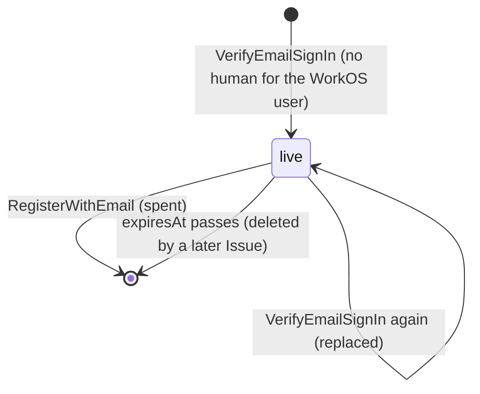
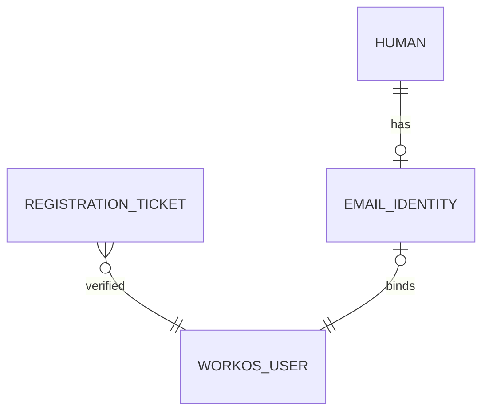

# Email sign-in, pass 3

Approved. Contexts: Identity. Builds on [pass 2](email-sign-in-pass-2.md), which stays in force except where this spec says otherwise. The connector's web consent ([email sign-in](email-sign-in.md), pass 1) is unchanged: it still uses AuthKit's hosted page in the browser.

What changes:

- The iOS and Mac apps sign in and sign up with email entirely in the app: type the address, type the six-digit code WorkOS emails, and you are in. A new person gets one more screen, handle, name, invite and terms, and no second trip to WorkOS.
- There is no separate "sign in" and "create an account". The code proves the address; the hub then says whether it belongs to an account.
- No web page and no app callback in the email flow. The app keeps no PKCE verifier.
- A human whose password the hub trusts (operator-created humans, the App Review account, and humans who registered in released builds with AuthKit's password sign-up) can type it instead of the code, on the same screen. Password sign-in never creates an account.
- Adding email sign-in from Settings is the same two screens.

## Ubiquitous language

| Term | Meaning | Stored or derived |
|---|---|---|
| Email code | Six digits WorkOS emails to an address on the hub's request, single use, expiring 10 minutes after it is sent | Not stored by the hub: WorkOS holds it |
| Email sign-in | The app sends an address, then the code; the hub verifies the code with WorkOS and either signs the address's human in or issues a registration ticket | Not stored: the session or the ticket is the trace |
| Registration ticket | Proof, for 15 minutes, that the bearer verified a WorkOS user that holds no human. Spent by registration | Stored, as a hash |
| Email registration | Handle, display name, invite and terms presented with a registration ticket | Not stored beyond the human it creates |
| Password sign-in | The address and the WorkOS user's password, checked by WorkOS instead of a code. Signs in only a human with a trusted password; never issues a registration ticket | Not stored by the hub: WorkOS holds the password |

Replaced from pass 2: "App email sign-in" (AuthKit's hosted page with the app's PKCE verifier) and pass 2's "Email registration" (AuthKit's sign-up screen) no longer describe what the apps do. The RPC fields that carried them stay served for released builds (Compatibility).

## Domain model

Changes to [domain-model](domain-model.md). Unchanged objects are not repeated.

### Identity

#### EmailAddress

Value object. Never stored: it passes through the hub to WorkOS and into the rate limiter's keyed digest.

| Field | Type | Meaning |
|---|---|---|
| `value` | string | The address as WorkOS will see it: trimmed, the domain lowercased, the local part as typed |

Constructor `ParseEmailAddress(raw)` refuses (`FIELD_INVALID`, field `email`): more than 254 characters after trimming, anything but exactly one `@`, an empty local part or domain, a domain without a dot, whitespace or a control character anywhere. It checks shape only; WorkOS decides deliverability.

#### RegistrationTicket

Entity, aggregate root. The standard credential shape (identifier, SHA-256 of the secret at rest, secret shown once) with a WorkOS user as its subject.

| Field | Type | Meaning |
|---|---|---|
| `id` | UUID | Identifies the ticket in its token |
| `providerUserId` | string | The WorkOS user the code verified, `user_` and 1 to 64 alphanumerics |
| `secretHash` | bytes | SHA-256 of the 32-byte secret |
| `expiresAt` | Timestamp | 15 minutes after issue |

Token: `sock_rg_<id>_<secret>`, secret 32 random bytes base64url without padding, the shape of every other sock token. The constructor refuses any other prefix, a non-UUID id and a secret that does not decode to 32 bytes.

Behaviors:

- `Issue(signedInEmail, now)` (factory, `VerifyEmailSignIn`): refuses an unverified address. Replaces any ticket already held for the same WorkOS user, so one person has at most one live ticket.
- A ticket is issued only from a proof of the address: an email code or a Google sign-in. A password proves only that the caller holds the WorkOS user's password, which anyone could have set through password self sign-up before the owner proved the address, so it never earns a ticket.

#### PasswordSignIn (new)

Value object, owned by `Account` through its `EmailIdentity`, 0 or 1. Its existence is the hub's trust in the WorkOS user's password: `SignInWithEmailPassword`, and a password login through AuthKit's hosted page (released builds, the connector's consent), sign in only a human that has one.

| Field | Type | Meaning |
|---|---|---|
| `grantedAt` | Timestamp | When the trust was recorded |

Granted only when the operator set the password: `sockd humans create` with a password. Existing email identities are trusted when this ships. Never granted by an email code, Google or an AuthKit login of any method: a code or Google proves the address, not the password, and an AuthKit password login proves only that someone set one. Goes with the email identity.

Checked on every sign-in whose WorkOS authentication method is `Password`: no row is refused. A method that proves the address (`MagicAuth`, `GoogleOAuth`, `AppleOAuth`) needs none. Any other method, an empty or unknown one included (`Other`: WorkOS passkeys, SSO, every social provider the hub does not name), signs in no one, with or without a row, and the hub logs WorkOS's name for it: WorkOS's set of methods is open, so a method turned on in the dashboard must not inherit a password's trust. Pass 2's `RegisterWithEmail` and `AddEmailSignIn` refuse an AuthKit login whose method is not `MagicAuth` or `GoogleOAuth` (`EMAIL_CODE_INVALID`), so a password never binds a WorkOS user to a human. Pass 2's `SignInWithEmail` and the connector's web consent answer an untrusted password login the same whether or not the WorkOS user holds a human (`EMAIL_CODE_INVALID`; the consent's fixed 400 page).

Why: self sign-up stays on (WorkOS's switch covers every method, so turning it off refuses a new address its code), so a stranger can put a password on an address before its owner signs up. Once the owner proves the address by code or Google, WorkOS marks that user verified and the stranger's password works on AuthKit's page. Trust recorded by the hub, not WorkOS's verified flag, decides, and nothing a stranger can do at WorkOS records it.
- `Spend(secret, now)` (`RegisterWithEmail`): returns the `EmailIdentity` when the secret matches in constant time and `now` is before `expiresAt`; refuses otherwise with one answer for unknown, wrong and expired. The ticket is deleted in the registration's transaction.

Invariants: one ticket per WorkOS user; a ticket past `expiresAt` proves nothing. A refusal for invite, handle or terms happens before `Spend` and leaves the ticket live.

Relationships: references one WorkOS user (n-1 over time, 1-1 live). Owned by nothing: it exists before the human does, as an `Invite` does.

States: `live` → spent (`RegisterWithEmail`, row deleted); `live` → replaced (a newer `Issue` for the same user, row replaced); `live` → expired (`expiresAt` passes; the row is deleted by the next `Issue`, any user). Anything unlisted is refused.

#### Account (changed behaviors)

- `RegisterEmailHuman(emailIdentity, handle, displayName)`: unchanged, now reached from a spent ticket as well as from a redeemed AuthKit code.
- `AddEmailIdentity(signedInEmail)`: unchanged, now reached from a verified email code as well.

#### EmailSignIn (anti-corruption layer, changed)

```go
type EmailSignIn interface {
	// unchanged from pass 2: AuthorizeURL, Redeem, CreateUser, DeleteUser

	// SendCode asks WorkOS to email a fresh code to address.
	SendCode(ctx context.Context, address EmailAddress) error
	// VerifyCode checks address and code with WorkOS and returns the WorkOS user it
	// proves, creating that user when the address has none.
	VerifyCode(ctx context.Context, address EmailAddress, code EmailCode) (SignedInEmail, error)
	// VerifyPassword checks address and password with WorkOS and returns the WorkOS
	// user it proves. It never creates a user.
	VerifyPassword(ctx context.Context, address EmailAddress, password string) (SignedInEmail, error)
}

// EmailCode is six ASCII digits.
type EmailCode string
```

`SendCode` is `POST /user_management/magic_auth`. `VerifyCode` is `POST /user_management/authenticate` with `grant_type` `urn:workos:oauth:grant-type:magic-auth:code`. Both map a timeout or 5xx to `ErrUnavailable` and honor `Retry-After`. `VerifyCode` maps WorkOS's refusal of the code to `ErrCodeRefused` and an impersonated session to `ErrImpersonated`, as `Redeem` does. A code proves the address, so `Verified` is true on every success. `VerifyPassword` is `POST /user_management/authenticate` with `grant_type` `password`; a wrong address or password is `ErrCodeRefused`, WorkOS's `email_verification_required` is `Verified` false, and the password is never logged or kept past the call.

### Diagrams





## Configuration

| Variable or setting | Meaning |
|---|---|
| `SOCK_WORKOS_CLIENT_ID`, `SOCK_WORKOS_API_KEY` | As pass 2. Without them the new RPCs answer `unavailable` too |
| `SOCK_EMAIL_LIMIT_KEY` | New. 32 or more random bytes, base64. Keys the HMAC-SHA-256 digest of an address in the per-address limiter, so the hub holds no recoverable address. Required when the WorkOS pair is set; sockd refuses to start otherwise |
| WorkOS dashboard, per environment | Magic Auth on, beside email and password (operator-created humans and the connector's web consent keep passwords). Self sign-up on: with it off WorkOS refuses `magic_auth` for a new address (`sign_up_not_allowed`). Released builds' AuthKit password sign-up then fails at the hub; their AuthKit email code sign-up still works. Off: WorkOS passkeys and SSO (the hub refuses them as `Other`), MFA (the hub cannot answer its challenge, so every enrolled human loses email sign-in), impersonation (refused anyway), Radar and organization domain policies (their challenges are not answerable from the app). The hub relies on WorkOS for one thing it cannot check: a Google or Apple login whose address matches an existing WorkOS user is linked to it only after WorkOS proves the person reads the inbox. sock-server's `deploy/cloud/README.md` keeps the table of these settings as read from each environment |

## Caller classes

Changed: Anonymous, Human device.

| Class | Authenticates with | Trusted to assert | Never trusted to assert |
|---|---|---|---|
| Anonymous (changed) | Nothing. Reaches three more RPCs, `StartEmailSignIn`, `VerifyEmailSignIn` and `SignInWithEmailPassword`, rate limited per client network in the one anonymous bucket and per address | That it wants a code sent to an address; that it holds a code or a password; that it holds a registration ticket | Any WorkOS user id, that an address is theirs (only a verified code says), any account or device id |
| Human device (changed) | As today | As today, plus that it holds a code for the address it is adding | As today |

## API

### Identity RPCs (IdentityService)

| RPC | Caller | Authentication | Authorization | Request | Response | Errors | Idempotency | Domain behavior |
|---|---|---|---|---|---|---|---|---|
| `StartEmailSignIn` (new) | Anonymous or Human device | None | None. The answer is the same whether or not the address has a WorkOS user or a human | `email` (`EmailAddress`) | empty | `FIELD_INVALID` (`email`), `RATE_LIMITED`, `unavailable` (WorkOS unreachable, or email sign-in not configured) | Each call sends a fresh code; WorkOS invalidates none of the earlier ones before they expire | none: WorkOS sends the code. Takes from the anonymous network bucket and the address bucket |
| `VerifyEmailSignIn` (new) | Anonymous | None. Address and code verified with WorkOS server to server (5 seconds) | The WorkOS user is not impersonated; if it holds a human, the human is not suspended; the WorkOS user is not queued for deletion | `email`, `code` (six ASCII digits), `device_label` (1 to 64) | oneof: `session` (`Session`) when the WorkOS user holds a human; `registration` (`registration_ticket` string, `expires_at` Timestamp) when it holds none | `EMAIL_CODE_INVALID` (wrong, spent or expired code), `ACCOUNT_SUSPENDED`, `FIELD_INVALID`, `RATE_LIMITED`, `unavailable` (also the WorkOS user is queued for deletion, as pass 2) | Not idempotent: the code is single use at WorkOS; each `session` answer issues a new device, each `registration` answer replaces the user's ticket | Human: `Device.Issue(account, label)`, as `SignInWithEmail`; emits `DeviceAdded`, and `DeviceRemoved` for an evicted session. No human: `RegistrationTicket.Issue`; emits none |
| `SignInWithEmailPassword` (new) | Anonymous | None. Address and password verified with WorkOS server to server (5 seconds) | The WorkOS user holds a human with a `PasswordSignIn`; the human is not suspended | `email`, `password` (1 to 1024 characters, never logged), `device_label` | `session` only; `registration` is never set | `PASSWORD_INVALID` (one answer for a wrong address or password, an unverified address, a WorkOS user with no human, and a human without a trusted password), `ACCOUNT_SUSPENDED`, `FIELD_INVALID`, `RATE_LIMITED`, `unavailable` | Not idempotent, as `VerifyEmailSignIn` | `Device.Issue`, as `VerifyEmailSignIn` for a human |
| `RegisterWithEmail` (changed) | Anonymous | `registration_ticket`, checked after the hub's own fields | A valid unexpired invite, a free handle and `accepted_terms_version` equal to the current version, all checked before the ticket is spent; then the ticket is live and its WorkOS user holds no human | New oneof `proof`: `authkit` (pass 2's `code`, `code_verifier`) or `registration_ticket`. `device_label`, `invite_code`, `handle`, `display_name`, `accepted_terms_version` unchanged | `Session` | As pass 2, plus `REGISTRATION_TICKET_INVALID` (unknown, wrong or expired ticket; the app starts email sign-in again). `ALREADY_REGISTERED` now also means the ticket's user registered elsewhere since it was issued | A refusal for invite, handle or terms leaves the ticket live for its 15 minutes; any later outcome spends it | `RegistrationTicket.Spend`, `Invite.Redeem`, `Account.RegisterEmailHuman`, `Account.AcceptTerms`, `Device.Issue`, one transaction. Emits `HumanRegistered`, `DeviceAdded` |
| `AddEmailSignIn` (changed) | Human device | `sock_st_` session; then the proof verified with WorkOS | As pass 2 | New oneof `proof`: `authkit` (pass 2's `code`, `code_verifier`) or `email_code` (`email`, `code`) | empty | As pass 2 | As pass 2 | `Account.AddEmailIdentity`, as pass 2 |

`SignInWithEmail` is unchanged and kept for released builds (Compatibility).

`ERROR_REASON_REGISTRATION_TICKET_INVALID = 67` and `ERROR_REASON_PASSWORD_INVALID = 69` (Connect `unauthenticated`) join the taxonomy; 68 is the passkey spec's.

### Rate limits

- `StartEmailSignIn`: the anonymous network bucket, then a send bucket per client network (burst 5, 20 an hour), then an address bucket of 5 codes per hour per address, keyed by `HMAC-SHA-256(SOCK_EMAIL_LIMIT_KEY, inbox)`. The inbox is the address as the limiter sees it: lowercased, the local part cut at its first `+` (unless nothing would be left), and on `gmail.com` and `googlemail.com` without dots and as `gmail.com`; WorkOS is sent the address as typed. The address bucket stops one person's inbox being flooded from many networks, whatever spelling reaches it; the network send bucket stops one network mailing many inboxes, or making WorkOS users, at the sign-in rate.
- `VerifyEmailSignIn` and `SignInWithEmailPassword`: the anonymous network bucket, then the address bucket's verify half, keyed by the same inbox, shared by both: 10 attempts per 10 minutes per address. A million codes cannot be walked in 10 minutes, nor a password guessed quickly, from any number of networks.
- `RegisterWithEmail` with a ticket: the anonymous network bucket, as today.

Wire shape: pass 2's `code` and `code_verifier` stay top-level fields 1 and 2 of `RegisterWithEmailRequest` and `AddEmailSignInRequest`, which released builds send; moving them into a oneof would break those builds. The new proofs are new fields (`registration_ticket = 8`; `oneof proof { email_code = 3; google = 4 }`), and the hub refuses a request carrying neither or both kinds (`FIELD_INVALID`).

## Domain events

None new. `HumanRegistered`, `DeviceAdded` and `DeviceRemoved` are emitted by the same transitions as pass 2, now also reached through the new RPCs. A registration ticket is Identity's own row; no other context cares.

## Data layer

Migration `00029_email_codes.sql`.

### `identity.registration_tickets`

Owning aggregate: RegistrationTicket.

| Column | Type | Null |
|---|---|---|
| `id` | `uuid` | NOT NULL |
| `provider_user_id` | `text` | NOT NULL |
| `secret_hash` | `bytea` | NOT NULL |
| `expires_at` | `timestamptz` | NOT NULL |

- Primary key `id`: serves `Spend` by the token's id.
- Unique `provider_user_id`: one live ticket per WorkOS user; `Issue` upserts on it.
- Check `provider_user_id ~ '^user_[A-Za-z0-9]{1,64}$'`, check `octet_length(secret_hash) = 32`.
- Index `registration_tickets_expires_idx (expires_at)`: serves `Issue`'s sweep, `DELETE WHERE expires_at < now()`, so expired rows go on the next issue without a timer.
- No foreign key: the WorkOS user is not a row here.

### `identity.email_address_buckets`

Owning aggregate: none, as the client network buckets.

| Column | Type | Null |
|---|---|---|
| `address_digest` | `bytea` | NOT NULL |
| `kind` | `text` | NOT NULL |
| `millitokens` | `integer` | NOT NULL |
| `refilled_at` | `timestamptz` | NOT NULL |

- Primary key `(address_digest, kind)`; check `kind IN ('send', 'verify')` is a closed vocabulary of two the limiter names; check `octet_length(address_digest) = 32`, `millitokens >= 0`.
- Same take statement as the client network buckets: refill, check and spend under the row's lock in one statement.

### `identity.password_sign_ins`

Owning aggregate: Account, through its email identity.

| Column | Type | Null |
|---|---|---|
| `human_id` | `uuid` | NOT NULL |
| `granted_at` | `timestamptz` | NOT NULL, default `now()` |

- Primary key `human_id`: serves the password sign-in's check after WorkOS names the user and the hub finds its human.
- Foreign key `human_id` → `identity.email_identities (human_id)` ON DELETE CASCADE: no trust without the email identity, gone with it.
- The migration inserts a row for every existing email identity.

### Normal form

Both tables are 5NF: one fact per row keyed by what it is about, no nullable column. The hub stores no email address; the digest cannot be reversed without `SOCK_EMAIL_LIMIT_KEY`.

## Apps

One flow on iOS and Mac. Sign in with Apple stays on iOS beside it, unchanged.

1. Sign-in screen: "Continue with email".
2. Email screen: one field, keyboard and autofill set for an email address. Continue calls `StartEmailSignIn` and moves to the code screen.
3. Code screen: "We sent a code to <address>." One six-digit field with one-time-code autofill (iOS reads it from Mail). Six digits typed submits `VerifyEmailSignIn`. "Send a new code" (enabled after 30 seconds), "Use a password instead" and "Use a different email" below it. A wrong code says "That code didn't work. Check it, or send a new one."
   "Use a password instead" swaps the code field for a password field (password autofill on), submitting `SignInWithEmailPassword`. A wrong password says "That email and password don't match." There is no in-app password setup or reset: anyone without a password uses the code.
4. A `session` answer signs in. A `registration` answer opens "Create your account": handle, display name, invite code and the terms line, one button, "Agree and create account". `RegisterWithEmail` with the ticket. `INVITE_INVALID`, `HANDLE_TAKEN` and `TERMS_NOT_ACCEPTED` keep the form and the ticket. `REGISTRATION_TICKET_INVALID` returns to the email screen with the address filled: "That took too long. We'll send a new code."
5. Settings, "Add email sign-in": the email and code screens, then `AddEmailSignIn` with `email_code`.

Nothing in this flow opens a browser. The app drops `ASWebAuthenticationSession`, the PKCE verifier and `state` from email sign-in.

## Compatibility

Released builds (Mac 1.0, App Store iOS) use `SignInWithEmail` and the `authkit` proofs. The hub keeps serving them, with `GET /workos/app-callback`, the association file and the app-callback redirect URI at WorkOS, until no supported build uses them. Removing them is a later pass with its own spec.

## Cross-check

| Transition | API | Event | DDL |
|---|---|---|---|
| `RegistrationTicket.Issue` | `VerifyEmailSignIn` (no human) | none: Identity's own row | `identity.registration_tickets` upsert, expired rows deleted |
| `RegistrationTicket.Spend` | `RegisterWithEmail` (ticket) | none itself; the registration emits `HumanRegistered`, `DeviceAdded` | `identity.registration_tickets` delete, with pass 2's registration rows |
| `Device.Issue` (email code) | `VerifyEmailSignIn` (human) | `DeviceAdded`, `DeviceRemoved` on eviction | `identity.devices` |
| `Account.AddEmailIdentity` (email code) | `AddEmailSignIn` | none, as pass 2 | `identity.email_identities` insert |
| `Device.Issue` (trusted password) | `SignInWithEmailPassword` | `DeviceAdded`, `DeviceRemoved` on eviction | `identity.devices` |
| `PasswordSignIn` granted | `sockd humans create` with a password | none: Identity's own row | `identity.password_sign_ins` insert |
| Code sent | `StartEmailSignIn` | none: WorkOS's act, nothing in the domain changes | `identity.email_address_buckets` take |

## Completeness gate

- Every new or changed RPC has every field.
- No event added or changed.
- Every new table has every column, key, constraint and index, each index naming its query.
- Caller classes: Anonymous reaches the three new RPCs and the ticket proof; a human device reaches `StartEmailSignIn` and the `email_code` proof.
- Every transition traces through API, events and DDL or says why not.

## Open questions

- Whether WorkOS caps wrong attempts per code. The hub's verify bucket stands either way; if WorkOS caps lower, its refusal maps to `EMAIL_CODE_INVALID`.
- The sender and wording of WorkOS's code email: set in the dashboard per environment, sock's name and no link to click.
- When released builds stop being supported, which sets when Compatibility ends.
