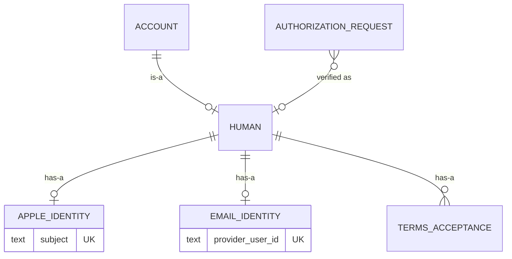

# Email sign-in

Pass 2, approved; PKCE binding and the signed-in handle added after security review. Context: Identity. Phase 1: email sign-in is accepted only by the OAuth consent flow, and only the operator creates email humans.

## Ubiquitous language

| Term | Meaning | Stored or derived |
|---|---|---|
| Sign-in identity | What a human proves to sign in: an Apple identity or an email identity | Stored |
| Apple identity | Apple's stable `sub` for this app's team | Stored (moved off `Human`) |
| Email identity | A WorkOS user, named by its WorkOS user id. Email, password, reset and verification are WorkOS's | Stored: the id only |
| Email address | The address the person signs in with | Not stored: WorkOS's, read at creation only |
| Email sign-in | Signing in on WorkOS AuthKit's hosted page, then the hub redeeming the code AuthKit returns | Not stored: the verified request is the trace |
| Email human | A human whose only sign-in identity is an email identity | Derived |

Inferred, to confirm: "email identity" names the WorkOS user even if AuthKit later offers other methods (passkeys, magic links) to the same user; it is still one email identity.

## Domain model

Changes to [domain-model](domain-model.md). Unchanged objects are not repeated.

### Account (changed behaviors and one invariant)

Entity, aggregate root.

New factory:

- `CreateEmailHuman(emailIdentity, handle, displayName)` (operator only, `sockd humans create`): creates the account, its `Human` and its email identity. Records no `TermsAcceptance`: the person accepts at their first consent.

Changed behavior:

- `AcceptTerms(version)` gains a second caller: Allow on `/oauth/consent` when the human's terms are not current.

Changed invariant:

- Was: "A human registers only by accepting the current terms version." Now: a human who registers themselves (`RegisterWithApple`) does so only by accepting the current terms version; an email human created by the operator holds no acceptance until they accept at consent, and consent refuses Allow until they do.

New relationship:

| With | Kind | Cardinality |
|---|---|---|
| `SignInIdentity` | has-a (humans) | 1 to n, n ≥ 1; at most one of each variant |

### Human (changed)

Value object, variant of `Account`. `appleSubject` moves to `AppleIdentity`.

| Field | Type | Meaning |
|---|---|---|
| `handle` | `Handle` | Unique among humans |

### SignInIdentity

Value object, owned by `Account` (humans). A sum: exactly one of the variants below. Created with the human (`RegisterHuman`, `CreateEmailHuman`), deleted with it on `Erase`. Phase 1 adds no way to attach a second identity to an existing human.

Invariants:

- A human holds at least one sign-in identity, and at most one of each variant.
- An identity belongs to at most one human: one Apple identity or one WorkOS user is one person.

#### AppleIdentity

| Field | Type | Meaning |
|---|---|---|
| `subject` | string | Apple's `sub`, 1 to 255 characters. Unique across humans |

#### EmailIdentity

| Field | Type | Meaning |
|---|---|---|
| `providerUserId` | string | The WorkOS user id (`user_` then 1 to 64 letters and digits). Unique across humans. The hub binds to this, never to the email address, so an address change at WorkOS moves no account |

### AuthorizationRequest (changed behavior)

`Verify(human, consentTokenHash)` gains a second caller: `/workos/oauth-callback`, after the code exchange names an email identity that belongs to a human. Its rules are unchanged: one verification per request, the browser's cookie must match.

### ConnectorGrant (changed behavior)

`Consent` (Allow): when the human's terms are not current, Allow requires `accept_terms`, and `Account.AcceptTerms(current)` runs in the consent transaction, beside the puppet it already creates. This is the same multi-aggregate write `Consent` already makes for `CreatePuppet`; it stays one transaction so a grant never exists for a human whose terms are not current.

### Anti-corruption layer

The domain port, in Identity's own types:

```go
// EmailSignIn is AuthKit as Identity sees it.
type EmailSignIn interface {
	// AuthorizeURL is the hosted sign-in page for one pending request.
	AuthorizeURL(requestID string) string
	// Redeem exchanges AuthKit's code for the email identity it signed in.
	Redeem(ctx context.Context, code string) (EmailIdentity, error)
	// CreateUser makes a verified WorkOS user with a password (operator only).
	CreateUser(ctx context.Context, email, password string) (EmailIdentity, error)
}
```

`internal/workos` implements it and is the only package that knows WorkOS. `AuthorizeURL` sends a PKCE challenge (`S256`) whose verifier is derived from the secret key and the request id (base64url HMAC-SHA256, nothing stored); `Redeem(requestID, code)` sends that verifier and no client secret, so WorkOS must check it. A code AuthKit returned to one request is refused when replayed through another, the binding Apple's nonce gives the Apple leg. It speaks plain HTTPS with `net/http` (three calls: `GET /user_management/authorize` is a URL it builds, `POST /user_management/authenticate`, `POST /user_management/users`), so no SDK dependency. `Redeem` returns `ErrImpersonated` when WorkOS's response carries `impersonator`: a WorkOS dashboard admin impersonating a user never consents as that human. A 4xx from the exchange is `ErrCodeRefused`; a timeout or 5xx is `ErrUnavailable`.

### Diagram



## Configuration

| Variable | Meaning |
|---|---|
| `SOCK_WORKOS_CLIENT_ID` | The WorkOS environment's client id (`client_…`) |
| `SOCK_WORKOS_API_KEY` or `SOCK_WORKOS_API_KEY_FILE` | The environment's secret key (`sk_live_…` in production, `sk_test_…` elsewhere). Never logged |

Both or neither. With them, OAuth must be on (sockd refuses to start otherwise). Without them the authorize page offers Apple only and `/workos/oauth-callback` answers `404`. The WorkOS dashboard, per environment: redirect URI exactly `https://<hub host>/workos/oauth-callback`, self sign-up off, email and password the only authentication method (the operator marks addresses verified without proof, so a method that links by email would admit whoever holds the address).

## Caller classes

Changed: Consenting browser.

| Class | Authenticates with | Trusted to assert | Never trusted to assert |
|---|---|---|---|
| Consenting browser | The `__Host-sock-consent` cookie set at `/oauth/authorize`; then Apple's id_token on `/apple/oauth-callback` or AuthKit's code on `/workos/oauth-callback`, which the hub redeems itself with its secret key; then the single-use consent token on `/oauth/consent` | That the person holding it is the human Apple or WorkOS verified for this pending request, their Allow or Deny, and their acceptance of the current terms | Which human it is (only the verified identity says), any WorkOS user id, an email address |

New: none. WorkOS is called by the hub, never calls it. `sockd humans create` runs on the operator's host with the database URL and the WorkOS key, as `sockd connector token mint` does.

## API

Changed and new routes. Rate limits as the existing OAuth page routes (per client address).

| Route | Caller | Authentication | Authorization | Request | Response | Errors | Idempotency | Domain behavior |
|---|---|---|---|---|---|---|---|---|
| `GET /oauth/authorize` (changed) | Consenting browser | As today | As today | As today | As today, plus, when email sign-in is configured, a second link "Continue with email" to `https://api.workos.com/user_management/authorize?response_type=code&client_id=<SOCK_WORKOS_CLIENT_ID>&redirect_uri=https://<hub host>/workos/oauth-callback&provider=authkit&state=<request id>&code_challenge=<S256 of the request's verifier>&code_challenge_method=S256` | As today | As today | `AuthorizationRequest.Open`, unchanged |
| `GET /workos/oauth-callback` (new) | Consenting browser, redirected by AuthKit | `__Host-sock-consent-<8 chars of request id>` whose SHA-256 equals the pending request's browser hash; then the code, redeemed server to server with the request's PKCE verifier (5 seconds) | The request is pending and not yet verified; the redeemed WorkOS user is an email identity of a human; the human is not suspended; the session is not impersonated | Query: `state` (`^[A-Za-z0-9_-]{43}$`, the request id) and either `code` (1 to 512 printable ASCII) or `error` (`^[a-z_]{1,64}$`). Each at most once | `200` consent page, the same page `/apple/oauth-callback` renders, `Referrer-Policy: same-origin` | Fixed `400` page: malformed query, unknown or expired request, request already verified, cookie absent or mismatched, AuthKit's `error`, a code WorkOS refuses, an impersonated session, a code issued to another request. "Not registered" page: a WorkOS user with no human (phase 1: "ask the operator for an account"). "Suspended" page. `503` unavailable page: the exchange timed out or WorkOS answered 5xx; the request stays pending. `429` page. `404` when disabled | Single use: a request is verified once; a replayed callback is the fixed `400` (and WorkOS refuses a spent code) | `AuthorizationRequest.Verify` |
| `POST /apple/oauth-callback` (changed) | As today | As today | As today | As today | As today; the consent page carries the terms box when the human's terms are not current | As today | As today | `AuthorizationRequest.Verify`, unchanged |
| `POST /oauth/consent` (changed) | Consenting browser | As today | As today | Form as today, plus `accept_terms` (`on`; required for Allow when the human's terms are not current, ignored otherwise) | As today | As today, except "accept the current terms in the app" (`TERMS_NOT_ACCEPTED`) becomes the consent page again with the terms box and the problem "Accept the terms to continue", the request left pending with the same consent token | As today | `ConnectorGrant.Consent`, with `Account.AcceptTerms` in the same transaction when needed |

The consent page names the account the sign-in verified ("Signed in as @<handle>"), for Apple and email alike, so a person sees whose account they are connecting.

The consent page's terms box: a checkbox `accept_terms` labeled "I accept the sock [Terms](https://joinsock.com/terms) (version `<SOCK_TERMS_VERSION>`)", shown only when the human's terms are not current. The link is the hub's own constant, never the client's.

Operator CLI:

| Command | Caller | Authentication | Request | Result | Errors | Idempotency | Domain behavior |
|---|---|---|---|---|---|---|---|
| `sockd humans create --email <addr> --handle <h> --display-name <n>` | Operator's host | `SOCK_DATABASE_URL` and `SOCK_WORKOS_API_KEY` in its environment | Email (WorkOS validates), handle (`Handle` rules), display name (1 to 64) | Creates the WorkOS user (`email_verified: true`, a generated password of 24 random characters), then the human; prints the account id and the password once | Handle taken (nothing created at WorkOS); email taken at WorkOS (nothing created in sock); WorkOS created but the sock write failed: prints the WorkOS user id so the operator deletes it at WorkOS, exits non-zero | Not idempotent: rerunning after a success fails on the email | `Account.CreateEmailHuman` |

## Domain events

| Event | Emitting aggregate | Transition | Payload | Consumers | Delivery | Boundary | Domain service |
|---|---|---|---|---|---|---|---|
| `HumanRegistered` (existing, one more emitter) | Account | `RegisterHuman` and now `CreateEmailHuman` | `account_id` UUID, unchanged | Messaging: create `Participant(Human)` | As today: outbox, at least once | Published | none: single aggregate (`Participant` created) |

No new event. `AuthorizationRequest.Verify` and `AcceptTerms` emit none, as today.

## Data layer

Migration `00025_sign_in_identities.sql`.

### `identity.apple_identities`

Owning aggregate: Account (humans). Holds what was `identity.humans.apple_subject`; the column is copied here and dropped.

| Column | Type | Null |
|---|---|---|
| `human_id` | `uuid` | NOT NULL |
| `subject` | `text` | NOT NULL |

- Primary key `human_id`: at most one Apple identity per human.
- Foreign key `human_id` → `identity.humans (account_id)` ON DELETE CASCADE: erased with the human.
- Unique `subject`: one Apple identity is one person. Serves `SignInWithApple` and `/apple/oauth-callback` lookup by subject.
- Check `char_length(subject) BETWEEN 1 AND 255`.

### `identity.email_identities`

Owning aggregate: Account (humans).

| Column | Type | Null |
|---|---|---|
| `human_id` | `uuid` | NOT NULL |
| `provider_user_id` | `text` | NOT NULL |

- Primary key `human_id`: at most one email identity per human.
- Foreign key `human_id` → `identity.humans (account_id)` ON DELETE CASCADE.
- Unique `provider_user_id`: one WorkOS user is one person. Serves the lookup in `/workos/oauth-callback`.
- Check `provider_user_id ~ '^user_[A-Za-z0-9]{1,64}$'`.

### `identity.humans` (changed)

`apple_subject` dropped. A human with no row in either identity table cannot sign in at all: "at least one sign-in identity" is a constraint trigger, `DEFERRABLE INITIALLY DEFERRED`, on `identity.humans` insert and on identity delete, checked at commit.

### Normal form

Both new tables are 5NF: one fact per row (this human has this identity), keyed by the human, each column readable alone. No nullable column.

## Cross-check

| Transition | API | Event | DDL |
|---|---|---|---|
| `Account.CreateEmailHuman` | `sockd humans create` | `HumanRegistered` | `identity.accounts`, `identity.humans`, `identity.email_identities` |
| `Account.RegisterHuman` (changed storage) | `RegisterWithApple` | `HumanRegistered` | adds `identity.apple_identities` |
| `AuthorizationRequest.Verify` (email) | `GET /workos/oauth-callback` | none, as for Apple: the request is internal and short-lived | `identity.authorization_request_identities` |
| `Account.AcceptTerms` (at consent) | `POST /oauth/consent` | none, as today | `identity.terms_acceptances` |
| `Account.Erase` | unchanged | `AccountErased` | cascades both identity tables |

## Completeness gate

- Every changed or new route and command has every field.
- The one event touched has every field.
- Both new tables and the changed one have every field.
- Caller classes: Consenting browser reaches the four routes above; the operator's host reaches the one command.
- Every transition above traces through all three, or says why not.

## Open questions

- Attaching a second identity to an existing human (an Apple human adding email, or the reverse): not in phase 1. Needs its own proof of both identities.
- Email sign-in to the app, the CLI and the web console; self-registration with invites; password reset and two-factor settings at WorkOS. Phase 2, each its own spec.
- Whether WorkOS refuses a second redemption of one code: its docs do not say. The hub does not rely on it (the request is verified once), but the answer belongs here.
- The sign-in page lives on a WorkOS domain unless a custom one (`auth.joinsock.com`, a paid WorkOS add-on) is set up.
- Sock Pro without the App Store for an email human, needed only if `SOCK_PRO_REQUIRED` is ever set.
