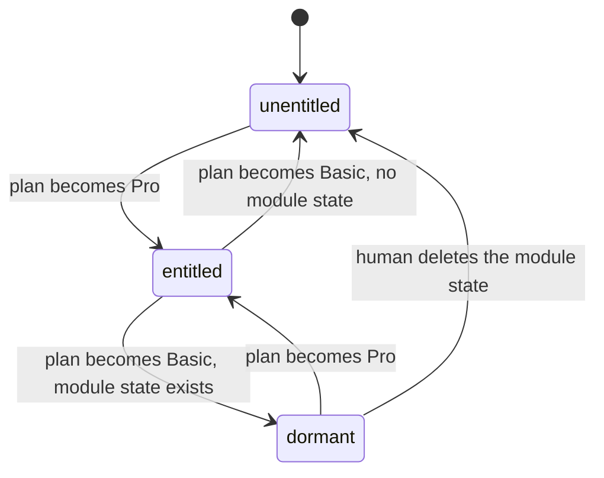
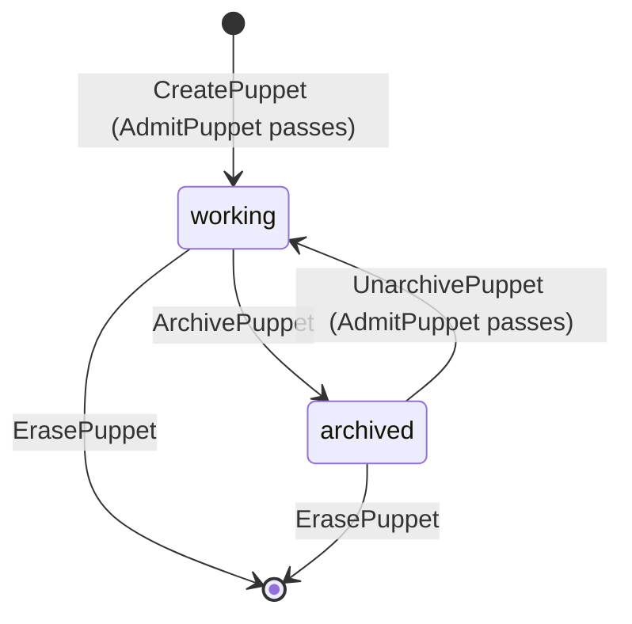
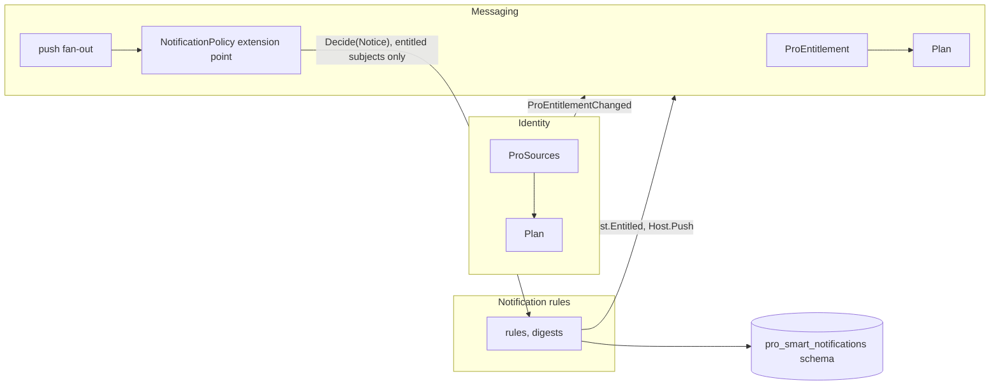

# Entitlements and Pro modules

Pass 1, draft. Contexts: Identity, Messaging, Notification rules (new). Changes [plans](plans.md); builds on [feature flags](feature-flags.md). Unchanged objects are not repeated. Decision record: [ADR 61](https://github.com/Aeryx-ai/sock-server/blob/main/docs/adr/contract/0061-pro-grants-new-features-and-every-human-shares-the-launch-limits.md).

What changes:

- Everything Sock does today is free. Pro grants only features built after this spec. Basic includes none of them; Pro includes every one.
- Plans no longer differ by limits. Every human starts at the same launch limits: 10 unarchived puppets, 20 group members, 60 sends a minute per puppet. [Limits and overrides](limits-and-overrides.md) makes them operator settings, overridable per human and raised on request.
- Waitlisting is gone. Past the puppet limit, creating or unarchiving a puppet is refused; no working puppet ever stops working because of the limit.
- `SOCK_PRO_REQUIRED` is removed, along with every Pro clause it switched: the puppet gate, the Pro clause of the active-puppet rule and consent's Pro check.
- Each Pro feature is a module inside sock-server that registers with the hub. The hub decides entitlement at each extension point and in its auth interceptor, never the module.
- Modules import only the extension package and the kernel, never other hub packages. A test enforces it, so a module can later move out of the repo without rework.
- First extension point: the notification policy, consumed by smart notifications. Smart notifications' own rules, digests and RPCs get their own pass.

## Ubiquitous language

| Term | Meaning | Stored or derived |
|---|---|---|
| Plan (changed) | What a human's account includes: Basic or Pro. Decides features only | Derived: Pro while `ProActiveUntil()` is after now |
| Launch limits | The platform limits Sock launches with: 10 puppets, 20 group members, 60 puppet sends a minute | Stored, see [limits and overrides](limits-and-overrides.md) |
| Feature | A capability Pro includes, one of the closed set the hub declares | Code |
| Entitled | A human's plan includes the feature now. A puppet is entitled when its owner is | Derived: `Plan.Includes` |
| Module | The code that implements one feature and registers with the hub | Code, `internal/pro/<feature>` |
| Available feature | Entitled, and its module registered in this build | Derived |
| Extension point | A named place in the hub that calls a registered module, with a declared subject and a default | Code |
| Subject | The human whose entitlement an extension point checks: the human whose own configuration the module applies | Declared per extension point |
| Default | What an extension point does with no module or no entitled subject: the hub's behavior before this spec | Code |
| Dormant | A module's state for a human not entitled now: kept, unused, used again once entitled | Derived |

Removed: Plan limits (per plan), Puppet rank, Waitlisted puppet, Covered puppet.

## Domain model

### Kernel (shared by Identity, Messaging and modules)

#### Feature

Enumeration, declared in `kernel` and in proto as `sock.v1.Feature`. Today one value:

| Value | Description |
|---|---|
| `smart_notifications` | Rules that mute, prioritize, batch and escalate a human's notifications |

Adding a value is a code change and a proto value, not an operator action. Not a `FeatureFlagKey`: a flag switches a platform behavior for everyone; a feature is what a plan grants one human.

#### Plan (changed)

Enumeration, values unchanged.

Behaviors:

- `Includes(Feature) bool`: Pro includes every declared feature, Basic none.

Removed: `Limits()`, `Covers`, `AdmitsPuppet`, `GroupLimit`.

Invariants:

- Pro includes every declared feature. A test enumerates `Feature`.
- A Basic human never gets less than the default. No extension point refuses or degrades anything for a human because that human is Basic; only a feature's own configuration RPCs refuse.

Identity answers `Includes` from the human's Pro sources, Messaging from its `ProEntitlement(activeUntil)` projection.

#### Limits

Value object, replaces `PlanLimits`: the same for both plans. Defined, with its storage, overrides and requests, in [limits and overrides](limits-and-overrides.md). Owner-direct limits (ADR 50) and the caps of 10 on machine keys, tokens per puppet and sessions are unchanged.

#### Feature state, per human (derived)

Nothing here is stored. A lapse or grant moves the state at the next check, with no event and no clock job.

### Identity

#### Account (changed behaviors)

- `AdmitPuppet()` (`CreatePuppet`, consent's Allow, `UnarchivePuppet`): refuses `LIMIT_REACHED` when the human already has their effective `puppets` limit of unarchived non-system puppets. A human already past the limit keeps every puppet and creates or unarchives none until under it.
- `MintPuppetToken`, `IssueConnectorPuppetToken` and every call made with a puppet token: no plan clause.

Removed: `Plan()`'s limits, `Covers(puppet)`, `PassProGate`'s remaining callers, the auth interceptor's Pro policy.

Invariant (changed): creating or unarchiving a puppet never takes a human past their effective `puppets` limit. Not "a human owns at most that many": rows past the limit that exist at migration stay.

#### Puppet states (changed)

`archived` is the existing archive row; `working` is its absence. Anything not drawn is refused.

### Messaging

#### RecipientPolicy (changed)

Active puppet: a system puppet, or one not archived, neither it nor its owner suspended. No Pro or coverage clause.

#### Conversation (changed behaviors)

- `StartGroup`, `AddMember`: refuse `GROUP_FULL` past the group's limit ([limits and overrides](limits-and-overrides.md)). A group already past it stays and refuses adds.
- `Post(puppet sender, ...)`: the send bucket refills at the owner's effective `puppetSendsPerMinute`.

### Extension

Package `internal/extension`. What a module may import from the hub, with `kernel`.

#### Module

Value object, registered at startup in `app.New`. Constructed by `extension.NewModule`.

| Field | Type | Meaning |
|---|---|---|
| `feature` | `kernel.Feature` | The feature this module implements |
| `notificationPolicy` | `NotificationPolicy` | Its notification policy. Absent means the module does not use that extension point |
| `services` | list of Connect handlers, each with its configuring procedures | The module's RPC services, mounted behind the hub's auth interceptor. Empty means none |
| `migrations` | `fs.FS` | The module's numbered goose migrations for its own schema |
| `start` | `func(ctx, Host) error` | Starts the module's own workers. Returns when `ctx` ends |

Invariants, refused by `NewModule`:

- `feature` is declared.
- At least one extension point or service is set.

Invariant, refused at startup (the hub does not start): at most one module per feature.

Relationships:

| With | Kind | Cardinality |
|---|---|---|
| `Feature` | references | n to 1, at most one per build |
| `NotificationPolicy` | has-a | 1 to 0..1 |
| `Host` | references | given at `start` |

#### Host

Interface the hub gives a module at `start`, for work the module starts itself, such as a digest timer.

| Method | Meaning |
|---|---|
| `Entitled(ctx, human uuid.UUID) (bool, error)` | Whether the human is entitled to this module's feature now, by the same rule as the extension points |
| `Push(ctx, human uuid.UUID, Digest) error` | Pushes one notification to every device of the human, through the existing `PushDevice` path |
| `DB() *pgxpool.Pool` | The hub's pool. The module queries its own schema only |
| `Logger() *slog.Logger`, `Meter() metric.Meter` | Scoped to the module's feature |

#### NotificationPolicy

Interface, the first extension point.

- `Decide(ctx, Notice) (Disposition, error)`.

Called from the push fan-out (`push.fanOut`), once per recipient human with at least one push target, before their `PushDevice` rows are written. Subject: the recipient. Not called when the recipient is not entitled or no module registered it; `Deliver` is used without a call.

A call that errors or exceeds 2 seconds is `Deliver`, logged and counted by outcome. A lost notification costs more than an unwanted one, and retrying the fan-out would delay every other recipient's push.

#### Notice

Value object, what `Decide` sees.

| Field | Type | Meaning |
|---|---|---|
| `messageID` | `uuid.UUID` | The posted message |
| `conversationID` | `uuid.UUID` | Its conversation |
| `recipientID` | `uuid.UUID` | The human being notified: the subject |
| `senderID` | `uuid.UUID` | The posting account, human or puppet |
| `senderIsPuppet` | bool | Whether the sender is a puppet |
| `senderOwnerID` | `uuid.UUID` | The puppet's owner; equal to `senderID` for a human |
| `postedAt` | `time.Time` | When the hub accepted the message |
| `text` | string | The message body as posted. Open question below |

#### Disposition

Enumeration.

| Case | Meaning |
|---|---|
| `Deliver` | The default: push as today |
| `Silence` | No push. The message is still delivered to streams and the inbox |
| `Escalate` | Push as time-sensitive, breaking through Focus |
| `Hold` | No push now. The module now owns notifying this human about this message, through `Host.Push` |

### Context map

Messaging is upstream: `extension` is its open host service and published language, and each module conforms to it.

### Structure

## Module boundary

- Modules live in `internal/pro/<feature>`. A test lists each module's imports and fails on any sock-server package other than `internal/extension` and `internal/kernel`.
- Moving modules out of the repo later is a package move plus making `extension` public. That split is not part of this spec.

## Configuration

Removed: `SOCK_PRO_REQUIRED`. Nothing added.

## Caller classes

Unchanged.

## API

`SUBSCRIPTION_REQUIRED` is never sent (kept for wire compatibility). `LIMIT_REACHED` gains `UnarchivePuppet` past the puppet limit. `GROUP_FULL` means the group is at the launch limit.

New error reason `FEATURE_REQUIRED` (`failed_precondition`): the caller's plan does not include the feature this RPC configures. The message names the feature.

| RPC | Caller | Authentication | Authorization | Request | Response | Errors | Idempotency | Domain behavior |
|---|---|---|---|---|---|---|---|---|
| `GetMe` (changed) | Human, puppet | As today | Self | none | `limits` carries the effective limits, the same rule for both plans. Adds `features` `repeated Feature`: the available features of the human, or the puppet's owner. `plan` unchanged | none | Read | none: reads `Plan.Includes` and the registry |
| `CreatePuppet` (changed) | Human, machine key | As today | As today, the limit clause `Account.AdmitPuppet()` | As today | As today | `LIMIT_REACHED` | As today | `Account.AdmitPuppet()` |
| `UnarchivePuppet` (changed) | Human, machine key | As today | As today, and `Account.AdmitPuppet()` | As today | As today | Adds `LIMIT_REACHED` | As today | `Account.AdmitPuppet()`, then as today |
| `ListPuppets` (changed) | Human, machine key | As today | As today | As today | `waitlisted` always false (kept for wire compatibility) | As today | Read | none |
| `MintPuppetToken`, `IssueConnectorPuppetToken`, every puppet-token call (changed) | As today | As today | No plan clause | As today | As today | `SUBSCRIPTION_REQUIRED` no longer returned | As today | As today |
| `CreateGroup`, `AddMember` (changed) | Human | As today | Member count within the group's limit | As today | As today | `GROUP_FULL` | As today | `Conversation.StartGroup`, `Conversation.AddMember` |
| A module RPC that creates or changes configuration | As the module's spec says | As today | The module's rule, and the subject entitled | The module's | The module's | `FEATURE_REQUIRED` when not entitled | The module's | The module's aggregate |
| A module RPC that reads or deletes configuration | As above | As today | The module's rule. No entitlement: a lapsed human sees and removes dormant state | The module's | The module's | The module's | The module's | The module's aggregate |

The hub's auth interceptor enforces `FEATURE_REQUIRED` from each module service's declared configuring procedures, not the module.

OAuth consent's Allow, when it creates a puppet: `Account.AdmitPuppet()`; the consent page's Pro message goes.

## Domain events

| Event | Emitting aggregate | Transition | Payload | Consumers | Delivery | Boundary | Domain service |
|---|---|---|---|---|---|---|---|
| `ProEntitlementChanged` | Account | Unchanged | Unchanged | Messaging: unchanged upsert, which now decides only which features its recipients are entitled to | Unchanged | Published | none |
| `PuppetArchiveChanged` | Account | Unchanged | Unchanged | Messaging: unchanged; no longer moves other puppets' coverage | Unchanged | Published | none |
| `MessagePosted` | Conversation | Unchanged | Unchanged | Push fan-out: now consults `NotificationPolicy` per entitled recipient | Unchanged | Internal | none |

No new event.

## Data layer

Migration `00045_entitlements.sql`:

- The `puppets_owner_rank` indexes stay: `(owner_id, account_id)` serves `AdmitPuppet`'s count by `owner_id`.
- The send bucket's `CHECK` and the launch limits' rows are in [limits and overrides](limits-and-overrides.md)' `00046`.

Modules:

- Each module owns one schema, `pro_<feature>`, migrated by its own goose migrations with their own version table, `pro_<feature>.goose_db_version`, run after the hub's at startup.
- A module row about a human references `identity.humans (account_id) ON DELETE CASCADE`, so erasure deletes it in the same transaction.
- The hub's schema rules hold: 5NF unless a reason is recorded, real constraints, no JSON columns, numbered migrations, tests against real Postgres.

## Apps, CLI and website

- Apps' Settings show the plan, the launch limits and the available features. The waitlisted puppet UI goes.
- The CLI drops its waitlisted marker and message. `LIMIT_REACHED` on create or unarchive names the limit and how to request more.
- Website: the Sock Pro section says everything today is free and lists the Pro features as they ship.

## Cross-check

| Transition | API | Event | DDL |
|---|---|---|---|
| Puppet created or unarchived at the limit | `CreatePuppet`, `UnarchivePuppet`, consent: `LIMIT_REACHED` | none: refusal only | none: count by `owner_id` |
| Group at the limit | `CreateGroup`, `AddMember`: `GROUP_FULL` | none: refusal only | none |
| Plan changes, features move between entitled and dormant | `GetMe.features`; `FEATURE_REQUIRED` on configuring RPCs | `ProEntitlementChanged` (existing) | none: derived |
| A message is notified under a policy | none: push | `MessagePosted` (existing) | none in the hub; the module's own |
| A module registers | none: startup, refused on a duplicate feature | none | The module's migrations |
| A human is erased | Existing | Existing | `ON DELETE CASCADE` into module rows |

## Decided in pass 1

- Everything today is free; Pro grants only new features.
- Every human starts at the same launch limits: 10, 20, 60. Operator settings, per [limits and overrides](limits-and-overrides.md).
- No waitlisting; `SOCK_PRO_REQUIRED` removed.
- Entitlements are a function of the plan only: no per-feature grants, no add-ons.
- Two plans.
- Modules live in sock-server behind an import boundary; no repo split now.
- Smart notifications is the first module.

## Open questions

- `Notice.text`: rules like "a puppet mentions a failed deployment" need the body. Alternative: rules match sender and conversation only.
- Whether each feature also gets a platform flag for staged rollout. Without one, registering the module is the switch.
- Pro's price, with only new features in it: $14.99 a month today, $6 in the shortlist.
- Pro's 50 puppets, 100 members and 300 sends drop to 10, 20 and 60. How many Pro humans exist, and whether they get notice or overrides.
- `Escalate` maps to APNs `interruption-level: time-sensitive`, which needs the Time Sensitive Notifications entitlement in the apps.
