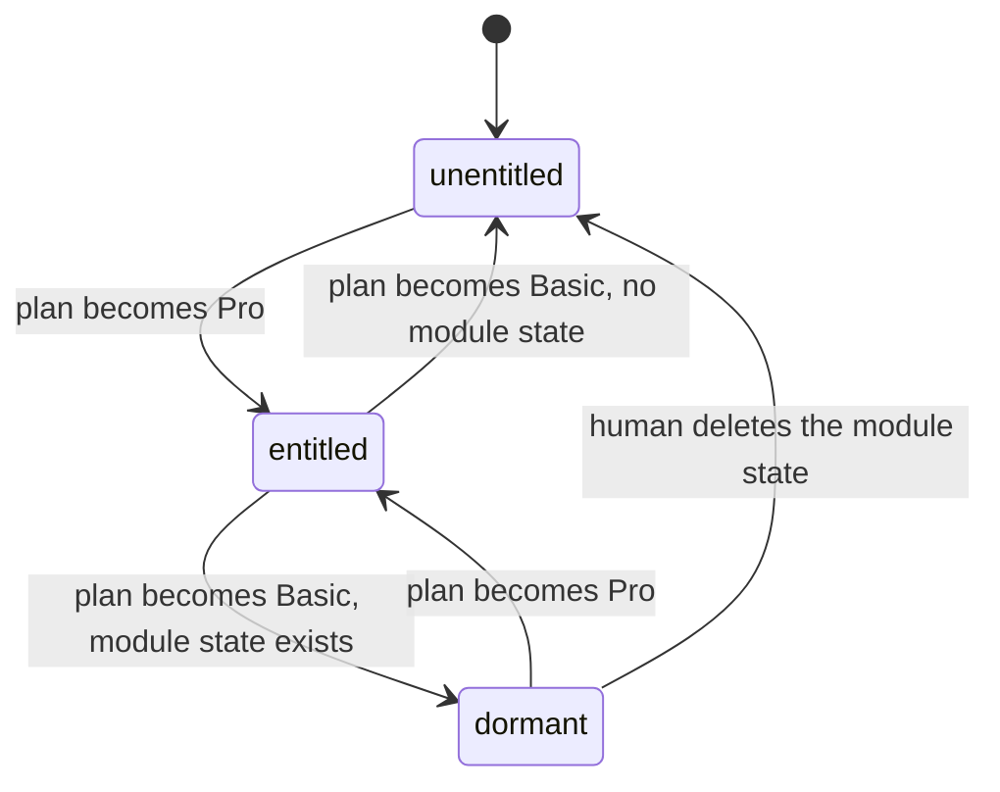
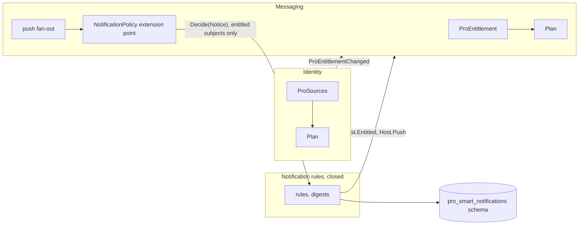
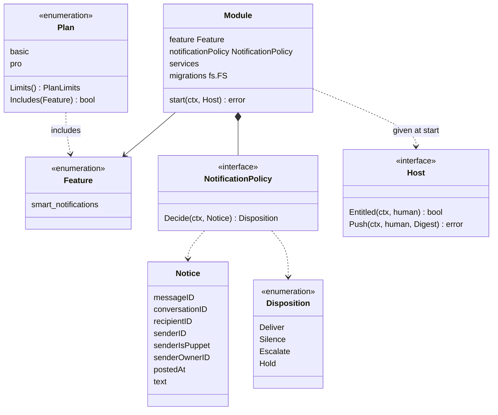

# Entitlements and Pro modules

Pass 1, draft. Contexts: Identity, Messaging, Notification rules (new). Builds on [plans](plans.md) and [feature flags](feature-flags.md); unchanged objects are not repeated. Decision record: [ADR 61](https://github.com/Aeryx-ai/sock-server/blob/main/docs/adr/contract/0061-pro-features-are-closed-modules-behind-open-extension-points.md).

What changes:

- A plan grants features as well as limits. Features are a closed set the hub declares. Basic includes none; Pro includes every one.
- Pro features are built as closed modules outside sock-server. sock-server (MIT) exposes extension points in a public package, `github.com/guygrigsby/sock-server/ext`.
- The hub decides entitlement at each extension point, never the module. A module is called only for an entitled subject; otherwise the hub's default runs.
- The production hub is built from a private repo whose `main` links sock-server and the modules. The MIT build runs with no modules: plans and limits work, no feature is available.
- First extension point: the notification policy, consumed by smart notifications. Smart notifications' own rules, digests and RPCs get their own pass.

## Ubiquitous language

| Term | Meaning | Stored or derived |
|---|---|---|
| Feature | A capability a plan can include, one of the closed set the hub declares | Code |
| Entitled | A human's plan includes the feature now. A puppet is entitled when its owner is | Derived: `Plan.Includes` |
| Module | Closed code that implements one feature and registers with the hub at build time | Code, linked into the private build |
| Available feature | Entitled, and its module is registered in this build | Derived |
| Extension point | A named place in the hub that calls a registered module, with a declared subject and a default | Code |
| Subject | The human whose entitlement an extension point checks: the human whose own configuration the module applies | Declared per extension point |
| Default | What an extension point does with no module or no entitled subject: the hub's behavior before this spec | Code |
| Dormant | A module's state for a human not entitled now: kept, unused, used again once entitled | Derived |

## Domain model

### Kernel (shared by Identity, Messaging and, through `ext`, modules)

#### Feature

Enumeration, declared in `ext` (public, so modules name it) and in proto as `sock.v1.Feature`. Today one value:

| Value | Description |
|---|---|
| `smart_notifications` | Rules that mute, prioritize, batch and escalate a human's notifications |

Adding a value is a sock-server code change and a proto value, not an operator action. Not a `FeatureFlagKey`: a flag switches a platform behavior for everyone; a feature is what a plan grants one human.

#### Plan (changed)

Enumeration, values unchanged. New behavior:

- `Includes(Feature) bool`: Pro includes every declared feature, Basic none. A constant beside `PlanLimits` in `kernel` (ADR 56).

Invariants:

- Pro includes every declared feature. A test enumerates `Feature`.
- A Basic human never gets less than the default. No extension point refuses or degrades anything for a human because that human is Basic; only the feature's own configuration RPCs refuse.

Identity answers `Includes` from the human's Pro sources; Messaging from its `ProEntitlement(activeUntil)` projection, as both already do for limits.

#### Feature state, per human (derived)

Nothing here is stored: the plan is derived from Pro sources, and module state is the module's rows. A lapse or grant moves the state at the next check, with no event and no clock job.

### ext (public package)

#### Module

Value object, registered at build time. Constructed by `ext.NewModule`.

| Field | Type | Meaning |
|---|---|---|
| `feature` | `Feature` | The feature this module implements |
| `notificationPolicy` | `NotificationPolicy` | Its notification policy. Absent means the module does not use that extension point |
| `services` | list of Connect handlers | The module's RPC services, mounted on the hub's mux behind the hub's auth interceptor. Empty means none |
| `migrations` | `fs.FS` | The module's numbered goose migrations for its own schema |
| `start` | `func(ctx, Host) error` | Starts the module's own workers. Returns when `ctx` ends |

Invariants, refused by `NewModule`:

- `feature` is declared.
- At least one extension point or service is set. A module that hooks nothing has no reason to link.

Invariant, refused by `sockserver.Main` at startup (the hub does not start):

- At most one module per feature. Two would answer the same extension point for the same subject.

Relationships:

| With | Kind | Cardinality |
|---|---|---|
| `Feature` | references | n to 1, at most one per build |
| `NotificationPolicy` | has-a | 1 to 0..1 |
| `Host` | references | given at `start` |

#### Host

Interface the hub gives a module at `start`. What a module may ask of the hub outside an extension point call, for work the module starts itself (a digest timer).

| Method | Meaning |
|---|---|
| `Entitled(ctx, human uuid.UUID) (bool, error)` | Whether the human is entitled to this module's feature now. The same rule the extension points use |
| `Push(ctx, human uuid.UUID, Digest) error` | Pushes one notification to every device of the human, through the hub's existing `PushDevice` path |
| `Logger() *slog.Logger`, `Meter() metric.Meter` | Scoped to the module's feature |

No database handle: a module opens its own pool (see Data layer). `ext` carries no pgx, Stripe or internal hub type.

#### NotificationPolicy

Interface, the first extension point.

- `Decide(ctx, Notice) (Disposition, error)`.

Called from the push fan-out (`push.fanOut`), once per recipient human with at least one push target, before their `PushDevice` rows are written. Subject: the recipient. Not called when the recipient is not entitled or no module registered this extension point; `Deliver` is used without a call.

A call that errors or exceeds 2 seconds is `Deliver`, logged and counted by outcome. A lost notification costs more than an unwanted one, and retrying the fan-out would delay every other recipient's push.

#### Notice

Value object, what `Decide` sees.

| Field | Type | Meaning |
|---|---|---|
| `messageID` | `uuid.UUID` | The posted message |
| `conversationID` | `uuid.UUID` | Its conversation |
| `recipientID` | `uuid.UUID` | The human being notified: the subject |
| `senderID` | `uuid.UUID` | The posting account, human or puppet |
| `senderIsPuppet` | bool | Whether the sender is a puppet |
| `senderOwnerID` | `uuid.UUID` | The puppet's owner; equal to `senderID` for a human |
| `postedAt` | `time.Time` | When the hub accepted the message |
| `text` | string | The message body as posted. Open question below |

#### Disposition

Enumeration with data (a sum).

| Case | Data | Meaning |
|---|---|---|
| `Deliver` | none | The default: push as today |
| `Silence` | none | No push. The message is still delivered to streams and the inbox |
| `Escalate` | none | Push as time-sensitive, breaking through Focus |
| `Hold` | none | No push now. The module now owns notifying this human about this message, through `Host.Push` |

### Context map

Messaging is upstream: `ext` is its open host service and published language, and each module conforms to it. Modules never read hub tables or import hub internals.

### Structure

## Build and release

- sock-server gains `sockserver.Main(ctx, ...ext.Module)`, the hub's startup moved out of `internal/app`'s caller. sock-server's own `cmd/sockd` calls it with no modules.
- A private repo holds the modules and a `cmd/sockd` that calls `sockserver.Main` with them. The production image is built there.
- The release pipeline's `v*` tag and `production` job move to the private repo. A sock-server tag no longer deploys production.
- `ext` and `sockserver.Main` are sock-server's only public Go API. A breaking change to either needs a version bump that the private repo takes on purpose.

## Configuration

| Variable | Meaning |
|---|---|
| `SOCK_PRO_DATABASE_URL` | New, private build only. The modules' Postgres role. Each module uses its own schema with it |

`SOCK_PRO_REQUIRED` is unchanged and does not gate features (open question below).

## Caller classes

Unchanged. A module's RPCs sit behind the hub's existing authentication; their callers are humans and puppets as today.

## API

New error reason `FEATURE_REQUIRED` (`failed_precondition`): the caller's plan does not include the feature this RPC configures. The message names the feature. Not `SUBSCRIPTION_REQUIRED`, which means a waitlisted puppet.

| RPC | Caller | Authentication | Authorization | Request | Response | Errors | Idempotency | Domain behavior |
|---|---|---|---|---|---|---|---|---|
| `GetMe` (changed) | Human, puppet | As today | Self | none | Adds `features` `repeated Feature`: the available features of the human, or the puppet's owner. Empty on Basic and on the MIT build | none | Read | none: reads `Plan.Includes` and the registry |
| A module RPC that creates or changes configuration | Human, puppet as the module's spec says | As today | The module's own rule, and the subject entitled | The module's | The module's | `FEATURE_REQUIRED` when not entitled | The module's | The module's aggregate |
| A module RPC that reads or deletes configuration | As above | As today | The module's own rule. No entitlement: a lapsed human sees and removes dormant state | The module's | The module's | The module's | The module's | The module's aggregate |
| Any module RPC on the MIT build | Any | none | none | Any | none | Connect `unimplemented`: the service is not mounted | n/a | none |

The hub's auth interceptor enforces `FEATURE_REQUIRED`, not the module: each module service declares which of its procedures configure.

## Domain events

| Event | Emitting aggregate | Transition | Payload | Consumers | Delivery | Boundary | Domain service |
|---|---|---|---|---|---|---|---|
| `ProEntitlementChanged` | Account | Unchanged | Unchanged | Messaging: unchanged upsert, which now also moves which features its recipients are entitled to | Unchanged | Published | none |
| `MessagePosted` | Conversation | Unchanged | Unchanged | Push fan-out: unchanged, now consulting `NotificationPolicy` per entitled recipient | Unchanged | Internal | none |

No new event. Entitlement and dormancy are derived at each check from rows both contexts already hold. Modules consume no outbox in this pass; they get extension points.

## Data layer

Hub: no migration. Every new hub fact is derived.

Modules:

- Each module owns one schema, `pro_<feature>`, created and migrated by its own goose migrations with their own version table, `pro_<feature>.goose_db_version`. The private build runs them after the hub's.
- The `SOCK_PRO_DATABASE_URL` role has `USAGE` and `CREATE` on module schemas only, and `REFERENCES` on `identity.humans`. It has no other grant on hub schemas, so a module cannot read hub rows.
- A module row about a human references `identity.humans (account_id) ON DELETE CASCADE`. Erasing a human deletes their module rows in the same transaction, with no extension point and no event.
- The hub's schema rules hold: 5NF unless a reason is recorded, real constraints, no JSON columns, numbered migrations, tests against real Postgres.

## Cross-check

| Transition | API | Event | DDL |
|---|---|---|---|
| Plan changes, features move between entitled and dormant | `GetMe.features`; `FEATURE_REQUIRED` on configuring RPCs | `ProEntitlementChanged` (existing) | none: derived |
| A message is notified under a policy | none: push | `MessagePosted` (existing) | none in the hub; the module's own |
| A module is registered | none: build time, refused at startup on a duplicate feature | none | The module's migrations |
| A human is erased | Existing | Existing | `ON DELETE CASCADE` into module rows |

## Decided in pass 1

- Closed modules behind open extension points; the production build is private.
- Entitlements are a function of the plan only: no per-feature grants and no add-ons. The operator grants Pro wholesale, as today.
- Two plans. A third is a later code change.
- Smart notifications is the first module.

## Open questions

- `Notice.text`: rules like "a puppet mentions a failed deployment" need the body, so closed code reads message content. The privacy policy names that processing. Alternative: no text, rules match sender and conversation only.
- Whether `SOCK_PRO_REQUIRED` off should make every human entitled, as it waives the puppet limit, or leave features gated by plan.
- Where Pro proto lives. Clients must call module RPCs, so the service definitions are public in sock-contract by default, with only the implementation closed.
- The private repo's name.
- Whether each feature also gets a platform flag for staged rollout. Without one, registering the module in the build is the switch.
- `Escalate` maps to APNs `interruption-level: time-sensitive`, which needs the Time Sensitive Notifications entitlement in the apps.
