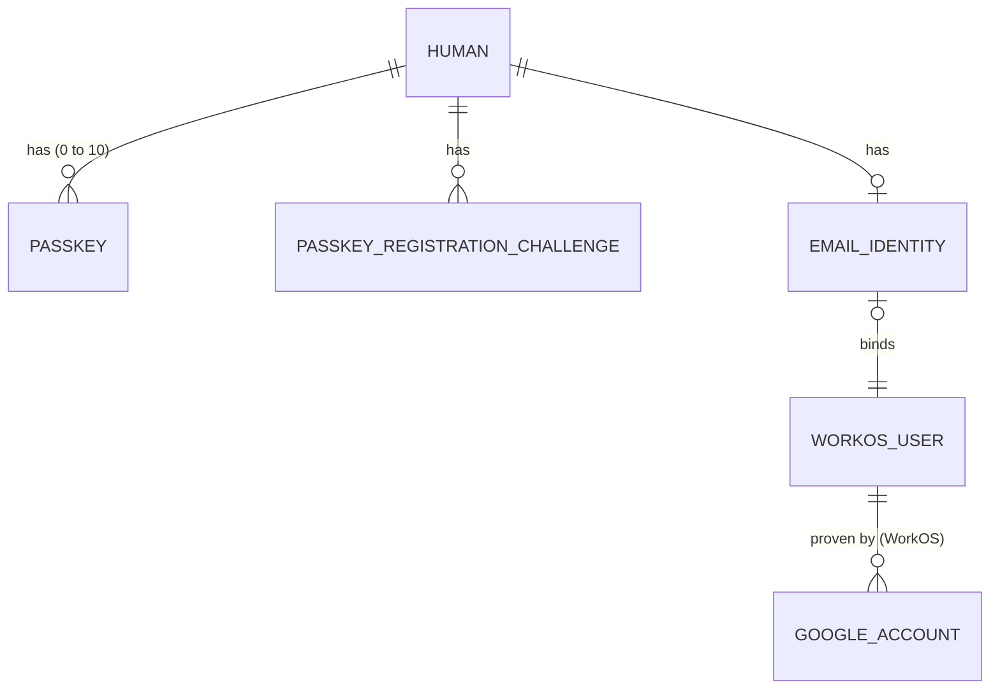
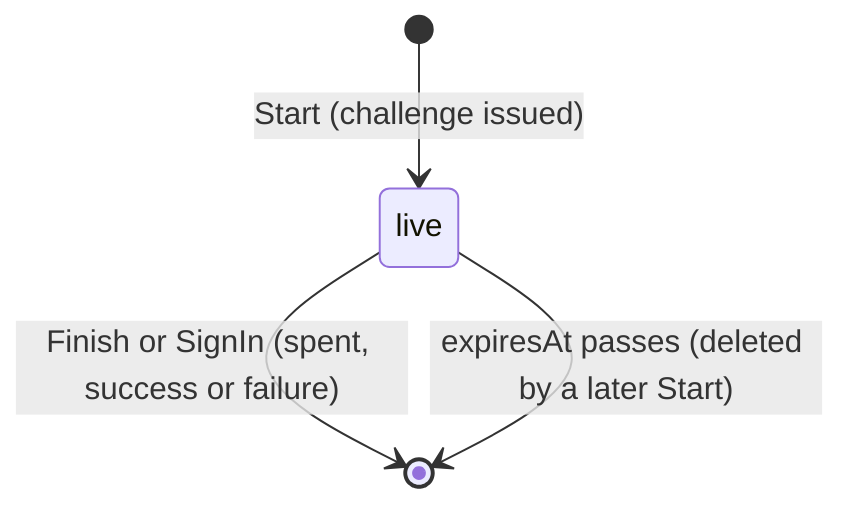
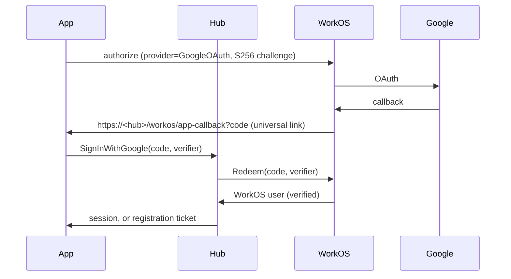

# Google and passkey sign-in

Approved, pass 1. Contexts: Identity. Builds on [email sign-in, pass 3](email-sign-in-pass-3.md) (its registration ticket) and [pass 2](email-sign-in-pass-2.md) (its code exchange and app callback); both stay in force except where this spec says otherwise.

What changes:

- The iOS and Mac apps offer "Continue with Google". WorkOS runs Google's sign-in in a short in-app browser session; the Google account becomes the human's email identity, the same WorkOS user an email code would prove. A new person gets pass 3's registration screen.
- A signed-in human can add a passkey in Settings and then sign in with it: Face ID, Touch ID or a security key, no code and no browser. The hub verifies passkeys itself, for `joinsock.com`. A passkey never creates an account.
- Enterprise SSO is out of scope; nothing here precludes it.

## Ubiquitous language

| Term | Meaning | Stored or derived |
|---|---|---|
| Google sign-in | The app opens WorkOS's authorize URL for Google with a PKCE challenge; Google returns to the hub's app callback; the app hands the code and verifier to the hub, which redeems them with WorkOS for the WorkOS user | Not stored: the session or the registration ticket is the trace |
| Email identity | Unchanged: the WorkOS user bound to a human. A Google account is one way to prove it; WorkOS attaches Google to an existing WorkOS user only after confirming the person controls that inbox, and refuses the sign-in otherwise | Stored (`identity.email_identities`) |
| Passkey | A WebAuthn public-key credential a human registered for relying party `joinsock.com`: the hub keeps its public key and verifies signatures with it | Stored |
| Relying party (RP) ID | `joinsock.com`, the domain every passkey is bound to. Changing it orphans every passkey | Configuration |
| Passkey challenge | 32 random bytes the hub issues for one registration or one sign-in, single use, expiring 5 minutes after issue | Stored until spent or swept |
| Passkey sign-in | The app asks the platform for any `joinsock.com` passkey (discoverable credentials) against a sign-in challenge; the hub verifies the assertion and issues a session | Not stored: the session is the trace |

## Domain model

Changes to [domain-model](domain-model.md). Unchanged objects are not repeated.

### Identity

#### Passkey

Entity, owned by `Account` (humans only), 0 to 10 per human. Identity persists across sign-ins as its signature counter moves.

| Field | Type | Meaning |
|---|---|---|
| `id` | UUID | Server-generated (`uuidv7`); names the passkey in `ListPasskeys` and `RemovePasskey` |
| `credentialId` | bytes | The authenticator's credential id, 16 to 1023 bytes (WebAuthn), unique across all humans |
| `publicKey` | bytes | The COSE public key from the attestation, as the authenticator encoded it |
| `signCount` | int64 | The authenticator's signature counter at the last verified use; 0 for synced passkeys, which never count |
| `backupEligible` | bool | The attestation's BE flag; WebAuthn forbids it changing for a credential, so every assertion is checked against it |
| `aaguid` | bytes (16) | The authenticator model's id, all zeros when the authenticator gives none; shown as the provider's name when known |
| `label` | string | 1 to 64 characters, the device label the human's device sent when adding it |
| `createdAt` | Timestamp | Server clock |

Invariants (constructor and `Account.AddPasskey`): the attestation verifies for RP ID `joinsock.com` and an allowed origin, with user presence and user verification; `credentialId` is not already registered; the human holds fewer than 10 passkeys. `signCount`, when the stored or presented value is nonzero, only grows: a presented count not above the stored one refuses the sign-in (a cloned authenticator) and is logged.

Behaviors: `VerifyAssertion(challenge, assertion)` checks the signature with `publicKey`, the RP ID hash, user presence and verification, the BE flag and the counter, and advances `signCount`.

#### PasskeyChallenge

Value object, two kinds kept apart because they bind different things:

- `PasskeyRegistrationChallenge`: owned by `Account`, 0 or more live. `challenge` (32 bytes), `expiresAt` (5 minutes after issue).
- `PasskeySignInChallenge`: owned by nothing, as `RegistrationTicket` is. `challenge` (32 bytes), `expiresAt`.

Each is spent (deleted) by the one ceremony that presents it, whether that ceremony succeeds or fails, so a challenge is never checked twice. An expired challenge refuses the ceremony. Expired rows go when the next challenge of the kind is issued.

#### Account (changed behaviors)

- `BeginPasskeyRegistration()` (`StartPasskeyRegistration`): issues a registration challenge and returns the creation options: RP ID, the WebAuthn user handle (the account id's 16 bytes, which names no person), the user name (`@handle`), and the human's existing credential ids to exclude.
- `AddPasskey(challenge, attestation, label)` (`FinishPasskeyRegistration`): spends the challenge, verifies the attestation (Passkey invariants) and stores the passkey. A suspended human is refused, as every human write is.
- `RemovePasskey(id)` (`RemovePasskey`): deletes one of the human's passkeys. Removing the last one is allowed: the human keeps the identities they signed up with.
- `Erase()`: unchanged; the passkeys and registration challenges cascade with the account.
- Google sign-in (`SignInWithGoogle`): once WorkOS has named the WorkOS user, as pass 3's `VerifyEmailSignIn`: a human signs in; no human means a `RegistrationTicket`.

Sign-in with a passkey is `Device.Issue(account, label)` for the account whose passkey verified, as every other sign-in.

#### PasskeyVerifier (anti-corruption layer, new)

```go
// PasskeyVerifier is WebAuthn as Identity sees it. Only internal/passkey
// imports github.com/go-webauthn/webauthn; no library type crosses it.
type PasskeyVerifier interface {
	// CreationOptions are the fields the platform needs to create a passkey.
	CreationOptions(challenge PasskeyChallenge, userHandle []byte, userName string, exclude [][]byte) CreationOptions
	// VerifyAttestation checks a registration response against its challenge
	// and returns the new credential.
	VerifyAttestation(challenge PasskeyChallenge, response AttestationResponse) (NewPasskey, error)
	// VerifyAssertion checks a sign-in response against its challenge and the
	// stored credential, and returns the counter to store.
	VerifyAssertion(challenge PasskeyChallenge, stored Passkey, response AssertionResponse) (signCount int64, err error)
}
```

`AttestationResponse` is `credential_id`, `client_data_json`, `attestation_object`; `AssertionResponse` is `credential_id`, `client_data_json`, `authenticator_data`, `signature`, `user_handle`. Both are bytes as the platform returns them; the adapter parses, the hub never re-encodes. Every refusal is `ErrPasskeyRefused` with the reason logged, never returned.

The library is [`go-webauthn/webauthn`](https://github.com/go-webauthn/webauthn) (BSD-3-Clause, maintained, used by large deployments). Nothing in the module covers WebAuthn today and the standard library does not.

#### EmailSignIn (anti-corruption layer, unchanged)

Google needs no new method: `Redeem(code, verifier)` already exchanges any WorkOS authorization code with its PKCE verifier, whichever provider produced it. The apps build the authorize URL with `provider=GoogleOAuth`.

### Diagrams







## Configuration

| Variable or setting | Meaning |
|---|---|
| `SOCK_PASSKEY_RP_ID` | New. The RP ID, `joinsock.com` in production and staging. Empty turns passkeys off: the four passkey RPCs answer `unavailable`. sockd refuses a value that is not a lowercase DNS name |
| `SOCK_PASSKEY_ORIGINS` | New. Comma-separated origins accepted in `clientDataJSON`, `https://joinsock.com` (the origin Apple platforms report for an app's associated domain). Required with the RP ID; each must be `https://` on the RP ID or a subdomain of it |
| WorkOS dashboard, per environment | Google OAuth on, with sock's own Google Cloud OAuth client (WorkOS's shared one is for development only). The redirect URI `https://<hub host>/workos/app-callback` stays registered permanently (Compatibility) |
| Google Cloud | An OAuth client (Web application) whose authorized redirect is WorkOS's callback, and a consent screen naming Sock, with the app's privacy policy and terms links |
| joinsock.com | The website serves `/.well-known/apple-app-site-association` with `{"webcredentials":{"apps":["<team id>.ai.aeryx.sock"]}}`, `application/json`, no redirect |
| Apple app entitlements | Associated domain `webcredentials:joinsock.com` added beside the hub hosts |

## Caller classes

Changed: Anonymous, Human device.

| Class | Authenticates with | Trusted to assert | Never trusted to assert |
|---|---|---|---|
| Anonymous (changed) | Nothing. Reaches `SignInWithGoogle`, `StartPasskeySignIn` and `SignInWithPasskey`, rate limited per client network in the anonymous bucket | That it holds a WorkOS code and its verifier; that it holds a passkey's signature over a challenge the hub issued | Any account, WorkOS user or credential binding (only the redeemed code or the verified signature says) |
| Human device (changed) | As today | As today, plus that the passkey it registers belongs to its human | That a credential id is unused (the hub checks), any other human's passkey |

## API

### Identity RPCs (IdentityService)

| RPC | Caller | Authentication | Authorization | Request | Response | Errors | Idempotency | Domain behavior |
|---|---|---|---|---|---|---|---|---|
| `SignInWithGoogle` (new) | Anonymous | None. Code and verifier redeemed with WorkOS server to server (5 seconds) | WorkOS reports the authentication method `GoogleOAuth` (any other method, a password login on AuthKit's page included, is `EMAIL_CODE_INVALID`); then as pass 3's `VerifyEmailSignIn`: not impersonated, the email verified, the human (if any) not suspended, the WorkOS user not queued for deletion | `code` (1 to 512 printable ASCII), `code_verifier` (43 to 128 of `[A-Za-z0-9._~-]`), `device_label` (1 to 64) | oneof `session` (`Session`) or `registration` (`registration_ticket`, `expires_at`), as `VerifyEmailSignIn` | `EMAIL_CODE_INVALID` (WorkOS refused the code), `ACCOUNT_SUSPENDED`, `FIELD_INVALID`, `RATE_LIMITED`, `unavailable` | Not idempotent: the code is single use at WorkOS | `EmailSignIn.Redeem`, then as `VerifyEmailSignIn`: `Device.Issue` (emits `DeviceAdded`, `DeviceRemoved` on eviction) or `RegistrationTicket.Issue` |
| `AddEmailSignIn` (changed) | Human device | As pass 3 | As pass 3 | oneof `proof` gains `google` (`code`, `code_verifier`), redeemed as above; WorkOS must report `GoogleOAuth` | empty | As pass 3, plus `EMAIL_CODE_INVALID` for any other method | As pass 3 | `Account.AddEmailIdentity`, as pass 3 |
| `StartPasskeyRegistration` (new) | Human device | `sock_st_` session | Humans only; not suspended; passkeys on | empty | `challenge` (32 bytes), `rp_id`, `user_handle` (16 bytes), `user_name` (`@handle`), `exclude_credential_ids` (repeated bytes) | `PERMISSION_DENIED` (a puppet or machine key), `ACCOUNT_SUSPENDED`, `LIMIT_REACHED` (10 passkeys), `unavailable` | Each call issues a new challenge; earlier live ones stay valid until spent or expired | `Account.BeginPasskeyRegistration` |
| `FinishPasskeyRegistration` (new) | Human device | `sock_st_` session; then the attestation verified | The challenge is this human's, live; the credential is new; under 10 passkeys | `challenge`, `credential_id`, `client_data_json`, `attestation_object` (bytes as the platform returns them), `label` (1 to 64) | `Passkey` (`id`, `label`, `created_at`, `provider` name or empty) | `PASSKEY_INVALID` (any verification failure, unknown or expired challenge), `ALREADY_ISSUED` (credential registered already), `LIMIT_REACHED`, `ACCOUNT_SUSPENDED`, `FIELD_INVALID` | The challenge is spent whatever the outcome; a retry needs a new challenge | `Account.AddPasskey`; emits none |
| `ListPasskeys` (new) | Human device | `sock_st_` session | Own passkeys only | empty | repeated `Passkey`, newest first | `PERMISSION_DENIED` | Read | read of the human's passkeys |
| `RemovePasskey` (new) | Human device | `sock_st_` session | Own passkey only; another human's id answers as unknown | `id` (UUID) | empty | `NOT_FOUND`, `FIELD_INVALID` | Idempotent by outcome: a second call is `NOT_FOUND` | `Account.RemovePasskey`; emits none |
| `StartPasskeySignIn` (new) | Anonymous | None | None | empty | `challenge` (32 bytes), `rp_id` | `RATE_LIMITED`, `unavailable` | Each call issues a new challenge | `PasskeySignInChallenge` issued |
| `SignInWithPasskey` (new) | Anonymous | The assertion verified against the stored passkey | The challenge is a live sign-in challenge; the passkey exists; its human is not suspended | `challenge`, `credential_id`, `client_data_json`, `authenticator_data`, `signature`, `user_handle` (bytes), `device_label` (1 to 64) | `Session` | `PASSKEY_INVALID` (unknown credential, bad signature, wrong user handle, counter not advanced, unknown or expired challenge: one answer), `ACCOUNT_SUSPENDED`, `FIELD_INVALID`, `RATE_LIMITED` | The challenge is spent whatever the outcome | `Passkey.VerifyAssertion`, `Device.Issue`, one transaction; emits `DeviceAdded`, `DeviceRemoved` on eviction |

`ERROR_REASON_PASSKEY_INVALID = 68` (Connect `unauthenticated`) joins the taxonomy, after pass 3's 67.

Terms: `StartPasskeyRegistration` and `FinishPasskeyRegistration` need the current terms accepted, as other human writes. `ListPasskeys` and `RemovePasskey` are exempt, so a human can always see and remove their passkeys.

### Rate limits

`SignInWithGoogle`, `StartPasskeySignIn` and `SignInWithPasskey` take from the anonymous client network bucket, as every sign-in RPC. A sign-in challenge is 32 random bytes and single use, so walking signatures is not a concern; the bucket bounds challenge rows.

## Domain events

None new. `DeviceAdded` and `DeviceRemoved` come from the same `Device.Issue` as every sign-in; `HumanRegistered` from pass 3's registration. Passkeys are Identity's own rows and no other context reads them.

## Data layer

Migration `00030_passkeys.sql` (pass 3 takes 00029).

### `identity.passkeys`

Owning aggregate: Account.

| Column | Type | Null |
|---|---|---|
| `id` | `uuid` | NOT NULL, default `uuidv7()` |
| `account_id` | `uuid` | NOT NULL |
| `credential_id` | `bytea` | NOT NULL |
| `public_key` | `bytea` | NOT NULL |
| `sign_count` | `bigint` | NOT NULL |
| `backup_eligible` | `boolean` | NOT NULL |
| `aaguid` | `bytea` | NOT NULL |
| `label` | `text` | NOT NULL |
| `created_at` | `timestamptz` | NOT NULL, default `now()` |

- Primary key `id`: serves `RemovePasskey`.
- Foreign key `account_id` → `identity.humans (account_id)` ON DELETE CASCADE: humans only, gone with the human.
- Unique `credential_id`: serves `SignInWithPasskey`'s lookup by the presented credential, and refuses a credential registered twice.
- Checks `octet_length(credential_id) BETWEEN 16 AND 1023`, `octet_length(aaguid) = 16`, `sign_count >= 0`, `char_length(label) BETWEEN 1 AND 64`.
- Index `passkeys_account_idx (account_id, created_at)`: serves `ListPasskeys` and the 10-per-human count `AddPasskey` takes under the account's lock.

### `identity.passkey_registration_challenges`

Owning aggregate: Account.

| Column | Type | Null |
|---|---|---|
| `challenge` | `bytea` | NOT NULL |
| `account_id` | `uuid` | NOT NULL |
| `expires_at` | `timestamptz` | NOT NULL |

- Primary key `challenge`: serves `FinishPasskeyRegistration`'s spend, `DELETE ... WHERE challenge = $1 AND account_id = $2 RETURNING expires_at`.
- Foreign key `account_id` → `identity.humans (account_id)` ON DELETE CASCADE.
- Check `octet_length(challenge) = 32`.
- Index `passkey_registration_challenges_expires_idx (expires_at)`: serves the sweep `StartPasskeyRegistration` runs before issuing.

### `identity.passkey_sign_in_challenges`

Owning aggregate: none, as `identity.registration_tickets`.

| Column | Type | Null |
|---|---|---|
| `challenge` | `bytea` | NOT NULL |
| `expires_at` | `timestamptz` | NOT NULL |

- Primary key `challenge`: serves `SignInWithPasskey`'s spend.
- Check `octet_length(challenge) = 32`.
- Index `passkey_sign_in_challenges_expires_idx (expires_at)`: serves the sweep `StartPasskeySignIn` runs before issuing.

### Normal form

All three are 5NF: one fact per row keyed by what it is about, no nullable column, no column whose meaning depends on another. The two challenge kinds are two tables because one binds an account and the other binds nothing; one table would need a nullable `account_id` whose meaning depends on a kind column. Google adds no table: it proves an existing kind of identity.

## Apps

iOS and Mac.

1. Sign-in screen, in order: "Sign in with passkey" (shown when the platform reports passkeys available), "Continue with Google", "Continue with email", and on iOS Sign in with Apple. The platform's passkey autofill also offers a passkey in the email field.
2. Passkey: `StartPasskeySignIn`, then `ASAuthorizationPlatformPublicKeyCredentialProvider(relyingPartyIdentifier: "joinsock.com")` with the challenge and no allow list, then `SignInWithPasskey`. Cancelled or no passkey: back to the sign-in screen with no error. `PASSKEY_INVALID`: "That passkey isn't set up for this account. Sign in another way, then add it in Settings."
3. Google: `ASWebAuthenticationSession` to WorkOS's authorize URL with `provider=GoogleOAuth`, the S256 challenge, `state` and `redirect_uri` `https://<hub host>/workos/app-callback`, as pass 2's AuthKit session. On return, `SignInWithGoogle`. A `registration` answer opens pass 3's "Create your account" screen with the ticket.
4. Settings, "Passkeys": the list (`ListPasskeys`) with remove, and "Add a passkey": `StartPasskeyRegistration`, the platform's create sheet, `FinishPasskeyRegistration` with the device's label. After a human's first sign-in on a device that supports passkeys, the app offers "Add a passkey" once.
5. Settings, "Add Google sign-in" for a human without an email identity: the Google session, then `AddEmailSignIn` with `google`.

The connector's web consent (pass 1) uses AuthKit's hosted page, which shows Google once it is on in the WorkOS dashboard; no hub change.

## Compatibility

Pass 3 retires `GET /workos/app-callback`, the association file on hub hosts and the app-callback redirect URI once released builds stop using AuthKit codes. Google sign-in uses all three, so they stay permanently; pass 3's Compatibility now covers only `SignInWithEmail` and the `authkit` proofs.

## Cross-check

| Transition | API | Event | DDL |
|---|---|---|---|
| Google sign-in, human | `SignInWithGoogle` | `DeviceAdded`, `DeviceRemoved` on eviction | `identity.devices` |
| Google sign-in, no human | `SignInWithGoogle` | none: pass 3's ticket is Identity's own row | `identity.registration_tickets` upsert |
| `Account.AddEmailIdentity` (Google) | `AddEmailSignIn` | none, as pass 2 | `identity.email_identities` insert |
| `Account.BeginPasskeyRegistration` | `StartPasskeyRegistration` | none: a challenge is Identity's own row | `identity.passkey_registration_challenges` insert, expired swept |
| `Account.AddPasskey` | `FinishPasskeyRegistration` | none: no other context reads passkeys | challenge delete, `identity.passkeys` insert |
| `Account.RemovePasskey` | `RemovePasskey` | none | `identity.passkeys` delete |
| Sign-in challenge issued | `StartPasskeySignIn` | none | `identity.passkey_sign_in_challenges` insert, expired swept |
| `Passkey.VerifyAssertion`, `Device.Issue` | `SignInWithPasskey` | `DeviceAdded`, `DeviceRemoved` on eviction | challenge delete, `identity.passkeys.sign_count` update, `identity.devices` |
| `Account.Erase` | unchanged | unchanged | passkeys and registration challenges cascade |

## Completeness gate

- Every new or changed RPC has every field.
- No event added or changed.
- Every new table has every column, key, constraint and index, each index naming its query.
- Caller classes: Anonymous reaches `SignInWithGoogle`, `StartPasskeySignIn` and `SignInWithPasskey`; a human device reaches the four account-scoped passkey RPCs and the `google` proof.
- Every transition traces through API, events and DDL or says why not.

## Open questions

- Staging's RP ID: this pass uses `joinsock.com` for staging too, since an app's passkey RP must be one of its associated domains and staging's host is not publicly reachable. A person with passkeys on both hubs sees both in the platform's picker, and picking the other hub's fails `PASSKEY_INVALID`. The alternative is `staging.joinsock.com` with its own association file.
- The origin Apple platforms put in `clientDataJSON` for an app passkey: expected `https://joinsock.com`; confirm on a device before release and set `SOCK_PASSKEY_ORIGINS` from what it reports.
- Whether WorkOS's `GoogleOAuth` provider value is spelled exactly so in the authorize URL: the reference page truncates the list. Confirm on staging.
- The provider names shown for an `aaguid` (iCloud Keychain, 1Password, Google Password Manager): a small static table in the hub, or none and the label alone.
