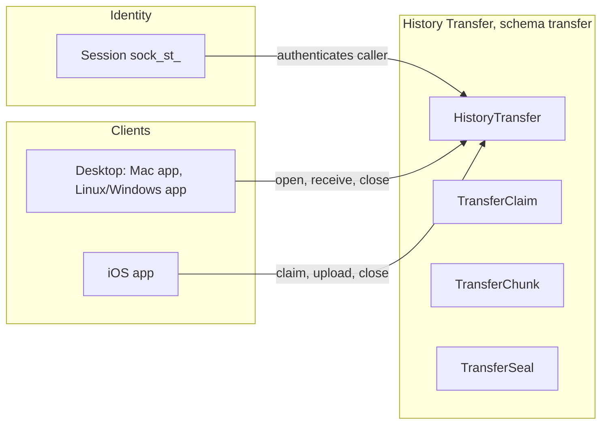
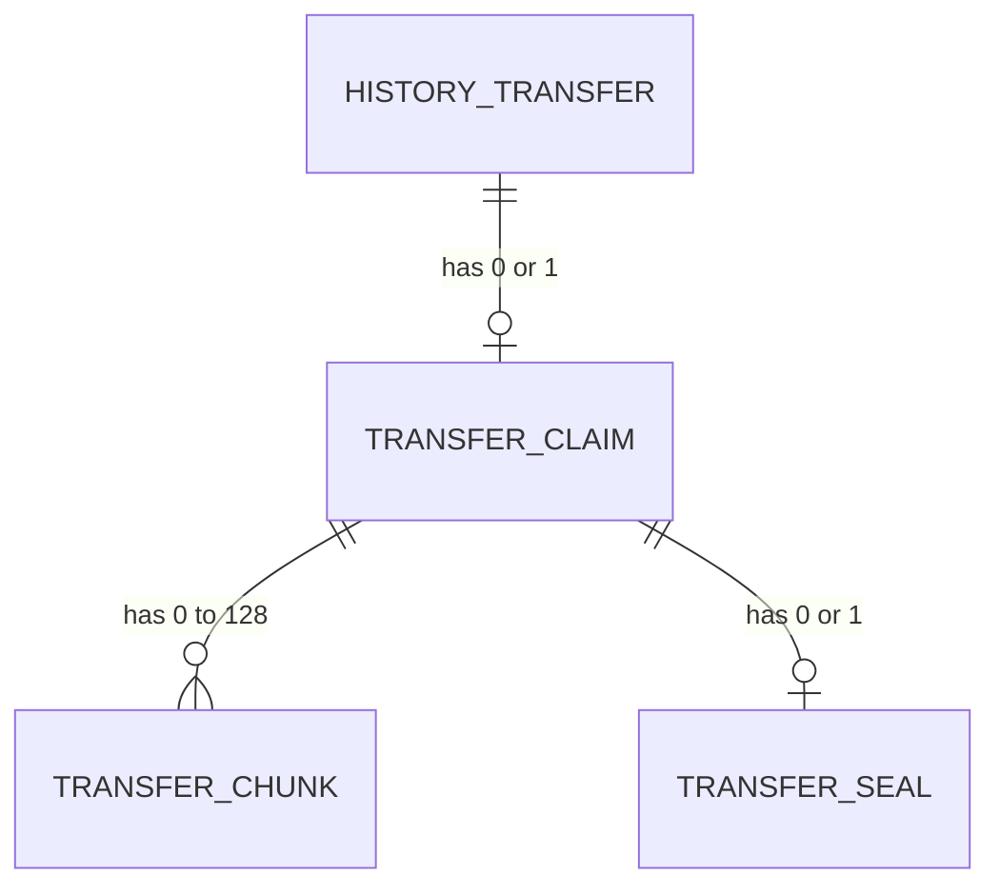
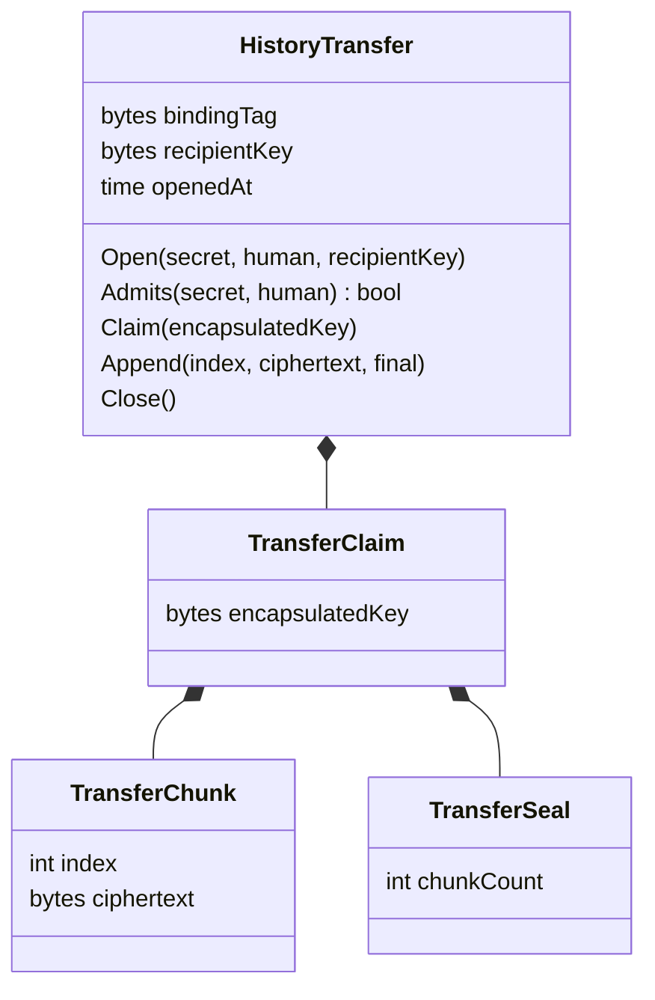
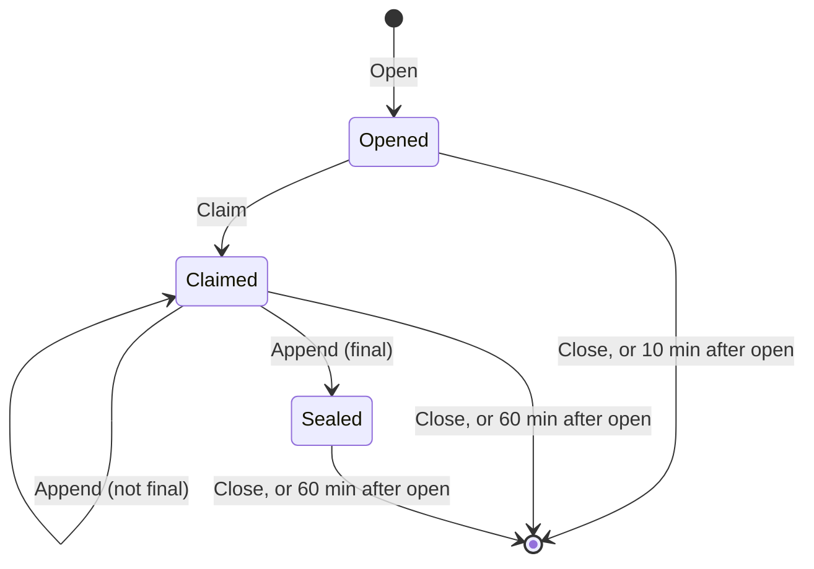

# History transfer: phone to desktop

Pass 1. Folded into [domain model](domain-model.md), [API](api.md), [events](events.md) and [context map](context-map.md); the proto is in `proto/sock/v1/history_transfer.proto`. The DDL goes in the server's next migration.

The hub keeps no message history, so a newly signed-in desktop starts empty. The phone already holds the history. This moves it once, phone to desktop, through the hub, encrypted to a key only the desktop holds. The hub stores ciphertext for at most an hour and keeps nothing afterwards: no account, no device, no record that a transfer happened. Sign-in is unchanged; the QR code moves history only.

## Language

| Term | Meaning |
|---|---|
| history transfer | One move of a phone's local history to one desktop of the same human, from the desktop opening it to its deletion |
| transfer secret | 32 random bytes the desktop generates and shows in the QR code. Proves to the hub that a caller saw the code. Never stored by the hub |
| binding tag | `HMAC-SHA-256(key = transfer secret, msg = "sock history transfer v1" ‖ human account id as 16 UUID bytes)`. The hub's only handle on a transfer. Computed by the hub from the caller's session and the presented secret; matches only for the human who opened it |
| recipient key | The desktop's one-time HPKE public key. The private half never leaves the desktop's memory |
| key digest | SHA-256 of the recipient key, carried in the QR code so the phone can detect a substituted key |
| claim | The phone's acceptance of a transfer, carrying its HPKE encapsulated key |
| chunk | One HPKE-sealed slice of the archive, at most 1 MiB of plaintext |
| seal | The fact that the final chunk is stored: the transfer is complete |
| archive | The plaintext the chunks carry: a stream of length-delimited `HistoryRecord` protobufs |

Stored: the binding tag, recipient key, encapsulated key, chunk ciphertexts, chunk count at seal, `opened_at`. Derived: state (from which fact rows exist), deadlines (from `opened_at` and constants), the transfer's owner (never stored; recomputed per call).

## Context

A new context, **History Transfer**, supporting subdomain, its own Postgres schema `transfer`. It shares no data with Messaging or Identity: no account or device id is stored, and "message" here is an opaque byte stream the hub cannot read. Relationship to Identity: conformist downstream for authentication only (the existing interceptor yields the caller's human). Separate ways with Messaging.







## HistoryTransfer

Entity, aggregate root. Identity is the binding tag. Owns its claim, chunks and seal outright; references nothing.

### Fields

| Field | Type | Meaning |
|---|---|---|
| `bindingTag` | 32 bytes | As defined above. Unique: two humans, or two secrets, never produce the same tag |
| `recipientKey` | bytes, the KEM's public key length | The desktop's HPKE public key, as the desktop sent it. The hub never checks it beyond length |
| `openedAt` | timestamp | Database clock at open. Every deadline derives from it |

### Behaviors

- `Open(secret, human, recipientKey)`: factory. Computes the tag, creates the transfer. Repeating it with the same secret and key returns the existing transfer; the same secret with a different key is refused.
- `Admits(secret, human)`: recomputes the tag and compares it in constant time. Every other call starts here. A transfer that does not admit the caller does not exist for that caller.
- `Claim(encapsulatedKey)`: creates the claim. Repeating with the same key is a no-op; a different key is refused. Refused after the claim deadline.
- `Append(index, ciphertext, final)`: stores a chunk. `index` must equal the stored chunk count (gapless, in order), or name an existing chunk with byte-identical ciphertext (a retried upload, no-op). `final` creates the seal with `chunkCount = index + 1`. Refused before a claim, after the seal, and at 128 chunks.
- `Close()`: deletes the transfer and everything it owns. Idempotent.

### Invariants

- No account id, device id, transfer secret or plaintext is ever stored.
- The tag is computed by the hub from the authenticated caller, never accepted from a client. A desktop that could supply its own tag could bind a transfer to someone else's phone and receive their history.
- Chunks are gapless from 0; at most one seal; the seal's `chunkCount` equals the number of chunks.
- Chunks and seal exist only under a claim.
- A transfer lives at most 10 minutes unclaimed and 60 minutes in total, from `openedAt`. Constants, placeholders until measured.

### States



| From | To | Trigger |
|---|---|---|
| none | Opened | `Open` |
| Opened | Claimed | `Claim`, before 10 minutes |
| Claimed | Claimed | `Append`, not final |
| Claimed | Sealed | `Append`, final |
| any | deleted | `Close`; the sweep at the deadline |

Anything unlisted is refused by the aggregate. State derives from which rows exist: no claim row is Opened, a claim and no seal is Claimed, a seal is Sealed.

### TransferClaim, TransferChunk, TransferSeal

Value objects owned by `HistoryTransfer` through the claim, created and deleted with it, never referenced elsewhere.

| Object | Field | Type | Meaning |
|---|---|---|---|
| `TransferClaim` | `encapsulatedKey` | bytes, the KEM's encapsulation length | HPKE `enc` from the phone's `NewSender`. No timestamp: nothing reads one |
| `TransferChunk` | `index` | int, 0 to 127 | Position in the stream |
| | `ciphertext` | bytes, 17 to 1 MiB + 16 | One HPKE `Seal` output |
| `TransferSeal` | `chunkCount` | int, 1 to 128 | Number of chunks; the last is `chunkCount - 1` |

Relationships: `HistoryTransfer` has-a `TransferClaim` 1 to 0..1; `TransferClaim` has-a `TransferChunk` 1 to 0..128; `TransferClaim` has-a `TransferSeal` 1 to 0..1.

## Cryptography

- **QR payload.** `sock-history:1:<base64url secret>:<base64url key digest>:<host>`, unpadded base64url. `<host>` is last and is everything after the fourth colon, so a `host:port` parses. It is the hub's API host as the desktop is configured, so a phone on another server says so instead of getting `NOT_FOUND`. Both sides compare hosts after mapping the hub's aliases (`api.sock.aeryx.ai` is `api.joinsock.com`) to one name, a constant in each client. No URL scheme: a camera app opening it in a browser would put the secret in browser history. The recipient key is too large for a comfortable QR, hence the digest; the full key travels through the hub and the phone checks it.
- **Suite.** HPKE base mode (RFC 9180), KEM `MLKEM768-X25519` (X-Wing, id `0x647a`), KDF HKDF-SHA256, AEAD AES-256-GCM. Hybrid post-quantum because ciphertext outlives the transfer in Render's point-in-time recovery window, and the stated adversary includes the law. Go: stdlib `crypto/hpke` (`MLKEM768X25519`). iOS: CryptoKit HPKE `XWingMLKEM768X25519_SHA256_AES_GCM_256` (iOS 26, the app's floor). Interop is pinned by cross-implementation test vectors (open question 1, resolved).
- **Context.** `info = "sock history transfer v1" ‖ bindingTag`. Both devices compute the tag themselves (each knows the secret and its own human id), so ciphertext is bound to this transfer.
- **Chunks.** One `Sender` context; chunk `i` is `Seal(aad = uint32_be(i) ‖ final byte, plaintext slice)`. The context's sequence number orders chunks; the final flag in the AAD stops truncation. The desktop refuses a stream that ends without a final chunk, or with a chunk after it.
- **What the hub can do.** Read and write the rows, and see the secret in transit. It can deny or delete a transfer. It cannot read the archive (no private key) or substitute the recipient key (the phone checks the digest from the QR). It can tell a phone "this transfer exists", but only to a phone of the same human.
- **What the hub could forge.** HPKE base mode does not authenticate the sender, and the hub sees the secret and knows the human and the key, so it could write its own claim and seal a fabricated archive. Accepted: the hub already asserts every live message's sender, `seq`, time and evidence tag, so a forging hub can already plant history on every device. Sender authentication belongs with end-to-end messaging, not here. My call.

## Archive

Plaintext is a stream of `HistoryRecord` messages, each prefixed by its length as a varint (protobuf delimited). Records are cut into chunks at arbitrary byte boundaries. Order: one `header`, then all `account` records, then for each conversation its `conversation` record followed by its `message` records in `seq` order.

```proto
// history_transfer.proto
message HistoryRecord {
  oneof record {
    HistoryHeader header = 1;
    Account account = 2;        // sock.v1.Account, as the phone last stored it
    Conversation conversation = 3; // sock.v1.Conversation; read_through_seq is the phone's local read position
    Message message = 4;        // sock.v1.Message, confirmed only, evidence_tag included
  }
}
message HistoryHeader {
  // 1. An importer refuses a higher version.
  uint32 format_version = 1;
  // The human whose history this is. The importer refuses an archive whose id
  // is not its signed-in account.
  string account_id = 2;
  google.protobuf.Timestamp exported_at = 3;
}
```

Included: confirmed messages only (pending and failed sends stay on the phone), every conversation the phone holds, the accounts those reference, and the phone's read positions. Messages with a body this build cannot show travel as the phone stored their wire bytes (`unsupportedRaw` on Apple), re-decoded as `Message`, so a newer desktop can show them. No attachments: sock has none.

## Caller classes

Unchanged; one class reaches the new service.

| Class | `HistoryTransferService` |
|---|---|
| Anonymous | no, `TOKEN_INVALID` (not in `AnonymousProcedures`) |
| Human device | yes: every RPC. Desktop and phone are both human sessions; the hub cannot and need not tell which is which |
| Puppet device | no, `CALLER_NOT_ALLOWED` from the handler (`IsPuppet`), since the interceptor has no puppet refusal. With the Pro gate on, a puppet whose owner lacks Pro gets `SUBSCRIPTION_REQUIRED` from the interceptor first |
| Machine key | no, `CALLER_NOT_ALLOWED` (not in `MachineKeyProcedures`) |
| Connector service, Operator, OAuth client, Consenting browser, Stripe | no, refused as for every other service |

Terms-exempt (moves no content to anyone else) and not Pro-gated. A suspended account's session does not authenticate, as everywhere.

## API contract

New service `sock.v1.HistoryTransferService`, Connect over HTTPS, its own `ReadMaxBytes` of 1 MiB + 64 KiB (the default 128 KiB cannot carry a chunk). Every RPC: Human device, `Authorization: Bearer sock_st_…`. Every lookup is by the tag recomputed from the caller and the presented secret, so an unknown, expired, closed or other human's transfer is the same `NOT_FOUND`, and nothing distinguishes them. `transfer_secret` is always exactly 32 bytes, else `FIELD_INVALID`. Every RPC can also return `unavailable`.

### OpenHistoryTransfer

| Field | Content |
|---|---|
| Caller | Desktop (any human session) |
| Request | `transfer_secret` bytes(32); `recipient_key` bytes, exactly the X-Wing public key length (1216) |
| Response | `expires_at` Timestamp: the claim deadline, `opened_at + 10 min` |
| Errors | `CALLER_NOT_ALLOWED`; `FIELD_INVALID` (lengths); `IDEMPOTENCY_MISMATCH` (tag exists with a different key); `LIMIT_REACHED` (256 open transfers hub-wide; `ClaimHistoryTransfer` caps claimed ones at 32). No per-human limit: any per-human row is one a legal demand could tie to a human. Caps are placeholders until measured |
| Idempotency | Same secret and key returns the existing transfer and its original `expires_at` |
| Domain behavior | `HistoryTransfer.Open` |

### GetHistoryTransferKey

| Field | Content |
|---|---|
| Caller | Phone, after scanning and before asking the person to confirm |
| Request | `transfer_secret` bytes(32) |
| Response | `recipient_key` bytes; `claim_by` Timestamp (`opened_at + 10 min`) |
| Errors | `CALLER_NOT_ALLOWED`; `FIELD_INVALID`; `NOT_FOUND` (includes past the claim deadline, and already claimed: a second phone learns nothing) |
| Idempotency | Read only |
| Domain behavior | `HistoryTransfer.Admits`, then a read. The phone checks the key's SHA-256 against the QR digest; a mismatch stops with "This code could not be verified" and calls `Close` |

### ClaimHistoryTransfer

| Field | Content |
|---|---|
| Caller | Phone, after the person confirms |
| Request | `transfer_secret` bytes(32); `encapsulated_key` bytes, exactly the X-Wing encapsulation length (1120), from `NewSender` against the digest-checked key |
| Response | `max_chunk_bytes` uint32 (1 MiB plaintext); `max_chunks` uint32 (128); `expires_at` Timestamp (`opened_at + 60 min`) |
| Errors | `CALLER_NOT_ALLOWED`; `FIELD_INVALID`; `NOT_FOUND` (includes past the 10-minute claim deadline); `IDEMPOTENCY_MISMATCH` (claimed with a different key); `LIMIT_REACHED` (32 claimed transfers hub-wide) |
| Idempotency | Same key repeats the response |
| Domain behavior | `HistoryTransfer.Admits`, `HistoryTransfer.Claim`. Emits `HistoryTransferChanged` when the claim row is created |

### UploadHistoryChunk

| Field | Content |
|---|---|
| Caller | Phone |
| Request | `transfer_secret` bytes(32); `index` uint32; `ciphertext` bytes, 17 to 1 MiB + 16; `final` bool |
| Response | `stored_chunks` uint32: chunk count after the call |
| Errors | `CALLER_NOT_ALLOWED`; `FIELD_INVALID` (lengths; `index` not the next and not a stored one; no claim; already sealed and `index` ≥ `chunkCount`; `index` 127 without `final`); `NOT_FOUND`; `IDEMPOTENCY_MISMATCH` (stored index, different bytes) |
| Idempotency | A repeated `(index, ciphertext)` returns the current count and stores nothing. Retries after a lost response are safe; a phone that rebuilt its archive (new `enc`) cannot resume and must `Close` |
| Domain behavior | `HistoryTransfer.Admits`, `HistoryTransfer.Append`. Emits `HistoryTransferChanged` when a chunk or the seal is stored |

Upload is sequential: the next chunk is sent when the previous call returns. The phone encodes and seals the next chunk while the current one uploads.

### ReceiveHistory (server streaming)

| Field | Content |
|---|---|
| Caller | Desktop |
| Request | `transfer_secret` bytes(32); `from_index` uint32, the first chunk not yet received (0 on first open) |
| Response stream | `oneof event`: `HistoryClaimed { encapsulated_key }`, sent once per stream when a claim exists; `HistoryChunk { index, ciphertext, final }` for each stored chunk from `from_index`, in order, as soon as it is stored; `Heartbeat` every 30 s. The stream ends with OK after the final chunk |
| Errors | `CALLER_NOT_ALLOWED`; `FIELD_INVALID`; `NOT_FOUND`, at open or mid-stream when the transfer is closed or expires. The stream re-checks the caller's session on every wake and heartbeat, as `Subscribe` does, and ends with `Subscribe`'s error: `TOKEN_INVALID` when the device is revoked, `ACCOUNT_SUSPENDED` when the account is suspended |
| Idempotency | Read only. A dropped stream reopens with `from_index` |
| Domain behavior | `HistoryTransfer.Admits`, then reads. Woken by `HistoryTransferChanged`; also re-reads on each heartbeat, so a lost notification delays at most 30 s |

### CloseHistoryTransfer

| Field | Content |
|---|---|
| Caller | Either device: the desktop after its import commits (the ack), or either side to cancel |
| Request | `transfer_secret` bytes(32) |
| Response | empty |
| Errors | `CALLER_NOT_ALLOWED`; `FIELD_INVALID` |
| Idempotency | Closing a missing transfer is OK, so there is no `NOT_FOUND`: a retry after a lost response succeeds |
| Domain behavior | `HistoryTransfer.Admits`, `HistoryTransfer.Close`. Emits `HistoryTransferChanged` when a row was deleted |

No new `ErrorReason`.

## Events

| Field | Content |
|---|---|
| Name | `HistoryTransferChanged` |
| Emitting aggregate | `HistoryTransfer` |
| Emitting transitions | `Claim` (row created), `Append` (chunk or seal stored), `Close` (row deleted), the sweep (row deleted) |
| Payload | the binding tag, hex. Nothing else |
| Consumers | Stream wake: `pg_notify('history_transfers', tag)` in the same transaction; each replica wakes its `ReceiveHistory` streams for that tag, which re-read the rows |
| Delivery | At most once (`NOTIFY`). Not an outbox row: the rows are the truth, and the heartbeat re-read bounds a lost notification to 30 s. `onReconnect` wakes every stream, as the delivery hub does |
| Boundary | Internal to History Transfer. The stream events are the published form |
| Domain service | None: the reaction is a read |

## Data contract

```sql
-- +goose Up
-- History transfer (sock-contract docs/specs/history-transfer.md).
-- No account or device id anywhere in this schema: a transfer is found only by
-- the tag the hub recomputes from the caller and the secret it presents.
CREATE SCHEMA transfer;

CREATE TABLE transfer.transfers (
    binding_tag   bytea       PRIMARY KEY CHECK (octet_length(binding_tag) = 32),
        -- HMAC-SHA-256(secret, label || human id); serves every lookup
    recipient_key bytea       NOT NULL CHECK (octet_length(recipient_key) = 1216),
        -- the desktop's X-Wing public key
    opened_at     timestamptz NOT NULL DEFAULT now()
        -- every deadline derives from it: claim by +10 min, gone by +60 min
);
CREATE INDEX transfers_opened_idx ON transfer.transfers (opened_at);
    -- serves the sweep and the sweeper's next deadline

CREATE TABLE transfer.claims (
    binding_tag      bytea PRIMARY KEY REFERENCES transfer.transfers ON DELETE CASCADE,
    encapsulated_key bytea NOT NULL CHECK (octet_length(encapsulated_key) = 1120)
        -- the row is the fact that a phone claimed; no timestamp, nothing reads one
);

CREATE TABLE transfer.chunks (
    binding_tag bytea   NOT NULL REFERENCES transfer.claims ON DELETE CASCADE,
        -- references claims, not transfers: no chunk without a claim
    idx         integer NOT NULL CHECK (idx BETWEEN 0 AND 127),
    ciphertext  bytea   NOT NULL CHECK (octet_length(ciphertext) BETWEEN 17 AND 1048592),
    PRIMARY KEY (binding_tag, idx)
        -- serves Append's next-index count and ReceiveHistory's ordered read
);
ALTER TABLE transfer.chunks ALTER COLUMN ciphertext SET STORAGE EXTERNAL;
    -- ciphertext does not compress; skip the attempt

CREATE TABLE transfer.seals (
    binding_tag bytea   PRIMARY KEY REFERENCES transfer.claims ON DELETE CASCADE,
    chunk_count integer NOT NULL CHECK (chunk_count BETWEEN 1 AND 128)
        -- the row is the fact that the final chunk is stored
);

-- +goose Down
DROP SCHEMA transfer CASCADE;
```

5NF: each table holds one fact keyed by the tag (plus index for chunks); nothing nullable; nothing derived stored. Rules a CHECK cannot hold, enforced in the write path under `SELECT … FROM transfer.claims WHERE binding_tag = $1 FOR UPDATE`: gapless `idx`; seal `chunk_count = idx + 1` of the final chunk, written in the same transaction; no chunk after the seal; claim only before `opened_at + 10 min`.

**Sweep.** The sweeper (deadline-driven, `NextDeadline` gains `min(opened_at) + 10 min` for unclaimed and `+ 60 min` for all) deletes `transfers` unclaimed past 10 minutes or any past 60, with `SKIP LOCKED`, and sends `HistoryTransferChanged` for each tag.

**Erasure and export.** `EraseAccount` cannot find a human's transfers and does not try: they hold no account id and are gone within an hour. `ExportIdentityData` and `ExportMessagingData` are unchanged for the same reason.

## Metadata the hub keeps

- **Database:** nothing after `Close` or the deadline. While live: tag, key, `enc`, ciphertext, chunk count, `opened_at`.
- **Telemetry:** `HistoryTransferService` spans, metrics and logs carry the procedure and status code only: no account, device or transfer id, no tag, no sizes per call. Aggregate counters only (transfers opened, sealed, closed, expired; bytes stored as a histogram without labels). Request bodies are never logged anywhere; this service carries a secret in every one.
- **Beyond sock's reach:** Render point-in-time recovery holds deleted rows for 7 days (no logical exports exist), so a transfer's tag, key, `enc`, ciphertext and `opened_at` stay recoverable for 7 days after deletion; Cloudflare and Render request logs hold client IP, path, time and size.

## Clients

### iOS (source)

- Before scanning, sums the byte size of stored message text and wire bytes. Over 120 MiB (headroom under the 128 MiB cap for record framing and accounts) it says "Your history is too large to transfer" and stops, so no transfer fails after 127 chunks. Larger history is future work.
- "Send history to a desktop" in Settings opens a scanner (VisionKit `DataScannerViewController`, QR only; adds `NSCameraUsageDescription`).
- Parses the payload; a host other than the session's slot says "This code is for another Sock server" and stops.
- Calls `GetHistoryTransferKey`, checks the key's SHA-256 against the digest, asks for confirmation, creates the HPKE sender, calls `ClaimHistoryTransfer`, then streams: reads the SwiftData store in pages (accounts, then conversation by conversation, messages by `seq`), writes delimited records, seals and uploads each 1 MiB slice, the last with `final`.
- Keeps the screen awake (`isIdleTimerDisabled`) and stays in the foreground, saying so. Leaving the app or any non-retryable error calls `Close` and tells the person to scan again.
- Transient errors retry the same chunk under SockKit's `Backoff`, honouring `SockError.retryAfter`.

### Desktop (target): Linux/Windows app and the Mac app

- "Transfer history from your phone" in Settings, as a sheet. Generates the secret and an X-Wing key pair in memory only, calls `OpenHistoryTransfer`, shows the QR and the time left, opens `ReceiveHistory`.
- On `HistoryClaimed`: "Receiving from your phone…" with progress by chunk. Decrypts each chunk in order as it arrives and feeds the record decoder; the stream is imported as it decrypts, in batches of a few hundred records per store transaction.
- On the final chunk: commits the last batch, then `CloseHistoryTransfer` (store first, then close, as sync stores before it acks). A crash before close loses the in-memory key; the transfer expires on its own and the person scans a new code.
- Refuses and closes on: a header whose `account_id` is not the signed-in account, a higher `format_version`, an AEAD failure, a stream without a final chunk.

**Merge rules** (both desktop stores, idempotent, so a partial import repeated is safe):

| Record | Rule |
|---|---|
| `account` | Insert if absent. An existing row is newer (fetched from the hub) and wins |
| `conversation` | Insert if absent with its kind and members. Existing: kind and members untouched (the hub's list is newer); read position raised to the record's `read_through_seq` through the existing raise-only path, which reports it with `MarkRead` on the next refresh |
| `message` | Through the existing message insert (Go `insertMessage`, Apple `upsert`), so dedupe by id (and on Go by `(conversation_id, seq)`), evidence tags, unsupported bytes and the search fold stay consistent. Never overwrites |

A `message` whose conversation is missing at insert (a sync refresh pruned it between import batches, so the account is no longer a member) is skipped and counted, never fatal; sync is not paused. My call.

Known effect: the next conversation refresh prunes conversations the hub no longer lists, with their imported messages, as it does for synced ones. The phone prunes the same way, so this removes only conversations left between export and import.

## Cross-check

| Transition | API | Event | DDL |
|---|---|---|---|
| `Open` | `OpenHistoryTransfer` | none: no stream can exist before the desktop has the transfer | insert `transfer.transfers` |
| `Admits` | every RPC | none: a read | PK lookup on `binding_tag` |
| read key | `GetHistoryTransferKey` | none: a read | `transfer.transfers` by PK, no `transfer.claims` row |
| `Claim` | `ClaimHistoryTransfer` | `HistoryTransferChanged` | insert `transfer.claims`, deadline checked against `opened_at` |
| `Append` | `UploadHistoryChunk` | `HistoryTransferChanged` | insert `transfer.chunks` under the claim lock; with `final`, insert `transfer.seals` |
| read chunks | `ReceiveHistory` | consumer of `HistoryTransferChanged` | `transfer.chunks` by PK prefix |
| `Close` | `CloseHistoryTransfer` | `HistoryTransferChanged` | delete `transfer.transfers`, cascade |
| expiry | none: the sweeper | `HistoryTransferChanged` | delete by `transfers_opened_idx` |

Gate: six RPCs, every field filled; one event, every field filled; four tables, every field filled; the one admitted caller class reaches all six; every transition traced or its absence stated.

## Open questions

1. Resolved: CryptoKit's X-Wing HPKE and Go's `crypto/hpke` `MLKEM768X25519` interoperate, with the 1216-byte key and 1120-byte `enc` the DDL pins. Swift imports the 32-byte seed Go writes (`XWingMLKEM768X25519.PrivateKey(seedRepresentation:publicKey:)`). Pinned both ways by checked-in vectors in `testdata/history-transfer/`: Swift `testOpenGoVector` opens `go-sealed.bin`, Go `TestOpenSwiftVector` opens `swift-sealed.bin`. The archive bytes and QR payload each side writes are identical.


## Required tests

Black-box (server), every RPC called successfully and per error: open and repeat; open with a different key `IDEMPOTENCY_MISMATCH`; a second human's session gets `NOT_FOUND` on claim, upload, receive and a no-op close with the first human's secret; claim after 10 minutes `NOT_FOUND`; upload out of order, before claim and after seal `FIELD_INVALID`; repeated chunk identical OK, different `IDEMPOTENCY_MISMATCH`; `ReceiveHistory` receives chunks stored after it opened, resumes from `from_index`, ends after final, ends `NOT_FOUND` on close; sweep removes past-deadline transfers and ends their streams; puppet (owner with Pro, or the gate off) and machine key `CALLER_NOT_ALLOWED`; no `transfer` row holds any value equal to an account or device id; telemetry for the service carries no ids (log and span capture). Crypto: shared Go and Swift test vector for one archive. Clients: merge rules above against the real SQLite and SwiftData stores, including re-import of the same archive changing nothing; header account mismatch refused; truncated stream refused.
