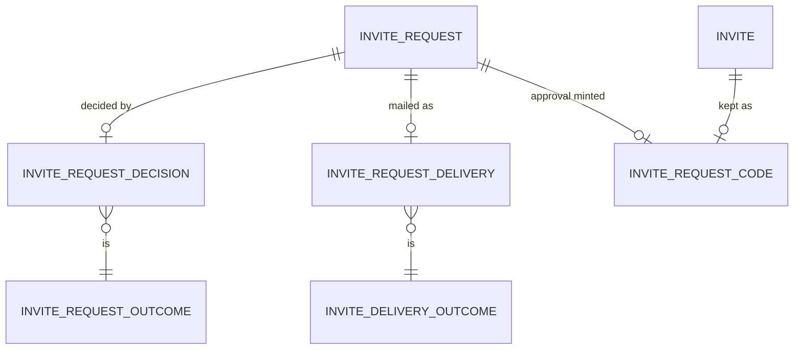
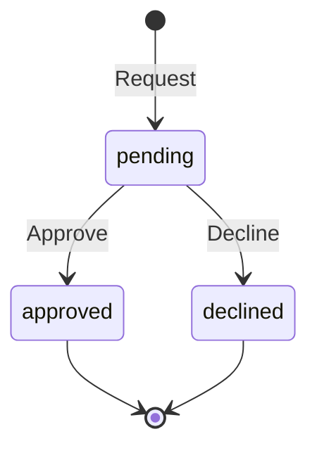

# Invite requests

Pass 2. Context: Identity. Request and response shapes will live in `proto/sock/v1/invite_request.proto` and `operator.proto`; this file holds what proto cannot say.

## Ubiquitous language

| Term | Meaning | Stored or derived |
|---|---|---|
| Invite request | One person's ask for an invite, by email address | Stored |
| Requester | The person who asked. Holds no account and no credential | Not modeled: only the email is kept |
| Decision | The operator's answer to a request: approved or declined | Stored, as its own fact |
| Pending | A request with no decision | Derived: no `InviteRequestDecision` row |
| Approved | A decision whose outcome is approved. The invite minted with it is a separate `Invite` | Derived from the decision |
| Kept code | The invite code minted on approval, kept encrypted until its invite is redeemed or expires | Stored, as its own fact |
| Delivery | The one attempt to mail an approved request its code, and how it ended | Stored, as its own fact |
| Declined | A decision whose outcome is declined | Derived from the decision |

Inferred, to confirm: "requester", "decision", "kept code" and "delivery" as terms; that approving and minting are one act.

## Domain model

### InviteRequest

Entity, aggregate root. One is created per distinct email address and lives until its retention window ends.

| Field | Type | Meaning |
|---|---|---|
| `id` | uuid (v7) | Identity. Time-ordered, so list order is id order |
| `email` | `EmailAddress` | The requester's address, normalized (below) |
| `note` | text, 0 to 500 characters | What the requester says they will use sock for. Empty means they wrote nothing |
| `createdAt` | Timestamp | Database clock at creation |

Relationships

| To | Kind | Cardinality |
|---|---|---|
| `InviteRequestDecision` | has-a | 1 to 0..1 |
| `InviteRequestDelivery` | has-a | 1 to 0..1 |
| `InviteRequestCode` | referenced by | 1 to 0..1 |

Behaviors

- `Request(email, note)` (factory; `RequestInvite`, after the Turnstile check passes): validates, normalizes and stores. Refused if `email` already names a request, in which case the call is a no-op that still answers success (see API).
- `Approve(operatorTokenId)`: records an `InviteRequestDecision` with outcome `approved` and emits `InviteRequestApproved`. A repeat approve is a no-op that reports the earlier approval and emits nothing. Refused if a decision exists with outcome `declined`.
- `RecordDelivery(outcome, detail)` (`InviteMailer`): records the `InviteRequestDelivery`. Refused without an approved decision, and if a delivery exists.
- `Decline(operatorTokenId)`: records an `InviteRequestDecision` with outcome `declined`. Refused if a decision exists with outcome `approved`. A repeat decline is a no-op.

Invariants

- `email` is valid and normalized at construction. Never changes.
- At most one request per normalized `email`.
- At most one decision per request.
- At most one delivery per request, and only for an approved one.
- `note` is at most 500 characters.

State machine (derived from the decision row)

| From | To | Trigger |
|---|---|---|
| (none) | pending | `Request` |
| pending | approved | `Approve` |
| pending | declined | `Decline` |

Anything unlisted is refused by the aggregate. Approved and declined are terminal.

### EmailAddress

Value object. Normalized form: surrounding whitespace trimmed, ASCII-lowercased, 3 to 254 bytes, exactly one `@` with a non-empty local part and a domain containing at least one `.`, no control characters, no Unicode space anywhere. The constructor rejects everything else. Case folding beyond ASCII is not done, and addresses that differ only in plus-tags are distinct.

### InviteRequestDecision

Entity-less fact, owned by `InviteRequest`, keyed by the request. Created by `Approve` or `Decline`, deleted with the request.

| Field | Type | Meaning |
|---|---|---|
| `requestId` | uuid | The request decided |
| `outcome` | `InviteRequestOutcome` | `approved` or `declined` |
| `operatorTokenId` | uuid | The verified operator token that decided. No foreign key: the fact outlives the token's sweep, as `OperatorAction` does |
| `decidedAt` | Timestamp | Database clock |

`InviteRequestOutcome` is an enumeration: `approved`, `declined`.

### InviteRequestDelivery

Fact owned by `InviteRequest`, keyed by the request. Created once by `InviteMailer`, deleted with the request. Its absence on an approved request means the mail is still queued or being retried.

| Field | Type | Meaning |
|---|---|---|
| `requestId` | uuid | The request mailed |
| `outcome` | `InviteDeliveryOutcome` | How the one attempt ended |
| `detail` | text | For `sent`, the result list Cloudflare put the recipient in: `delivered` or `queued` (its REST response has no message id). For `rejected`, `permanent_bounce`, `suppressed` (on Cloudflare's suppression list), or Cloudflare's numeric error code for a `4xx` other than `429`. Empty for `codeGone` and `codeUnopenable`, which carry no provider evidence. The check in the data layer enforces each |
| `deliveredAt` | Timestamp | Database clock |

`InviteDeliveryOutcome` is an enumeration:

| Value | Meaning |
|---|---|
| `sent` | Cloudflare accepted the mail |
| `rejected` | Cloudflare refused the mail for good: the address bounced permanently, or the request was refused with a `4xx` other than `401`, `403`, `408` and `429`. Not retried |
| `codeGone` | The invite was redeemed or expired before the mail went out. Nothing sent |
| `codeUnopenable` | The kept code did not open under the current key. Nothing sent |

Transient failures (Cloudflare unreachable, `5xx`, `408`, `429` or code `10004`, and `401` or `403`, which mean our token or account is misconfigured and must succeed once it is fixed) are not outcomes: the outbox row is retried with backoff, `Retry-After` pushes it out, and a row that exhausts its attempts dead-letters as every outbox row does.

### InviteRequestCode

Fact owned by `Invite`: created with it in the approval transaction, deleted with it when the invite is redeemed, expires or is swept. Names its request by id.

| Field | Type | Meaning |
|---|---|---|
| `codeHash` | 32 bytes | The invite's SHA-256 of its code, the invite's key |
| `requestId` | uuid | The request whose approval minted the invite |
| `sealedCode` | bytes | A 12-byte random nonce followed by the AES-256-GCM ciphertext and tag of the code, under `SOCK_INVITE_CODE_KEY`, with `codeHash` as additional data so a sealed code cannot be moved onto another row |

Relationships

| To | Kind | Cardinality |
|---|---|---|
| `Invite` | owned by (has-a from `Invite`) | 1 to 1 |
| `InviteRequest` | references | n to 1, n ≤ 1 |

Behaviors

- `Seal(code, codeHash, requestId, key)` (factory; in `ApproveInviteRequests`): encrypts with a fresh nonce.
- `Open(key)`: returns the code, or refuses when authentication fails or the opened code's SHA-256 is not `codeHash`. A refusal is reported as no code, never as a call error, and logged without the code.

Invariants

- At most one per invite and at most one per request: a request is approved at most once and mints one invite.
- `sealedCode` opens, under the key that sealed it, to a code whose SHA-256 is `codeHash`.

### Cross-aggregate write

Each request in `ApproveInviteRequests` gets its own transaction: the `InviteRequestDecision`, `Invite.Mint(operatorTokenId)`, the `InviteRequestCode`, the `InviteRequestApproved` outbox row and the `OperatorAction`. This is the same deliberate two-aggregate write as `OperatorToken.Revoke`. Minting stays in the approval transaction so the code is in the response with no wait on the mail. A batch is an application-service loop over those transactions; no transaction spans two requests.

### Anti-corruption layers

- `InviteMailer` (domain port, Identity): `Send(to EmailAddress, code string, expiresAt Timestamp) (SendResult, error)`, where `SendResult` is `sent(detail)` or `rejected(detail)` and the error is transient only, carrying `Retry-After` when Cloudflare sends one. The adapter is Cloudflare Email Service over REST (`POST /accounts/{SOCK_CLOUDFLARE_ACCOUNT_ID}/email/sending/send`, bearer `SOCK_CLOUDFLARE_EMAIL_TOKEN`) and is the only code that speaks that API. Cloudflare takes no idempotency key. The subject, body and sender are hub templates.
- `HumanCheck` (domain port, Identity): `Verify(token, clientAddress) (passed bool, error)`, the error transient only. The Cloudflare adapter posts to `siteverify` with `SOCK_TURNSTILE_SECRET` and is the only code that knows Turnstile.

### Diagrams

## Caller classes

| Class | Authenticates with | Trusted to assert | Never trusted to assert |
|---|---|---|---|
| Anonymous (existing) | Nothing. Gains `RequestInvite`, from the browser origins in `SOCK_INVITE_ORIGINS` and from any non-browser client | Nothing | That it is a real person, that the address is its own, any identity |
| Operator (existing) | `sock_ot_` bearer: `full` or `read` scope for `ListInviteRequests` (sock-triage polls it with `read`), `full` for approve and decline | That it is the operator | Anything about a requester: the requester has no account |

No other class reaches these RPCs. Every other class, including a human or puppet session, a machine key and a connector service, gets `CALLER_NOT_ALLOWED`, and so does a `read` operator token on approve and decline.

## API

`InviteRequestService` (anonymous) and three `OperatorService` RPCs. Anonymous like the other sign-in RPCs: a `sock_ot_` bearer is `CALLER_NOT_ALLOWED`. All four are on the terms exempt list, since they admit no account caller.

| RPC | Caller | Authorization | Request | Response | Errors | Idempotency | Domain behavior |
|---|---|---|---|---|---|---|---|
| `RequestInvite` | Anonymous | Request `Origin`, when present, is an exact entry of `SOCK_INVITE_ORIGINS`, else no CORS headers (the call itself is not refused: non-browser clients send no `Origin`). Checked in order: rate limit, field shapes, then `turnstile_token` with Cloudflare (`HumanCheck`; no `remoteip`: the hub keeps only the client network; siteverify's `hostname` must be a host of `SOCK_INVITE_ORIGINS` when that is set), then the store | `email` (1 to 254 bytes), `note` (0 to 500 characters), `turnstile_token` (1 to 2048 bytes) | none. Always empty success for a well-formed, verified request, whether or not the address was already known | `FIELD_INVALID` (email fails `EmailAddress`, note too long, `turnstile_token` empty or over 2048 bytes), `HUMAN_CHECK_FAILED` (Cloudflare refused the token), `RATE_LIMITED` (invite request bucket), `unavailable` (Cloudflare unreachable; nothing stored) | Idempotent: a repeat for a known address succeeds and stores nothing. Each Turnstile token verifies once, so a retry needs a fresh token | `HumanCheck.Verify`, `InviteRequest.Request` |
| `ListInviteRequests` | Operator | Any valid operator token, `full` or `read` | `limit` (0 means 25, at most 100), `after_request_id`, `state` (`pending`, `approved`, `declined` or unset for all) | `requests`, newest first by id: id, email, note, created time; decision (outcome and time; unset: pending); delivery (outcome and time; unset: none recorded); `code` and `expires_at`, set only for a `full` token on an approved request whose `InviteRequestCode` exists and opens | `FIELD_INVALID` (`limit` out of range, malformed `after_request_id`, unknown `state`) | Read | none (read) |
| `ApproveInviteRequests` | Operator | Any valid `full` operator token | `request_ids`: 1 to 100 distinct ids | `results`: one per id, in request order: `request_id`, `outcome`, and `code` and `expires_at` set only when `outcome` is `APPROVED` | `FIELD_INVALID` (no ids, more than 100, a duplicate or a malformed id). Nothing else refuses the call: each id's refusal is its `outcome` | Idempotent per id: a repeat approve answers `APPROVED` with the kept code while the invite is live, and records and sends nothing | Per id, one transaction: `InviteRequest.Approve`, `Invite.Mint(operatorTokenId)` (so `expires_at` follows `MintInvite`'s rule: the earlier of 7 days and a CLI-minted token's expiry, a flat 7 days for a sign-in token), `InviteRequestCode.Seal`, `OperatorAction(approveInviteRequest)`; emits `InviteRequestApproved` |
| `DeclineInviteRequests` | Operator | Any valid `full` operator token | `request_ids`: 1 to 100 distinct ids | `results`: one per id, in request order: `request_id`, `outcome` | `FIELD_INVALID` (as above) | Idempotent per id: a repeat decline answers `DECLINED` and records nothing | Per id, one transaction: `InviteRequest.Decline`, `OperatorAction(declineInviteRequest)` |

Approve outcomes, an enumeration with the proto's unspecified zero value never sent:

| Outcome | Meaning |
|---|---|
| `APPROVED` | Approved by this call or earlier; `code` and `expires_at` are the live invite's |
| `APPROVED_NO_CODE` | Approved earlier; the invite was redeemed or expired, or its code does not open under the current key. Nothing is minted |
| `DECLINED` | Refused: the request was declined earlier |
| `NOT_FOUND` | No such request, or deleted by retention |

Decline outcomes:

| Outcome | Meaning |
|---|---|
| `DECLINED` | Declined by this call or earlier |
| `APPROVED` | Refused: the request was approved earlier |
| `NOT_FOUND` | No such request, or deleted by retention |

An `OperatorAction` is recorded only for a request the call changes.

New `ErrorReason`: `HUMAN_CHECK_FAILED`, Connect code `permission_denied` (HTTP 403), so a client tells a failed bot check from a bad address by reason, never by message text.

Configuration. Config redaction covers the secrets; codes, sealed codes, tokens and secrets never appear in logs.

| Setting | Required | Meaning |
|---|---|---|
| `SOCK_INVITE_ORIGINS` | no | The form's browser origins, as above; empty: no CORS for this service |
| `SOCK_INVITE_CODE_KEY` | everywhere | 32 bytes, base64. Seals kept codes. sockd refuses to start without it, as for `SOCK_EVIDENCE_KEY` |
| `SOCK_TURNSTILE_SECRET` | on Render | The Turnstile widget's secret key. Off Render, unset refuses every `RequestInvite` as `unavailable`: nothing is stored unverified |
| `SOCK_INVITE_MAIL_FROM` | with the next two | The sender, an address on `joinsock.com`. A sender alone configures no sending |
| `SOCK_CLOUDFLARE_ACCOUNT_ID` | no; both or neither | The Cloudflare account that sends, with `joinsock.com` onboarded to Email Service |
| `SOCK_CLOUDFLARE_EMAIL_TOKEN` | no; both or neither | A Cloudflare API token scoped to sending email on that account and nothing else |

Without the two Cloudflare credentials, anywhere, every mail event waits in the outbox, unattempted, until a start with them, so a deploy need not wait on the mail provider.

`SOCK_TURNSTILE_VERIFY_URL` and `SOCK_CLOUDFLARE_API_URL` point the adapters at fakes for tests, and sockd refuses them on Render.

Rate limit for `RequestInvite`: per client network (as the sign-in bucket: IPv4 /32, IPv6 /64), a bucket separate from the sign-in bucket so form traffic cannot starve sign-in. Placeholders, hub constants: 5 requests an hour per network, burst 3. Every call draws, refused ones included. A refusal is `RATE_LIMITED` with `Retry-After`.

CORS: for an allowed `Origin` on paths starting `/sock.v1.InviteRequestService/`, answer preflight and `POST` as the operator paths do (`Access-Control-Allow-Origin` echoing the origin, `Allow-Methods: POST`, `Allow-Headers: Content-Type, Connect-Protocol-Version, Connect-Timeout-Ms`, `Max-Age: 7200`, no `Allow-Credentials`, `Vary: Origin`). The allowed origins are `SOCK_INVITE_ORIGINS` only, comma separated, exactly `https://host[:port]` (`http://localhost[:port]` off Render); sockd refuses to start otherwise. `SOCK_INVITE_ORIGINS` is never consulted for the operator paths or `/apple/console-callback`, and `SOCK_CORS_ORIGINS` is never consulted for this service.

Logs: procedure and outcome. Never the email, the note or the client address beyond what the existing anonymous logging already records.

## Domain events

One internal event, `InviteRequestApproved`, so the mail is sent after the approval commits. Nothing in another context holds a copy of an invite request; otherwise operator actions add no events.

| Name | Emitting aggregate | Emitting transition | Payload | Consumers | Boundary | Domain service |
|---|---|---|---|---|---|---|
| `InviteRequestApproved` | InviteRequest | `Approve`, only when it records the decision | `request_id` UUID. No email and no code: both are read when the row is handled | `InviteMailer`: loads the request and its `InviteRequestCode`; with no code or one that does not open, records `codeGone` or `codeUnopenable`; otherwise sends and records `sent` or `rejected`. A request already holding a delivery completes without sending. A crash after Cloudflare accepts the mail and before the delivery row commits sends it again on retry: the same code, twice, which is accepted. A request deleted by retention completes without sending. Its own outbox, `identity.invite_mail_outbox`, leased and unordered: at least once, backoff on transient failure, `Retry-After` honored, dead letter after 20 attempts. Never `identity.outbox`, whose consumer is ordered and whose emptiness moves Messaging's watermark, so a mail waiting on Cloudflare would hold back every Identity event | Internal | `InviteMailer` (InviteRequest, InviteRequestCode read, the mail provider) |

| Transition | Triggering RPC | Reaction | Written to |
|---|---|---|---|
| `InviteRequest.Request` | `RequestInvite` | none: nothing reacts | `identity.invite_requests` |
| `InviteRequest.Approve` | `ApproveInviteRequests` | `Invite.Mint` and `InviteRequestCode.Seal` in the same transaction (the deliberate two-aggregate write above); `InviteRequestApproved` | `identity.invite_request_decisions`, `identity.invites`, `identity.invite_mints`, `identity.invite_request_codes`, `identity.invite_mail_outbox` |
| `InviteRequest.RecordDelivery` | none: `InviteRequestApproved` | none | `identity.invite_request_deliveries` |
| `InviteRequest.Decline` | `DeclineInviteRequests` | none | `identity.invite_request_decisions` |
| `Invite` redeemed, expired or swept | `RegisterWithApple`, deadline | none | `identity.invite_request_codes` delete, by cascade from `identity.invites` |
| `OperatorAction.Record` | `ApproveInviteRequests`, `DeclineInviteRequests`, in each changed request's transaction | none: an audit | `identity.operator_actions`, `identity.operator_action_invite_requests` |
| Retention sweep | none: deadline | none | `identity.invite_requests` delete (cascades the decision, delivery and kept code) |

## Data layer

All in schema `identity`. Migration numbering follows the server's.

### `invite_request_outcomes`

Owner: `InviteRequest`. Vocabulary table, seeded `approved`, `declined`.

| Column | Type | Null |
|---|---|---|
| `name` | text | no |

Primary key `name`.

### `invite_requests`

Owner: `InviteRequest`.

| Column | Type | Null |
|---|---|---|
| `id` | uuid, default `uuidv7()` | no |
| `email` | text | no |
| `note` | text, default `''` | no |
| `created_at` | timestamptz, default `now()` | no |

- Primary key `id`.
- Unique `email`. Serves `Request`: one request per normalized address, inserted with `ON CONFLICT DO NOTHING`.
- Check `email = btrim(email) AND email !~ '[A-Z]'` (ASCII case only, as `EmailAddress` folds it: `lower()` is Unicode-aware), `char_length(email) BETWEEN 3 AND 254`, `email ~ '^[^@[:space:][:cntrl:]]+@[^@[:space:][:cntrl:]]+\.[^@[:space:][:cntrl:]]+$'`.
- Check `char_length(note) <= 500`.
- Index `(created_at)`. Serves the retention sweep.
- `id` order is time order, so the primary key serves `ListInviteRequests` paging.
- No nulls. Empty `note` means the requester wrote nothing.

### `invite_request_decisions`

Owner: `InviteRequest`.

| Column | Type | Null |
|---|---|---|
| `request_id` | uuid | no |
| `outcome` | text | no |
| `operator_token_id` | uuid | no |
| `decided_at` | timestamptz, default `now()` | no |

- Primary key `request_id`. At most one decision per request, which also makes approved and declined mutually exclusive.
- Foreign key `request_id` to `invite_requests (id)` `ON DELETE CASCADE`.
- Foreign key `outcome` to `invite_request_outcomes (name)` `ON DELETE RESTRICT`.
- `operator_token_id`: no foreign key, deliberately, as `operator_actions` has none.
- Index `(outcome, decided_at)`. Serves `ListInviteRequests` with a `state` filter and the decided-row sweep.
- No nulls.

### `invite_request_codes`

Owner: `Invite`.

| Column | Type | Null |
|---|---|---|
| `code_hash` | bytea | no |
| `request_id` | uuid | no |
| `sealed_code` | bytea | no |

- Primary key `code_hash`. Foreign key to `invites (code_hash)` `ON DELETE CASCADE`: redeeming, expiring or revoking the invite takes the kept code with it.
- Unique `request_id`. Foreign key to `invite_requests (id)` `ON DELETE CASCADE`. Serves `ListInviteRequests`, a repeat approve and `InviteMailer`, which look the code up by request; the uniqueness is the one-invite-per-request invariant.
- Check `octet_length(sealed_code) = 44`: a 12-byte nonce, the 16-character code and a 16-byte tag.
- No nulls.

### `invite_delivery_outcomes`

Owner: `InviteRequest`. Vocabulary table, seeded `sent`, `rejected`, `codeGone`, `codeUnopenable`.

| Column | Type | Null |
|---|---|---|
| `name` | text | no |

Primary key `name`.

### `invite_request_deliveries`

Owner: `InviteRequest`.

| Column | Type | Null |
|---|---|---|
| `request_id` | uuid | no |
| `outcome` | text | no |
| `detail` | text | no |
| `delivered_at` | timestamptz, default `now()` | no |

- Primary key `request_id`. At most one delivery per request; `InviteMailer` inserts with `ON CONFLICT DO NOTHING` and treats a conflict as already delivered.
- Foreign key `request_id` to `invite_request_decisions (request_id)` `ON DELETE CASCADE`: a delivery exists only for a decided request. That it is an approval is checked by `InviteRequest.RecordDelivery`; no constraint reaches the decision's outcome without a redundant column.
- Foreign key `outcome` to `invite_delivery_outcomes (name)` `ON DELETE RESTRICT`.
- Check `(outcome IN ('sent', 'rejected')) = (detail <> '')` and `char_length(detail) <= 64`.
- No index beyond the key: `ListInviteRequests` joins by request id.
- No nulls.

`identity.event_types` gains `InviteRequestApproved`; its payload is a `sockevents.v1` message.

### `invite_request_buckets`

Owner: none, rate-limit state like `signin_buckets`, with the same columns: `client_network` (primary key, the canonical network, never the raw header), `millitokens` (0 to 3000), `refilled_at`. Index `(refilled_at)` serves the sweep, which deletes a bucket untouched for an hour.

### `invite_mail_outbox` and `invite_mail_outbox_dead`

The mailer's outbox, the same shape as `identity.outbox` and `identity.outbox_dead`, with `event_type` referencing `identity.event_types`. Apart from `identity.outbox` for the reason in Domain events. Dead letters are swept after 30 days like Identity's.

### `operator_action_kinds` and `operator_action_invite_requests`

`operator_action_kinds` gains `approveInviteRequest` and `declineInviteRequest`. A target table follows the existing pattern:

| Column | Type | Null |
|---|---|---|
| `action_id` | bigint | no |
| `request_id` | uuid | no |

- Primary key `action_id`, foreign key to `operator_actions (id)` `ON DELETE CASCADE`.
- `request_id`: no foreign key, so the audit row survives the request's retention delete.
- The deferred constraint trigger `assert_action_target` gains this table: an `approveInviteRequest` or `declineInviteRequest` action has exactly one row here, any other action none.

### Retention

Placeholders, hub constants. Decided requests are deleted 30 days after `decided_at`; pending requests 90 days after `created_at`. A requester's address is therefore not kept indefinitely. Both are deleted by the existing sweeper's pattern (earliest deadline, delete expired).

### Normal form

All tables are in 5NF. `invite_request_decisions` is separate from `invite_requests` because the decision is a later fact, so no `decided_at` or `outcome` column sits null on a pending row.

## Cross-check

| Transition | API | Event | DDL |
|---|---|---|---|
| `Request` | `RequestInvite` | none, stated above | `invite_requests`, unique `email`, email check |
| `Approve` | `ApproveInviteRequests` | `InviteRequestApproved`; `Invite.Mint` and `InviteRequestCode.Seal` in the same transaction | `invite_request_decisions` PK, `invites`, `invite_mints`, `invite_request_codes`, `invite_mail_outbox` |
| `RecordDelivery` | none: the event's consumer | consumes `InviteRequestApproved` | `invite_request_deliveries` PK, outcome check |
| `Decline` | `DeclineInviteRequests` | none | `invite_request_decisions` PK |
| Invite gone | `RegisterWithApple`, deadline | none | `invite_request_codes` cascade |
| Retention | none | none | `invite_requests` delete, decision cascade |

Invariants to constraints: one request per email is `UNIQUE (email)`; one decision per request is the decision PK; one invite per request is `UNIQUE (request_id)` on `invite_request_codes`; one delivery per request is the delivery PK; email shape and note length are checks; outcome vocabulary is a foreign key.

## Completeness gate

- Every RPC has every field above.
- Every caller class reaches at least one RPC: anonymous reaches `RequestInvite`, operator reaches the other three.
- No RPC admits a class not enumerated.
- Every transition traces through the three contracts or states why it does not.
- Events: `InviteRequestApproved`, with emitter, payload, consumer and delivery semantics.

## Open questions

Undecided, left open on purpose:

- The mail's subject and body.
- Whether the operator can re-send a mail, for example after `rejected`. As written, no.
- Whether the console should tell a redeemed invite from an expired one. As written both delete the kept code and look the same.
- Rotation of `SOCK_INVITE_CODE_KEY`. As written there is one key, and rotating it leaves earlier codes unopenable.
- The numbers: bucket size, retention windows, the 500 character note limit and the 100-id batch cap are placeholders.
