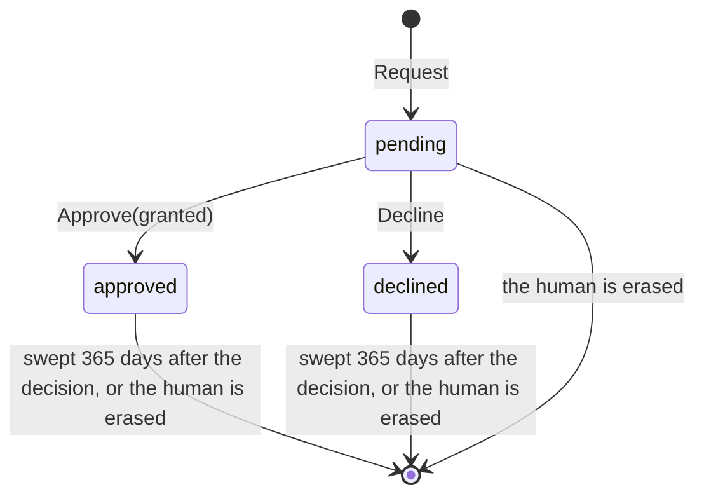
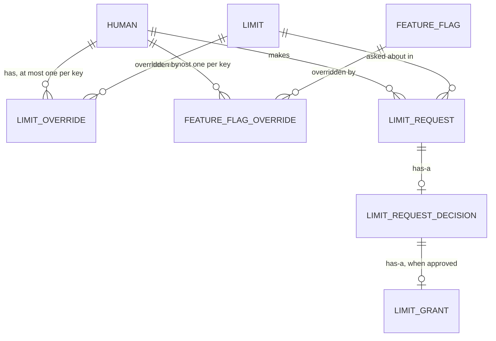
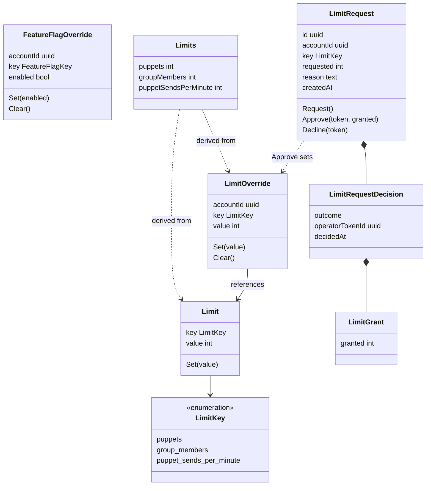

# Limits, account overrides and limit requests

Pass 1, draft. Context: Identity, read by Messaging. Changes [feature flags](feature-flags.md) and [entitlements](entitlements.md); unchanged objects are not repeated. Decision record: [ADR 62](https://github.com/Aeryx-ai/sock-server/blob/main/docs/adr/contract/0062-limits-are-operator-settings-with-account-overrides-and-requests.md).

What changes:

- The launch limits (10 puppets, 20 group members, 60 puppet sends a minute) become operator settings beside feature flags: stored in Postgres, set from the console and `sock-admin`, audited, applied on every replica through `NOTIFY` with no deploy.
- The operator can override any limit or flag for one human. A limit override wins over the platform value, higher or lower. A flag override is for rollout and betas only; it never makes a Basic human entitled to a Pro feature.
- A human can request a higher limit, with a reason. The operator approves with a value they choose, which sets an override, or declines.

## Ubiquitous language

| Term | Meaning | Stored or derived |
|---|---|---|
| Limit key | One of the numbers the hub declares: `puppets`, `group_members`, `puppet_sends_per_minute` | Code and the seed row |
| Platform limit | A limit key's value for every human without an override | Stored (`identity.limits`) |
| Limit override | One human's own value for a limit key | Stored (`identity.limit_overrides`) |
| Effective limit | A human's override when one exists, the platform limit otherwise | Derived |
| Limits | A human's effective limit for every key | Derived |
| Flag override | One human's own value for a feature flag | Stored (`identity.feature_flag_overrides`) |
| Limit request | A human's ask for a higher value of one limit key, with a reason | Stored |
| Limit request decision | The operator's answer: approved with a granted value, or declined | Stored, as its own fact |
| Pending | A limit request with no decision | Derived |

## Domain model

### Identity

#### LimitKey

Enumeration, declared in the hub with a description and a ceiling. A migration seeds each key's platform limit.

| Value | Description | Ceiling |
|---|---|---|
| `puppets` | Unarchived non-system puppets a human owns | 1000 |
| `group_members` | Members of a group | 1000 |
| `puppet_sends_per_minute` | Messages each of the human's puppets sends a minute | 6000 |

The ceiling stops a mistyped value; raising one is a code change. Ceilings are inferred, see open questions.

#### Limit

Entity, aggregate root. One per declared key, created by the migration that declares it.

| Field | Type | Meaning |
|---|---|---|
| `key` | `LimitKey` | Identity |
| `value` | int | The platform limit |

Behaviors:

- `Set(value)` (`SetLimit`): writes the value, records `OperatorAction(setLimit, LimitSet(key, value))` in the same transaction and notifies `limits`. Setting the current value succeeds and is recorded.

Invariants: `value` is between 1 and the key's ceiling. Exactly one row per declared key.

#### LimitOverride

Entity, aggregate root, identified by `(accountId, key)`.

| Field | Type | Meaning |
|---|---|---|
| `accountId` | uuid | The human. Erasing the human deletes the override |
| `key` | `LimitKey` | The limit overridden |
| `value` | int | The human's effective limit for `key`, whatever the platform limit |

Behaviors:

- `Set(value)` (`SetLimitOverride`, and `LimitRequest.Approve`): upserts, records `OperatorAction(setLimitOverride, LimitOverrideSet(accountId, key, value))`, notifies `limits`.
- `Clear()` (`ClearLimitOverride`): deletes, records `OperatorAction(clearLimitOverride, LimitOverrideCleared(accountId, key))`, notifies `limits`. Clearing an absent override succeeds and is recorded.

Invariants: `value` is between 1 and the key's ceiling. `accountId` names a human, not a puppet. At most one per `(accountId, key)`: two would leave the effective limit ambiguous.

Relationships:

| With | Kind | Cardinality |
|---|---|---|
| Human (`Account`) | references | n to 1, at most one per key |
| `Limit` | references | n to 1 |

#### FeatureFlagOverride

Entity, aggregate root, identified by `(accountId, key)`.

| Field | Type | Meaning |
|---|---|---|
| `accountId` | uuid | The human. Erasing the human deletes the override |
| `key` | `FeatureFlagKey` | The flag overridden |
| `enabled` | bool | The flag's value for this human, whatever the platform value |

Behaviors: `Set(enabled)` and `Clear()`, recorded as `setFeatureFlagOverride` and `clearFeatureFlagOverride` and notified on `feature_flags`, as `LimitOverride`.

Invariants: `accountId` names a human. At most one per `(accountId, key)`.

#### FeatureFlag (changed)

- `Enabled(accountId)`: the human's override when one exists, the platform value otherwise. A puppet is evaluated as its owner; an anonymous caller (zero) gets the platform value.

A flag never decides entitlement. `Plan.Includes` ignores flags; a module may still be behind a flag for rollout, and then both must pass.

#### Limits

Value object, derived for one human. Replaces `kernel.LaunchLimits` from [entitlements](entitlements.md).

| Field | Type | Meaning |
|---|---|---|
| `puppets` | int | Effective `puppets` |
| `groupMembers` | int | Effective `group_members` |
| `puppetSendsPerMinute` | int | Effective `puppet_sends_per_minute` |

Read through `Settings.LimitsOf(human)`, which Identity serves from memory (below). Identity's `AdmitPuppet` uses the human's `puppets`. Messaging uses:

- `Conversation.StartGroup`, `AddMember`: the highest `groupMembers` among the group's human members, including the human being added. Inferred, see open questions.
- `Post(puppet sender, ...)`: the owner's `puppetSendsPerMinute`.

#### LimitRequest

Entity, aggregate root. Created by the human, decided once by the operator.

| Field | Type | Meaning |
|---|---|---|
| `id` | uuid (v7) | Identity. Time-ordered, so list order is id order |
| `accountId` | uuid | The requesting human |
| `key` | `LimitKey` | The limit asked about |
| `requested` | int | The value asked for |
| `reason` | text, 1 to 500 characters | What the human needs it for |
| `createdAt` | Timestamp | Database clock at creation |

Behaviors:

- `Request(human, key, requested, reason)` (factory, `RequestLimitIncrease`): refused `FIELD_INVALID` when `requested` is not above the human's effective limit or is above the key's ceiling, or `reason` is out of bounds. Refused `LIMIT_REQUEST_PENDING` when the human has a pending request for `key`.
- `Approve(operatorTokenId, granted)` (`ApproveLimitRequest`): records an approved decision with `granted` and calls `LimitOverride.Set(granted)` in the same transaction. A repeat approve with the same `granted` is a no-op that reports the earlier decision. Refused when a decision exists otherwise.
- `Decline(operatorTokenId)` (`DeclineLimitRequest`): records a declined decision. A repeat decline is a no-op. Refused when approved.

Approve writes two aggregates, the request and the override, in one transaction. Same context, and an approval without its override would tell the human something false.

Invariants:

- At most one pending request per `(accountId, key)`, checked under the human's row lock.
- At most one decision per request.
- `granted` is between 1 and the key's ceiling. It may differ from `requested`: the operator picks.

Relationships:

| With | Kind | Cardinality |
|---|---|---|
| `LimitRequestDecision` | has-a | 1 to 0..1 |
| Human (`Account`) | references | n to 1 |
| `LimitOverride` | references, through `Approve` | n to 0..1 |

States (derived from the decision):



Anything not drawn is refused. A new request for the same key is allowed once the last one is decided.

#### LimitRequestDecision

Entity, owned by `LimitRequest`.

| Field | Type | Meaning |
|---|---|---|
| `outcome` | `approved` or `declined` | The answer |
| `operatorTokenId` | uuid | The verified token that decided |
| `decidedAt` | Timestamp | Database clock |

#### LimitGrant

Value object, owned by an approved `LimitRequestDecision`, absent on a declined one.

| Field | Type | Meaning |
|---|---|---|
| `granted` | int | The value the override was set to |

#### OperatorAction (changed)

`action` gains `setLimit`, `setLimitOverride`, `clearLimitOverride`, `setFeatureFlagOverride`, `clearFeatureFlagOverride`. `target` gains `LimitSet(key, value)`, `LimitOverrideSet(accountId, key, value)`, `LimitOverrideCleared(accountId, key)`, `FlagOverrideSet(accountId, key, enabled)`, `FlagOverrideCleared(accountId, key)`, each present exactly for its action. Approving and declining a request are recorded on the decision, as invite requests are; the approval's override set is a `setLimitOverride` action.

#### Settings (hub, not the model)

The hub keeps platform limits, limit overrides, flags and flag overrides in memory, as flags today: loaded at start, reloaded on each `limits` or `feature_flags` notification and after the listener reconnects. Overrides are operator-set and few, so all of them stay in memory.

Messaging reads `Settings.LimitsOf` through an interface in `kernel` that Identity's cache implements. This is the one place Messaging answers from something other than its own rows: limits are hub configuration, not a fact about a conversation, and a projection would only copy the cache.

### Diagrams





## Configuration

None new. The `limits` listener uses the hub's existing `pgnotify` connection.

## Caller classes

| Class | Authenticates with | Trusted to assert | Never trusted to assert |
|---|---|---|---|
| Human (changed) | As today | A limit key, a value and a reason for their own request | Another human's id; requests are always the caller's own |
| Operator (changed) | `sock_ot_` token, `full` or `read` | A limit key and value, a human's id, a request id and a granted value | Who it is beyond the token |

Puppets and machine keys cannot request limits.

## API

New error reason `LIMIT_REQUEST_PENDING` (`already_exists`): the human has a pending request for this key. `LIMIT_REACHED` and `GROUP_FULL` messages add "request more with `sock limits request`" or the apps' button.

### IdentityService (human)

| RPC | Caller | Authentication | Authorization | Request | Response | Errors | Idempotency | Domain behavior |
|---|---|---|---|---|---|---|---|---|
| `GetMe` (changed) | Human, puppet | As today | Self | none | `limits`: the human's effective limits, or the puppet owner's | none | Read | `Settings.LimitsOf` |
| `RequestLimitIncrease` (new) | Human | Human session | Self | `key` `LimitKey`, `requested` int32, `reason` string | `request` `LimitRequest` | `FIELD_INVALID` (`key`, `requested`, `reason`), `LIMIT_REQUEST_PENDING` | Not idempotent; a retry after success gets `LIMIT_REQUEST_PENDING` | `LimitRequest.Request` |
| `ListMyLimitRequests` (new) | Human | Human session | Self | none | `requests`: the caller's requests, newest first, each with `key`, `requested`, `reason`, `created_at`, `state` (`pending`, `approved`, `declined`), `granted` when approved, `decided_at` when decided | none | Read | none |

### OperatorService

| RPC | Caller | Authz | Request | Response | Errors | Idempotency | Domain behavior |
|---|---|---|---|---|---|---|---|
| `GetLimits` | Operator | `full` or `read` | none | `limits`: every declared key with `description`, `value`, `ceiling`, `last_set` | none | Read | none |
| `SetLimit` | Operator | `full` | `key`, `value` | `limit` | `FIELD_INVALID` (`key` undeclared, `value` out of bounds) | Idempotent; records an action | `Limit.Set` |
| `GetHuman` (changed) | Operator | As today | As today | Adds `limit_overrides` (`key`, `value`) and `flag_overrides` (`key`, `enabled`), and the human's effective `limits` | As today | Read | none |
| `SetLimitOverride` | Operator | `full` | `account_id`, `key`, `value` | `override` | `FIELD_INVALID`, `NOT_FOUND` (not a human) | Idempotent; records an action | `LimitOverride.Set` |
| `ClearLimitOverride` | Operator | `full` | `account_id`, `key` | none | `FIELD_INVALID`, `NOT_FOUND` | Idempotent; records an action | `LimitOverride.Clear` |
| `SetFeatureFlagOverride` | Operator | `full` | `account_id`, `key`, `enabled` | `override` | `FIELD_INVALID`, `NOT_FOUND` | Idempotent; records an action | `FeatureFlagOverride.Set` |
| `ClearFeatureFlagOverride` | Operator | `full` | `account_id`, `key` | none | `FIELD_INVALID`, `NOT_FOUND` | Idempotent; records an action | `FeatureFlagOverride.Clear` |
| `ListLimitRequests` | Operator | `full` or `read` | `state` filter (pending, approved, declined, any), `page_token` | `requests`, each as `ListMyLimitRequests` plus `account_id`, the human's handle and their effective value for the key; `next_page_token` | `FIELD_INVALID` (`page_token`) | Read | none |
| `ApproveLimitRequest` | Operator | `full` | `request_id`, `granted` | `request` | `FIELD_INVALID` (`granted`), `NOT_FOUND`, `CONFLICT` when declined or approved with another value | Idempotent for the same `granted` | `LimitRequest.Approve` |
| `DeclineLimitRequest` | Operator | `full` | `request_id` | `request` | `NOT_FOUND`, `CONFLICT` when approved | Idempotent | `LimitRequest.Decline` |

`GetFeatureFlags` and `SetFeatureFlag` are unchanged.

## Domain events

None. Limits, overrides and requests are Identity's own rows; Messaging reads limits from the in-memory settings, and the `limits` notification is cache invalidation, not an event. The requester learns of a decision from `ListMyLimitRequests` and their new `GetMe.limits`.

## Data layer

Migration `00046_limits.sql`. Next to each table, the query each index serves.

```sql
CREATE TABLE identity.limits (
    key   text    PRIMARY KEY,
        -- the closed set the hub declares; a new key is an INSERT in the
        -- migration that declares it
    value integer NOT NULL CHECK (value >= 1)
        -- the per-key ceiling is in code, beside the key's declaration
);
INSERT INTO identity.limits (key, value) VALUES
    ('puppets', 10), ('group_members', 20), ('puppet_sends_per_minute', 60);

CREATE TABLE identity.limit_overrides (
    account_id uuid    NOT NULL REFERENCES identity.humans (account_id) ON DELETE CASCADE,
    key        text    NOT NULL REFERENCES identity.limits (key) ON DELETE RESTRICT,
    value      integer NOT NULL CHECK (value >= 1),
    PRIMARY KEY (account_id, key)
        -- one override per human per key; serves GetHuman and the cache load
);

CREATE TABLE identity.feature_flag_overrides (
    account_id uuid    NOT NULL REFERENCES identity.humans (account_id) ON DELETE CASCADE,
    key        text    NOT NULL REFERENCES identity.feature_flags (key) ON DELETE RESTRICT,
    enabled    boolean NOT NULL,
    PRIMARY KEY (account_id, key)
);

CREATE TABLE identity.limit_requests (
    id         uuid        PRIMARY KEY,
    account_id uuid        NOT NULL REFERENCES identity.humans (account_id) ON DELETE CASCADE,
    key        text        NOT NULL REFERENCES identity.limits (key) ON DELETE RESTRICT,
    requested  integer     NOT NULL CHECK (requested >= 1),
    reason     text        NOT NULL CHECK (char_length(reason) BETWEEN 1 AND 500),
    created_at timestamptz NOT NULL DEFAULT now()
);
CREATE INDEX limit_requests_account_idx ON identity.limit_requests (account_id, key, id DESC);
    -- serves the pending check and ListMyLimitRequests

CREATE TABLE identity.limit_request_outcomes (name text PRIMARY KEY);
INSERT INTO identity.limit_request_outcomes (name) VALUES ('approved'), ('declined');

CREATE TABLE identity.limit_request_decisions (
    request_id        uuid        PRIMARY KEY REFERENCES identity.limit_requests (id) ON DELETE CASCADE,
        -- at most one decision per request
    outcome           text        NOT NULL REFERENCES identity.limit_request_outcomes (name) ON DELETE RESTRICT,
    operator_token_id uuid        NOT NULL,
        -- no FK, as operator_actions has none
    decided_at        timestamptz NOT NULL DEFAULT now()
);
CREATE INDEX limit_request_decisions_outcome_idx ON identity.limit_request_decisions (outcome, decided_at);
    -- serves ListLimitRequests' state filter and the decided sweep

CREATE TABLE identity.limit_grants (
    request_id uuid    PRIMARY KEY REFERENCES identity.limit_request_decisions (request_id) ON DELETE CASCADE,
    granted    integer NOT NULL CHECK (granted >= 1)
);
```

A deferred constraint trigger keeps `limit_grants` in step with `limit_request_decisions`: a grant exactly when the outcome is `approved`.

Audit: five `operator_action_kinds` and one target table each, `operator_action_limits (action_id, key, value)`, `operator_action_limit_overrides (action_id, account_id, key, value)`, `operator_action_limit_override_clears (action_id, account_id, key)`, `operator_action_flag_overrides (action_id, account_id, key, enabled)`, `operator_action_flag_override_clears (action_id, account_id, key)`. `account_id` carries no FK and is indexed for `Account.Erase`, as `operator_action_reinstatements`. `identity.assert_action_target` gains their counts.

`messaging.puppet_send_buckets`: the `CHECK` becomes `millitokens >= 0`; the cap is the owner's effective rate, applied in code. This replaces the narrowing in [entitlements](entitlements.md)' `00045`.

The decided sweep deletes requests 365 days after their decision, beside the invite request sweep.

## Console

- Limits tab beside Flags: one row per key with description, value, ceiling and last set; editing asks for confirmation.
- Limit requests tab: pending first, each with the human, key, current and requested values and reason; Approve opens a value field prefilled with `requested`; Decline asks for confirmation.
- Human page: the effective limits, each override with Clear, and Add override for a limit or a flag.

## sock-admin

| Command | RPC |
|---|---|
| `sock-admin limits list` | `GetLimits` |
| `sock-admin limits set <key> <value>` | `SetLimit` |
| `sock-admin overrides set <human> <key> <value>` and `clear <human> <key>` | `SetLimitOverride`, `SetFeatureFlagOverride` by key kind, and the clears |
| `sock-admin limit-requests list [--state]`, `approve <id> [--granted N]`, `decline <id>` | `ListLimitRequests`, `ApproveLimitRequest`, `DeclineLimitRequest` |

Writes confirm on a terminal; `--yes` off one.

## Apps, CLI and web inbox

- `sock limits` shows effective limits and the caller's requests. `sock limits request <key> <value> --reason "..."` calls `RequestLimitIncrease`.
- Apps' Settings show limits with Request more, opening a value and reason form; the same from a `LIMIT_REACHED` or `GROUP_FULL` alert.

## Threats

| Threat | Mitigation |
|---|---|
| Request spam | One pending request per key, three keys, reason capped at 500 characters, human callers only, behind the human rate limit |
| A mistyped limit or grant | The per-key ceiling, the console's and `sock-admin`'s confirmation, and the audit |
| A flag override used to give away a Pro feature | `Plan.Includes` never reads flags |
| A stale replica enforcing an old limit | Bounded by the listener's reconnect, as flags |
| An override outliving its reason | Visible on the human's page and in the audit; cleared by the operator |

## Cross-check

| Transition | API | Event | DDL |
|---|---|---|---|
| `Limit.Set` | `SetLimit` | none: invalidation | `limits` update, audit insert |
| `LimitOverride.Set`, `Clear` | `SetLimitOverride`, `ClearLimitOverride`, `ApproveLimitRequest` | none | `limit_overrides` upsert or delete, audit insert |
| `FeatureFlagOverride.Set`, `Clear` | `SetFeatureFlagOverride`, `ClearFeatureFlagOverride` | none | `feature_flag_overrides`, audit insert |
| `LimitRequest.Request` | `RequestLimitIncrease` | none | `limit_requests` insert |
| `LimitRequest.Approve` | `ApproveLimitRequest` | none | `limit_request_decisions`, `limit_grants`, `limit_overrides` in one transaction |
| `LimitRequest.Decline` | `DeclineLimitRequest` | none | `limit_request_decisions` |
| Effective limit read | `GetMe`, `CreatePuppet`, `UnarchivePuppet`, `CreateGroup`, `AddMember`, `Send` | none | Memory, loaded from the tables above |
| Human erased | Existing | Existing | `ON DELETE CASCADE` into overrides and requests; `Account.Erase` deletes the audit rows naming the human |
| Decided request swept | none | none | `limit_requests` delete, cascading |

## Decided in pass 1

- Limits are their own settings beside flags, sharing the shape.
- A limit override wins over the platform value, higher or lower.
- The operator picks the granted value.
- Flag overrides are for rollout and betas, never entitlement.

## Open questions

- A group's limit: the highest among its human members (above) or the creator's. Groups have no owner today.
- Ceilings of 1000, 1000 and 6000 a minute.
- Whether a human waits after a decline before asking again for the same key.
- Whether the requester gets an email when a request is decided.
- Whether puppets get their own overrides (one busy puppet's send rate) or only their owner.
