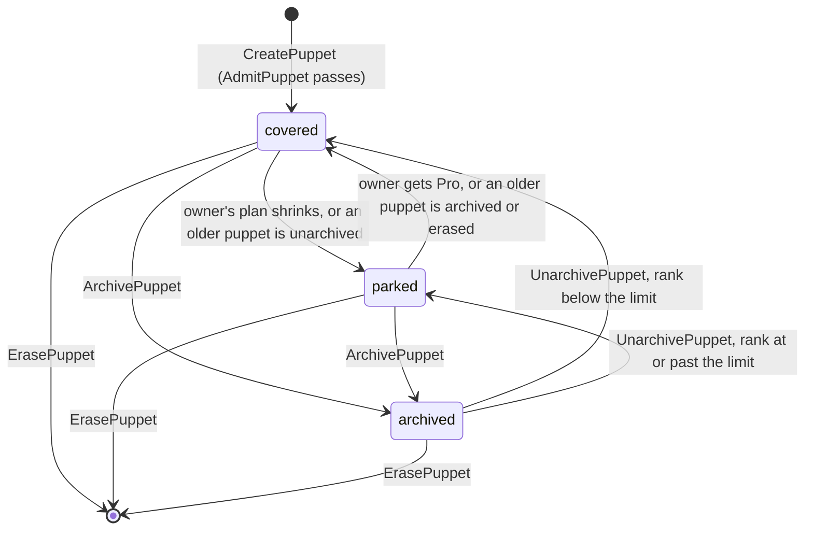
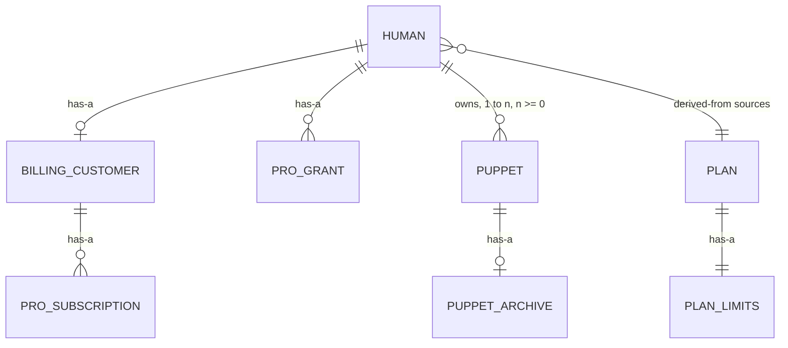

# Plans: Basic free forever, Pro for more

Pass 1, draft for approval. Contexts: Identity, Messaging. Changes [Sock Pro billing](sock-pro-billing.md) and [domain-model](domain-model.md); unchanged objects are not repeated.

What changes:

- Every human has a plan: Basic, free forever, or Pro, while any Pro source is active. Pro is still sold through Stripe and granted by the operator.
- Basic owns up to 5 working puppets, groups up to 20 members and today's send rates. Pro raises those limits.
- When a human has more unarchived puppets than their plan allows, the oldest ones by creation keep working and the rest are parked: their tokens are refused and they count for nothing in a conversation, until the owner archives or erases one, or gets Pro.
- The 7-day trial and its reminder email are gone. Basic is the trial.
- Humans are not metered. Machine keys, tokens per puppet and sessions keep their caps of 10 on both plans.
- Server-side history is a Pro capability with its own spec; nothing here builds it.

## Ubiquitous language

| Term | Meaning | Stored or derived |
|---|---|---|
| Plan | What a human's account allows: Basic or Pro | Derived: Pro while `ProActiveUntil()` is after now, Basic otherwise |
| Basic | The free plan every human has without a Pro source | Derived |
| Pro (Sock Pro) | The paid plan. Unchanged sources: a subscription or an operator grant | Derived from stored sources |
| Plan limits | The numbers a plan allows: puppets, group members, puppet send rate | Constants in the hub, per plan |
| Puppet rank | A puppet's position among its owner's unarchived, non-system puppets, oldest first by account id (account ids are UUIDv7, so creation order) | Derived |
| Parked puppet | An unarchived puppet whose rank is at or past its owner's plan's puppet limit (*inferred term, to confirm*) | Derived at each check |
| Covered puppet | A puppet that is not parked | Derived |
| Active puppet (changed) | A system puppet, or a covered puppet not archived, neither it nor its owner suspended | Derived at post time in Messaging |

Removed: Trial, Trial reminder.

## Domain model

### Identity

#### Plan

Enumeration: `basic`, `pro`. Derived per human, never stored.

#### PlanLimits

Value object, one constant per plan, in the hub's domain package. Constructor refuses a limit below 1.

| Field | Type | Basic | Pro |
|---|---|---|---|
| `puppets` | int | 5 | *open* |
| `groupMembers` | int | 20 | *open* |
| `puppetSendsPerMinute` | int | 60 | *open* |

Owner-direct limits (ADR 50) scale with `puppetSendsPerMinute` by the same factor as today: *open* whether they rise on Pro.

#### Account (changed behaviors and invariants)

Changed behaviors:

- `Plan()` (humans): `pro` while `ProActiveUntil()` is after now, or while `SOCK_PRO_REQUIRED` is off; `basic` otherwise.
- `ProActiveUntil()` (humans): the latest of every subscription's `activeUntil` and every unrevoked grant's `endsAt`. The trial term is gone.
- `AdmitPuppet()` (humans, replaces `PassProGate()` on `CreatePuppet` and consent's Allow): refuses `LIMIT_REACHED` when the human already has `Plan().puppets` unarchived non-system puppets. Starts nothing.
- `Covers(puppet)` (humans, replaces `PassProGate()` on `MintPuppetToken`, `IssueConnectorPuppetToken` and every call made with a puppet token): true for a system puppet, otherwise when the puppet's rank is below `Plan().puppets`. An archived puppet has no rank and is not covered; archived puppets already refuse their tokens' sends. Refusal is `SUBSCRIPTION_REQUIRED`.
- `MintMachineKey`: no longer gated by plan.
- `UnarchivePuppet`: never refused for the plan. The unarchived puppet takes its creation rank back, which can park a newer one (see open questions).

Removed: `PassProGate()`, the `ProTrial` and `TrialReminder` objects, `trial_available`.

New invariant:

- A human's covered puppets are their oldest `Plan().puppets` unarchived non-system puppets. Not stored: derived at every check from the puppets, their archives and the Pro sources, so a lapse, a grant, an archive or an erasure moves coverage with no write and no clock job.

#### Puppet states (changed)

`covered` and `parked` are derived, not stored; `archived` is the existing archive row. Anything not drawn is refused.

### Messaging

#### Participant (changed)

The puppet's rank among its owner's puppets is read from `messaging.puppets` and `messaging.puppet_archives`, which Messaging already holds; the owner's plan from `ProEntitlement(activeUntil)`. No new projection.

#### RecipientPolicy (changed)

A puppet member is active only when covered, by the same rule as `Account.Covers`, answered from Messaging's own rows. The rule lives once, in the domain package both stores call; each store supplies its own rows.

#### Conversation (changed behaviors)

- `StartGroup(creator, members)` and `AddMember(...)`: refuse `GROUP_FULL` past the group's member limit: Pro's `groupMembers` while any human member's `ProEntitlement.activeUntil` is after now, Basic's otherwise (*inferred, to confirm*). Never removes members: a group already past the limit stays and refuses adds.
- `Post(puppet sender, ...)`: the send bucket refills at the owner's plan's `puppetSendsPerMinute`.

### Diagrams

## Configuration

| Variable | Meaning |
|---|---|
| `SOCK_PRO_REQUIRED` | Changed: off, every human is on Pro (beta: nothing parks, no limit changes). `true`: plans apply |

Removed: `SOCK_BILLING_MAIL_FROM` (the reminder was its only sender).

## Caller classes

Unchanged. No class gains or loses an endpoint.

## API

`SUBSCRIPTION_REQUIRED` now means the puppet is parked: its owner's plan does not cover it. `LIMIT_REACHED` gains `CreatePuppet` and consent past the plan's puppet limit; its message names the limit. `GROUP_FULL` now means the group is at its plan's member limit.

### Identity RPCs (IdentityService)

| RPC | Caller | Authentication | Authorization | Request | Response | Errors | Idempotency | Domain behavior |
|---|---|---|---|---|---|---|---|---|
| `GetMe` (changed) | Human, puppet | As today | Self | none | Adds `plan` `Plan` (`PLAN_BASIC`, `PLAN_PRO`) and `limits` `PlanLimits{puppets, group_members, puppet_sends_per_minute}`, the human's or the puppet owner's. `trial_available` is always false and `PRO_SOURCE_TRIAL` never sent (kept for wire compatibility) | none | Read | none: reads `Account.Plan()` |
| `CreatePuppet` (changed) | Human, machine key | As today | As today, the Pro clause now `Account.AdmitPuppet()` | As today | As today | Adds `LIMIT_REACHED`; `SUBSCRIPTION_REQUIRED` no longer returned | As today | `Account.AdmitPuppet()`, then as today |
| `ListPuppets` (changed) | Human, machine key | As today | As today | As today | Each `Puppet` gains `parked` bool | As today | Read | none: reads `Account.Covers` per puppet |
| `MintPuppetToken`, `IssueConnectorPuppetToken` (changed) | As today | As today | As today, the Pro clause now `Account.Covers(puppet)` | As today | As today | `SUBSCRIPTION_REQUIRED` when parked | As today | `Account.Covers(puppet)`, then as today |
| `MintMachineKey` (changed) | Human | As today | As today, no plan clause | As today | As today | `SUBSCRIPTION_REQUIRED` no longer returned | As today | As today |
| `UnarchivePuppet` (changed) | Human, machine key | As today | As today | As today | As today | As today | As today | As today; may park a newer puppet, emits `PuppetArchiveChanged` as today |
| Every RPC called with a puppet token (changed) | Puppet | `sock_pt_` | The auth interceptor's Pro clause becomes `Account.Covers(puppet)`. An open `Subscribe` re-checks at each heartbeat and ends `SUBSCRIPTION_REQUIRED` once parked | As today | As today | `SUBSCRIPTION_REQUIRED` when parked | As today | `Account.Covers(puppet)` |

OAuth consent's Allow (ADR 11), when it creates a puppet: `Account.AdmitPuppet()`, refusing with the consent page's limit message.

### Messaging RPCs (MessagingService, changed)

| RPC | Caller | Authentication | Authorization | Request | Response | Errors | Idempotency | Domain behavior |
|---|---|---|---|---|---|---|---|---|
| `CreateGroup`, `AddMember` | Human | As today | As today, and the member count within the group's limit | As today | As today | `GROUP_FULL` at the plan's limit | As today | `Conversation.StartGroup`, `Conversation.AddMember` |
| `Send` | Human, puppet | As today | As today; the active-puppet rule now counts only covered puppets | As today | As today | As today | As today | `Conversation.Post`, consulting `RecipientPolicy` |
| `ListConversations` | Human, puppet | As today | As today | As today | `humans_can_post` follows the changed active-puppet rule | none | Read | none |

### Operator RPCs

`GetHuman`: `trial` is always absent. Otherwise unchanged.

## Domain events

| Event | Emitting aggregate | Transition | Payload | Consumers | Delivery | Boundary | Domain service |
|---|---|---|---|---|---|---|---|
| `ProEntitlementChanged` (changed) | Account | As today, less the trial start | Unchanged | Messaging: unchanged upsert, which now also moves its puppets' coverage and its groups' limits | Unchanged | Published | none |
| `PuppetArchiveChanged` | Account | Unchanged | Unchanged | Messaging: unchanged, which now also moves the owner's other puppets' coverage | Unchanged | Published | none |

No new event. Coverage is derived from rows both contexts already hold, at read time, so nothing is projected for it. A grant or subscription ending needs no event, as today.

## Data layer

Migration `00042_plans.sql`.

- Drops `identity.trial_reminders` and `identity.pro_trials`. Production holds no rows: the gate has been off, and it starts no trial while off.
- `CREATE INDEX puppets_owner_rank ON identity.puppets (owner_id, account_id)`: serves `Covers`' rank count (`owner_id = $1 AND account_id < $2`, excluding archived).
- `CREATE INDEX puppets_owner_rank ON messaging.puppets (owner_id, account_id)`: serves the same count in the active-puppet rule.
- `messaging.puppet_send_buckets.millitokens`: the `CHECK (millitokens BETWEEN 0 AND 60000)` widens to Pro's `puppetSendsPerMinute` x 1000 once that is decided.

No other table changes. Every new fact is derived.

## Apps, CLI and website

- Apps' Settings show the plan and its limits from `GetMe`, and parked puppets in the puppet list with "Parked: Basic covers your 5 oldest puppets". `parked` comes from `ListPuppets`, which apps call at stream open and after a `PuppetArchive` event; a plan change mid-stream shows at the next open.
- The CLI's `sock puppets list` marks parked puppets; `SUBSCRIPTION_REQUIRED` reads "this puppet is parked: archive another or get Sock Pro".
- Website: concepts doc's Sock Pro section rewritten for plans; a pricing section on `/download` or its own page.
- Terms and privacy: the privacy policy drops the trial and Apple purchase rows; the terms gain plans when Pro is enforced.

## Cross-check

| Transition | API | Event | DDL |
|---|---|---|---|
| Puppet created | `CreatePuppet`, consent | `PuppetCreated` (existing) | `identity.puppets` |
| Puppet parked or covered | Read through `Covers` on every puppet-token call and `ListPuppets` | none: derived, recorded here | Indexes above |
| Plan changes | `StartCheckout`, webhook, `GrantPro`, `RevokeProGrant` (existing) | `ProEntitlementChanged` | Existing source tables |
| Group past its limit | `CreateGroup`, `AddMember` | none: refusal only | none: count of members |

## Open questions

- Pro's limits: puppets, group members, send rate. Proposal to react to: 50 puppets, 100 members, 300 sends a minute.
- Whether owner-direct limits rise on Pro.
- Price: $14.99 a month and $149.99 a year were set for "Pro gates all puppets". Unchanged unless decided.
- Whose plan sets a group's limit. Drafted: Pro's while any human member has Pro. Alternatives: the creator's plan, or the plan of whoever adds.
- Unarchiving an older puppet parks the newest covered one. For the Claude Code plugin, which archives at session end and unarchives at resume, resuming an old session can park the running one. Alternative: rank by when the puppet last became unarchived, which needs that time stored.
- Whether a suspended puppet takes a slot. Drafted: yes, it stays unarchived.
- "Parked" as the user-facing word.
- Hosted agents (connectors): drafted as counting toward the puppet limit on both plans, with no separate Pro gate.
- Server-side history: its own spec, after this one.
