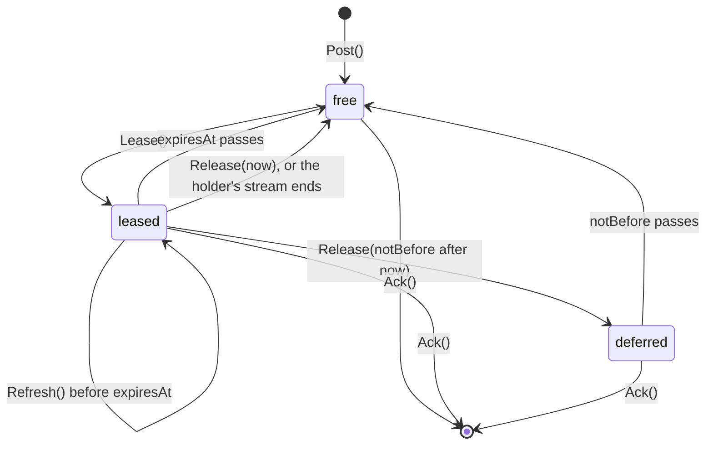
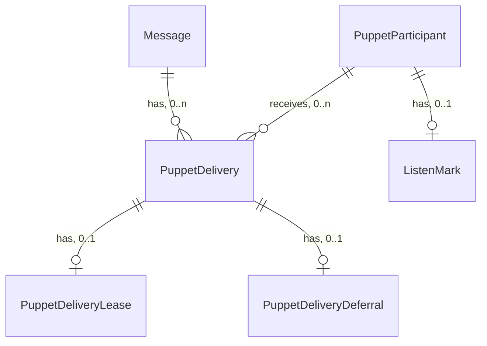

# Puppet inbound: delivery leases and listening

Pass 1, approved 2026-11-10. Context: Messaging. Builds on [domain-model](domain-model.md) (`Message`, `PuppetDelivery`, `Participant`), [api](api.md) (`Subscribe`, `FetchPending`, `Ack`) and [events](events.md).

The guarantee: a message delivered to a puppet is taken by one live consumer of that puppet, or the puppet's owner can see that nothing has listened for it since a stated time, at most 75 seconds after the last consumer stopped.

What changes:

- The hub leases a puppet delivery to the one consumer it hands it to: a `Subscribe` stream holds it while the stream lives, a `FetchPending` call for 5 minutes. No other consumer of the puppet is handed a leased delivery. Several consumers of one puppet become active and standby instead of each handling every message.
- A consumer that cannot handle a message gives it back with `Release`, now or after a delay, instead of leaving it unacked on a live stream where nothing hands it out again.
- The hub records when it last heard from each puppet's consumers. The owner gets that time with each conversation the puppet is in and live on their streams, and show "no agent listening since 14:02" once it is older than 75 seconds.

Human deliveries (`DeviceDelivery`, `AccountDelivery`) are unchanged.

## Ubiquitous language

| Term | Meaning | Stored or derived |
|---|---|---|
| Consumer | A `Subscribe` stream opened with one of a puppet's tokens, or one `FetchPending` call made with one | Not stored: a stream is in a replica's memory, a fetch is one request |
| Holder id | The id the hub gives one consumer: a random UUID per stream at open, per `FetchPending` call | Stored on its leases |
| Lease | The fact that one consumer holds a puppet delivery until a time; while live, the hub hands that delivery to no other consumer | Stored (`messaging.puppet_delivery_leases`) |
| Live lease | A lease whose `expiresAt` is after now | Derived |
| Free delivery | A puppet delivery with no live lease and no live deferral: the next consumer to read is handed it | Derived |
| Release | A consumer's giving a delivery back, now or not before a time, without acking it | Not stored: removes the lease, may write a deferral |
| Deferral | The fact that a released delivery is handed to no consumer before a time | Stored (`messaging.puppet_delivery_deferrals`) |
| Heard | The hub received a stream open, a stream heartbeat or a `FetchPending` from one of the puppet's tokens | Stored as the latest time (`messaging.puppet_listen_marks`) |
| Listening | The puppet was heard within the last 75 seconds | Derived, by the hub and by clients, from `lastHeardAt` |

Terms not changed: Delivery, Ack, Message mean what [domain-model](domain-model.md) says. "Activity" (`SetActivity`, working on a reply) is a separate thing: a puppet can be listening and idle, or have no consumer and still show `WORKING` until its 30 s expiry.

## Domain model

Changes to [domain-model](domain-model.md). Unchanged objects are not repeated.

### Message (changed)

Entity, aggregate root, as today. New behaviors, puppet deliveries only:

- `Lease(puppetId, holderId, until)`: writes a lease on the puppet's delivery when the delivery is free; replaces an expired lease and deletes a passed deferral in doing so. Returns whether this holder now holds it. A delivery with a live lease or a live deferral is refused (returns false, changes nothing).
- `Refresh(holderId, until)`: moves `expiresAt` of this holder's live lease to `until`. Refuses an expired lease: once expired the delivery may already be another holder's.
- `Release(puppetId, notBefore)`: deletes the lease, whoever holds it, and when `notBefore` is after now writes a deferral. A no-op for an acked delivery.
- `Ack(recipient)`: unchanged. Deleting the puppet delivery deletes its lease and deferral with it, whichever token acks.

Invariants:

- A puppet delivery has at most one lease and at most one deferral, and never both live at once.
- A delivery is handed to a consumer only by a `Lease` that returned true for that consumer's holder id.
- A lease never outlives its delivery.

Transactions: a stream's heartbeat refreshes all of its holder's leases in one statement, and a stream's end deletes them in one. These touch many `Message` aggregates in one transaction. Inferred, to confirm: allowed because no invariant spans them; each row's change is its own message's `Refresh` or `Release`, batched for cost, and a partial failure leaves each message valid.

#### PuppetDeliveryLease

Value object, owned by the `PuppetDelivery` of one `Message`, 0 or 1.

| Field | Type | Meaning |
|---|---|---|
| `puppetId` | UUID | The puppet whose delivery it is. With `messageId`, the identity of the row |
| `messageId` | UUID | The message |
| `holderId` | UUID | The consumer holding it: a stream's holder id or a `FetchPending` call's |
| `leasedAt` | Timestamp | Server clock when this holder took it |
| `expiresAt` | Timestamp | Live until then. A stream lease: 75 s after its last refresh. A fetch lease: 5 minutes after `leasedAt` |

Relationships: `PuppetDelivery` has-a `PuppetDeliveryLease`, 1 to 0..1. `holderId` references no stored object.

#### PuppetDeliveryDeferral

Value object, owned by the `PuppetDelivery` of one `Message`, 0 or 1.

| Field | Type | Meaning |
|---|---|---|
| `puppetId` | UUID | As the lease |
| `messageId` | UUID | As the lease |
| `notBefore` | Timestamp | No consumer is handed the delivery before this time. After it the row is inert and the next `Lease` deletes it |

Relationships: `PuppetDelivery` has-a `PuppetDeliveryDeferral`, 1 to 0..1.

#### PuppetDelivery states



Anything not drawn is refused. `Expire` and erasure delete the delivery in any state, as today.

### Participant (changed)

Puppet participants gain one owned value object.

#### ListenMark

Value object, owned by a puppet `Participant`, 0 or 1.

| Field | Type | Meaning |
|---|---|---|
| `puppetId` | UUID | The puppet. Identity of the row |
| `lastHeardAt` | Timestamp | The latest server time a consumer of the puppet was heard |

No row: no consumer has ever been heard for this puppet, which clients show as "no agent has connected yet".

Behavior on `Participant`: `Hear(at)`: writes the mark, or moves `lastHeardAt` to `at` when later; never moves it back. Returns whether the puppet went from not listening (no row, or `lastHeardAt` 75 s or more before `at`) to listening, which is when `PuppetHeard` is emitted.

Relationships: puppet `Participant` has-a `ListenMark`, 1 to 0..1.



## Caller classes

Unchanged from [api](api.md). Puppet: any of a puppet's tokens (`sock_pt_`, the connector device included). Human: a session. A machine key reaches none of the RPCs below.

## API contract

| RPC | Caller | Authorization | Request | Response | Errors | Idempotency | Domain behavior |
|---|---|---|---|---|---|---|---|
| `Subscribe` (changed) | Human, puppet | As today | As today | As today. A puppet stream is sent only deliveries it leased. A human stream also receives `PuppetHeard` events (below) | As today | Read, except that a puppet stream takes leases. A puppet stream ending, for any reason the replica observes, deletes its leases, so a reconnecting consumer is handed them at once | Puppet: `Participant.Hear` at open and at each heartbeat; at open and at each heartbeat, and on each `MessagePosted` or `DeliveryReleased` wake for the puppet, `Message.Lease(puppet, holderId, now + 75 s)` for each free delivery oldest first, sending those it took; `Message.Refresh` of its leases at each heartbeat |
| `FetchPending` (changed) | Human, puppet | As today | As today | Human: as today. Puppet: only the free deliveries this call leased, oldest first | As today | Puppet: not a read. Calling again within 5 minutes without acking does not return the same messages; `Release` makes them free at once | Puppet: `Participant.Hear`, then `Message.Lease(puppet, callId, now + 5 min)` per free delivery up to `limit` |
| `Ack` (changed) | Human, puppet | As today | As today | As today | As today | As today. A puppet's ack deletes the delivery whichever of its tokens or consumers holds the lease | `Message.Ack`; the lease and deferral go with the delivery |
| `Release` (new) | Puppet | Own deliveries only: ids that are not the calling puppet's deliveries are ignored, as `Ack` ignores them | `message_ids` (1 to 500), `retry_after_seconds` (0 to 3600; 0 frees them now) | none | `FIELD_INVALID` (no ids, more than 500, a malformed id, `retry_after_seconds` out of range), `CALLER_NOT_ALLOWED` (a human, a machine key), `SUBSCRIPTION_REQUIRED` (as every puppet RPC) | Idempotent: releasing again rewrites the same deferral end relative to now; unknown or acked ids are ignored | `Message.Release(puppet, now + retry_after)` per id; emits `DeliveryReleased` when it freed any delivery now |
| `ListConversations` (changed) | Human, puppet | As today | As today | Each `Conversation` gains `puppets_heard`: one `PuppetHeard` per puppet member the caller owns that has a `ListenMark`, for human callers only. Other humans' puppets are never listed. An owned puppet member without one is absent: never heard | As today | Read | none (read) |

`Release` is terms-exempt and draws from no bucket, as `Ack`: it moves nothing to anyone.

### Proto delta (additive)

```proto
service MessagingService {
  // Give puppet deliveries back unacked: free now, or no consumer is
  // handed them before retry_after_seconds. Puppet tokens only.
  rpc Release(ReleaseRequest) returns (ReleaseResponse) {}
}

message ReleaseRequest {
  // 1 to 500 message ids. Unknown, acked or other recipients' ids are ignored.
  repeated string message_ids = 1;
  // 0 to 3600. 0 frees them at once.
  int32 retry_after_seconds = 2;
}
message ReleaseResponse {}

// When the hub last heard from a consumer of a puppet: a Subscribe stream
// open or heartbeat, or a FetchPending. Clients show the puppet as not
// listening once last_heard_at is 75 s or more in the past.
message PuppetHeard {
  string puppet_id = 1;
  google.protobuf.Timestamp last_heard_at = 2;
}

// Conversation gains: repeated PuppetHeard puppets_heard = 6;
// SubscribeResponse.event gains: PuppetHeard puppet_heard = 6;
```

## Events

| Event | Emitting aggregate | Transition | Payload | Consumers | Delivery | Published or internal | Cross-aggregate rule |
|---|---|---|---|---|---|---|---|
| `PuppetHeard` | Participant (puppet) | `Hear` when the puppet goes from not listening to listening. Never on a refresh of a listening puppet | `puppet_id` UUID, `last_heard_at` Timestamp | Stream wake: `pg_notify('puppet_heard', payload)` in the same transaction; each replica writes a `PuppetHeard` event to the open `Subscribe` streams of the puppet's owner's human devices. Not an outbox row: `ListConversations` at stream open is the reconciliation | At most once, a hint | Internal; the stream event is the published form, additive | none: a stream write to the owner, as for `PuppetArchive` |
| `DeliveryReleased` | Message | `Release` that freed at least one delivery now | `puppet_id` UUID | Stream wake: `pg_notify('deliveries_released', puppet_id)` in the same transaction; each replica re-reads free deliveries for that puppet's open streams | At most once; a lost wake delays the hand-out to the next heartbeat, at most 30 s | Internal | none |

Going from listening to not listening emits nothing: it happens by time passing, and every client derives it from `lastHeardAt`. A lease expiring and a deferral passing emit nothing either: each puppet stream re-reads free deliveries at its heartbeat, so the hand-out waits at most 30 s.

## Data contract

```sql
-- One per puppet delivery a consumer holds. Serves the hand-out (free
-- deliveries of a puppet, joined on the PK) and Ack's cascade.
CREATE TABLE messaging.puppet_delivery_leases (
    puppet_id  uuid        NOT NULL,
    message_id uuid        NOT NULL,
    holder_id  uuid        NOT NULL,
        -- the stream's or FetchPending call's id; references nothing stored
    leased_at  timestamptz NOT NULL DEFAULT clock_timestamp(),
    expires_at timestamptz NOT NULL,
    PRIMARY KEY (puppet_id, message_id),
    FOREIGN KEY (puppet_id, message_id)
        REFERENCES messaging.puppet_deliveries (puppet_id, message_id) ON DELETE CASCADE,
    CHECK (expires_at > leased_at)
);
CREATE INDEX puppet_delivery_leases_holder_idx
    ON messaging.puppet_delivery_leases (holder_id);
    -- serves a stream's heartbeat refresh and the delete when it ends

-- One per released delivery waiting out its retry_after.
CREATE TABLE messaging.puppet_delivery_deferrals (
    puppet_id  uuid        NOT NULL,
    message_id uuid        NOT NULL,
    not_before timestamptz NOT NULL,
    PRIMARY KEY (puppet_id, message_id),
        -- serves the hand-out's exclusion of deferred deliveries
    FOREIGN KEY (puppet_id, message_id)
        REFERENCES messaging.puppet_deliveries (puppet_id, message_id) ON DELETE CASCADE
);

-- One per puppet ever heard. Serves ListConversations' puppets_heard and
-- Hear's transition check.
CREATE TABLE messaging.puppet_listen_marks (
    puppet_id     uuid        PRIMARY KEY
        REFERENCES messaging.puppets (account_id) ON DELETE CASCADE,
    last_heard_at timestamptz NOT NULL
);
```

STORE-ENFORCED, not by a constraint: a delivery is never both leased and deferred live. `Lease` and `Release` each lock the `puppet_deliveries` row (`FOR UPDATE`) before touching either table, so they serialize per delivery; `Lease` refuses when a live deferral exists and `Release` deletes the lease before writing the deferral.

No sweep: an expired lease or a passed deferral is replaced or deleted by the next `Lease`, and every row goes with its delivery. A dead holder's rows are only ever as many as the deliveries it held.

The hand-out, per puppet, oldest first by `(conversation_id, seq)` as today: deliveries of the puppet with no lease or an expired one, and no deferral or a passed one, then `Lease` on each with `ON CONFLICT (puppet_id, message_id) DO UPDATE ... WHERE expires_at <= now()` returning the rows this holder took. The existing `puppet_deliveries` PK and the two new PKs serve it.

## Cross-check

| Transition | API | Event | Data |
|---|---|---|---|
| `Message.Lease` | `Subscribe` (puppet), `FetchPending` (puppet) | none: the consumer that took it is the only one told | `puppet_delivery_leases` upsert; `puppet_delivery_deferrals` delete of a passed row |
| `Message.Refresh` | `Subscribe` heartbeat | none: nothing reacts | `puppet_delivery_leases.expires_at` |
| `Message.Release` | `Release`; a puppet stream ending (lease delete only) | `DeliveryReleased` when freed now; none for a stream's end, whose leases are re-read at the other streams' next heartbeat | `puppet_delivery_leases` delete, `puppet_delivery_deferrals` upsert |
| `Message.Ack` (puppet) | `Ack` | none, as today | `puppet_deliveries` delete, cascading |
| `Participant.Hear` | `Subscribe` (puppet open, heartbeat), `FetchPending` (puppet) | `PuppetHeard` on not listening to listening | `puppet_listen_marks` upsert with `GREATEST` |

## Consumers

- `sock listen` (cli): after the last exec attempt fails, `Release` with `retry_after_seconds` 60, then go on to the next message. Fixes `sock-cli-5ga`. Closes its stream on exit so its leases free at once.
- go-sdk `Client.Listen`: unchanged. A handler failure already ends the stream attempt, which frees its leases, and the message comes back first after the reconnect backoff.
- sock-mcp Claude and Codex inbound: an inbox or `turn/start` failure after its retries calls `Release` with 60; so does `NotLoaded`. No consumer calls `Release(0)` on a stream it keeps: the release wakes that stream, which takes the message straight back.
- sock-runner, sock-bridge, sock-http: unchanged; exit 1 reaches `Release` through `sock listen`.
- sock-mcpd: unchanged. A refusing webhook ends the stream attempt, which frees its leases, and keeps the fan-out in order ([connector](https://github.com/aeryx-ai/sock-integrations/blob/main/docs/specs/connector.md)).
- Apple app, desktop and webui: in a conversation with a puppet the human owns, show "no agent listening since <time>" when its `last_heard_at` is 75 s or more old, and "no agent has connected yet" when it has none, above the composer, rechecked each heartbeat. Reconcile from `ListConversations` at stream open, then apply `PuppetHeard` events.

## Rollout and compatibility

Additive on the wire. Server first; old clients keep working:

- A single consumer sees no change, except that a failed message stays leased to its live stream as it stays unhandled today, until the stream ends or the client releases it.
- Two consumers of one puppet stop both receiving every message: the first stream to read takes them and the second gets the rest when the first ends.
- A puppet calling `FetchPending` twice without acking no longer gets the same messages back within 5 minutes.

## Open questions

- Decided: the 75 s listening window and stream lease (2.5 heartbeats, so one lost heartbeat does not show a live agent as gone) and the 5-minute fetch lease, to start.
- Decided: only the owner sees `last_heard_at`. Another human in a group with the puppet sees nothing new.
- Undecided: whether `ListPuppets` carries `last_heard_at` for the owner's puppets that are in no conversation yet. It would make Identity read a Messaging row.
- Out of scope, recorded as decision A2 not taken: telling the human when a taken message got no reply within a time.
