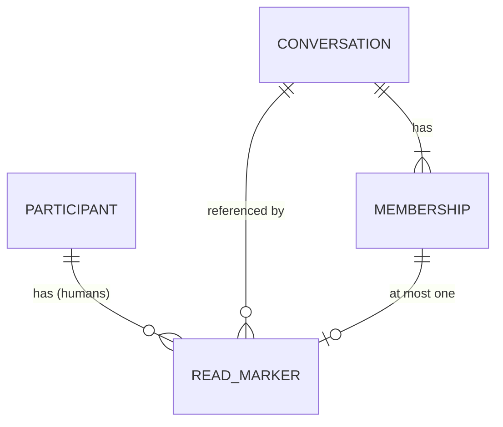

# Read markers

Pass 2, approved by sock server and sock-client with the changes folded in. Folded into [domain model](domain-model.md), [API](api.md) and [events](events.md); the proto delta below is in `proto/`. The server migration and handlers follow.

## Language

| Term | Meaning |
|---|---|
| read marker | A human's recorded position in one conversation |
| read through | The highest `seq` of that conversation the human has read on any device. 0 is never stored: no marker means nothing read |
| unread | Derived on a device, never stored on the server: the device holds a message from someone else with `seq` above the read-through position |

Stored: the marker's `readThroughSeq`. Derived: unread, and the Apple client's `lastIncomingSeq` comparison.

## Context

Messaging (core). A marker belongs to the Messaging context beside `Conversation` and `Message`; Identity publishes nothing new and Moderation is unaffected.



## ReadMarker

Entity, aggregate root. Identity is (account, conversation). It is not owned by `Conversation`: advancing it must not take the conversation row lock every `Post` holds, and it changes at a different rate than membership.

### Fields

| Field | Type | Meaning |
|---|---|---|
| `accountId` | UUID | The human. Never a puppet |
| `conversationId` | UUID | The conversation read |
| `readThroughSeq` | int64 | Highest `seq` read, 1 or more. Only rises |

No timestamps: nothing reads them, and a time of last reading is a privacy fact nobody asked for.

### Behaviors

- `Advance(seq)`: sets `readThroughSeq` to `max(current, seq)`; creates the marker if none. Idempotent, commutative: two devices' calls in any order give the larger value. Returns the resulting value.

### Invariants

- `readThroughSeq` never decreases.
- `readThroughSeq` is at least 1 and at most the highest `seq` the conversation has issued (`nextSeq - 1`).
- Only a member has a marker; leaving, removal, conversation deletion and account erasure delete it.
- Only a human has a marker.

### Relationships

| With | Kind | Cardinality |
|---|---|---|
| `Participant` (human) | references | n to 1; a human has 0 to n markers |
| `Conversation` | references | n to 1; a conversation has 0 to n markers, at most one per member |
| `Membership` | derived-from (exists only while the membership does) | 0 or 1 to 1 |

### States

None beyond existing or not. Anything but `Advance` is refused by the aggregate.

## ReadMarking (domain service)

Spans two aggregates: `Mark(account, conversation, seq)` checks the caller is a member and that `seq` is at most the conversation's issued `seq` (the issued maximum only grows, so a read taken without the conversation lock cannot be invalidated), then calls `ReadMarker.Advance`. It is one transaction touching one aggregate (`ReadMarker`); the conversation is read, not changed.

The rule "a marker lives only with its membership" is a referential cascade in the data layer (below), in the same transaction as the membership delete, not a second aggregate write from code. It extends the `Erasure` domain service by one line: markers of the erased human and of removed memberships go with them (step 3 of `Erasure`).

## Caller classes

Unchanged, and each still reaches an RPC. The new RPC admits one class.

| Class | `MarkRead` | New reads |
|---|---|---|
| Anonymous | no | none |
| Human device | yes | own markers only |
| Puppet device | no, `CALLER_NOT_ALLOWED` (puppets read through `Subscribe` and `Ack`) | none |
| App Store | no | none |
| Operator | no | none |

A human is never shown another member's marker: no RPC returns one.

## API contract

### New RPC

| Field | Content |
|---|---|
| Route | `MessagingService.MarkRead` (Connect, POST) |
| Caller class | Human device |
| Authentication | `Authorization: Bearer sock_st_…`, as every Messaging call |
| Authorization | Caller is a member of `conversation_id`. Open without current terms: it creates no content or contact |
| Request | `conversation_id` string (UUID); `read_through_seq` int64, 1 or more |
| Response | `read_through_seq` int64: the marker after the call (at least the request's, larger when the account had read further) |
| Errors | Checked in this order, in one transaction: `CALLER_NOT_ALLOWED` (puppet), `FIELD_INVALID` (malformed id, `read_through_seq` below 1), `NOT_FOUND` (no such conversation), `NOT_A_MEMBER`, then `FIELD_INVALID` (`read_through_seq` above the conversation's issued maximum). Membership comes before the seq check so a non-member learns nothing about a conversation's message count: every seq value, including one beyond the end, gets `NOT_A_MEMBER`. Every RPC can also return `unavailable` |
| Idempotency | Idempotent and monotone: repeating a call, or sending an older value, changes nothing and returns the current marker |
| Domain behavior | `ReadMarking.Mark` then `ReadMarker.Advance`. Emits `ReadMarkerAdvanced` only when the stored value rose |
| Rate limit | None beyond the per-human request handling in place: a call writes one row of the caller's own, bounded by their memberships. Open question 3 |

### Changed responses (additive fields)

| RPC | Change | Meaning |
|---|---|---|
| `ListConversations` | `Conversation.read_through_seq` int64 = 4 | The caller's marker for that conversation, 0 when none. Filled for human callers; always 0 for puppets. Only `ListConversations` and `ExportMessagingData` fill it: the `Conversation` returned by `CreateDirect`, `CreateGroup`, `AddMember` and `RemoveMember` carries 0, so clients take the marker from the list |
| `ExportMessagingData` | Same field on its `conversations` | Data-subject access includes the marker |
| `Subscribe` | `SubscribeResponse.event` gains `ReadMarker read_marker = 3` | See Events |

### Proto delta

```proto
// messaging.proto
rpc MarkRead(MarkReadRequest) returns (MarkReadResponse) {}

message MarkReadRequest {
  string conversation_id = 1;
  // 1 or more, at most the highest seq the conversation has issued.
  int64 read_through_seq = 2;
}
message MarkReadResponse {
  // The marker after the call: never below the request's.
  int64 read_through_seq = 1;
}

message SubscribeResponse {
  oneof event {
    Message message = 1;
    Heartbeat heartbeat = 2;
    ReadMarker read_marker = 3;
  }
}
// The caller read further on one of its devices. Sent to every device of the
// account, the one that called MarkRead included. A hint: at most once, so
// clients reconcile with ListConversations when a stream opens.
message ReadMarker {
  string conversation_id = 1;
  int64 read_through_seq = 2;
}

// types.proto, in Conversation
// The caller's read marker, 0 when none. Humans only.
int64 read_through_seq = 4;
```

No new `ErrorReason`.

## Events

One event, internal to Messaging, delivered to the caller's own live streams.

| Field | Content |
|---|---|
| Name | `ReadMarkerAdvanced` |
| Emitting aggregate | `ReadMarker` |
| Emitting transition | `Advance`, only when `readThroughSeq` rose (a create counts) |
| Payload | `account_id` UUID, `conversation_id` UUID, `read_through_seq` int64 |
| Consumers | Stream wake: `pg_notify('read_markers', payload)` in the same transaction; each replica writes a `ReadMarker` stream event to the open `Subscribe` streams of `account_id`, every device including the one that called |
| Delivery | At most once, by the nature of `NOTIFY`. Not an outbox row: correctness rests on `ListConversations`, which clients call when a stream opens, so a dropped event delays convergence and loses nothing. No ordering needed: `Advance` is a max |
| Boundary | Internal. The stream event is the published form, additive |
| Domain service | None: the reaction is a stream write, not a rule. The cross-aggregate rule (`ReadMarking`) runs before the event, in the RPC |

## Data contract

Server migration (next free number at implementation), in the style of `migrations/00001_init.sql`.

```sql
CREATE TABLE messaging.read_markers (
    account_id        uuid   NOT NULL,
    conversation_id   uuid   NOT NULL,
    read_through_seq  bigint NOT NULL CHECK (read_through_seq >= 1),
        -- NOT NULL: a marker row exists only once something was read; no row is
        -- "nothing read". Monotone and <= issued seq are written in the upsert
        -- (GREATEST, and the guard against messaging.conversations.next_seq),
        -- because a CHECK cannot compare with another row or table.
    PRIMARY KEY (account_id, conversation_id),
        -- serves the MarkRead upsert and ListConversations (account_id prefix)
    FOREIGN KEY (conversation_id, account_id)
        REFERENCES messaging.memberships (conversation_id, account_id) ON DELETE CASCADE
        -- a marker lives with its membership: Leave, RemoveMember, conversation
        -- deletion and Erasure remove it with no code of their own
);
-- no read_markers_conversation_idx: the primary key serves the upsert, and the
-- cascade from messaging.memberships looks up by the full key, which it also serves
```

5NF: one fact per row, keyed by (account, conversation); no derived column; nothing nullable. "Only a human has a marker" is enforced by the write path: the `MarkRead` handler, not the interceptor, refuses a puppet token (`CALLER_NOT_ALLOWED`) before any SQL runs, after the Pro gate: a lapsed puppet gets `SUBSCRIPTION_REQUIRED` first. A CHECK would need a join to `messaging.participants`. Recorded here as a STORE-ENFORCED rule beside the others in the data model.

The write, one transaction, in this order (the order is the contract):

```sql
-- 1. The conversation and the caller's membership. No row: NOT_FOUND.
--    member = false: NOT_A_MEMBER. This precedes any seq comparison.
SELECT c.next_seq - 1 AS issued,
       EXISTS (SELECT 1 FROM messaging.memberships m
               WHERE m.conversation_id = c.id AND m.account_id = $1) AS member
FROM messaging.conversations c WHERE c.id = $2;

-- 2. $3 > issued: FIELD_INVALID. (issued only grows, so no lock is needed.)

-- 3. The advance.
INSERT INTO messaging.read_markers (account_id, conversation_id, read_through_seq)
VALUES ($1, $2, $3)
ON CONFLICT (account_id, conversation_id)
DO UPDATE SET read_through_seq = GREATEST(messaging.read_markers.read_through_seq, EXCLUDED.read_through_seq)
RETURNING read_through_seq;
```

A membership removed between steps 1 and 3 makes the insert fail the foreign key; that maps to `NOT_A_MEMBER` as well.

## Cross-check

| Transition | API | Event | DDL |
|---|---|---|---|
| `ReadMarker.Advance` | `MarkRead` | `ReadMarkerAdvanced` | `messaging.read_markers` upsert |
| Marker read for a human | `ListConversations`, `ExportMessagingData` (`read_through_seq`) | none: a read | `messaging.read_markers` by `account_id` |
| Marker removed with a membership | `Leave`, `RemoveMember` | none: the membership events already say it | cascade from `messaging.memberships` |
| Marker removed with a conversation | none (last member leaving, or erasure) | none | cascade via `messaging.memberships` |
| Marker removed with an account | `EraseAccount` | `AccountErased` (existing) | cascade via `messaging.participants` then `memberships` |
| `ReadMarking.Mark` | `MarkRead` | none | guard in the upsert against `messaging.conversations.next_seq` |

Gate: every endpoint, event and table above has every field; the one new RPC reaches one caller class; every transition appears in all three or says why not.

## Apple consumer

The client keeps its two local markers and adds the account's:

- **Applying.** `lastReadSeq = max(lastReadSeq, read_through_seq)` from `ListConversations` (every sync that refetches conversations) and from a `ReadMarker` stream event. The list path folds into `MessageStore.upsert(conversations:)`, the same transaction that writes the rows (a crash between two calls would leave rows without markers); the stream event goes through `applyRemoteReadThrough(conversationID, seq)`. Both only raise and never touch `lastIncomingSeq`. Unread stays `lastIncomingSeq > lastReadSeq`.
- **Reporting: send on raise, best effort.** When `markRead` or `markAllRead` raises a conversation's `lastReadSeq`, the device sends `MarkRead(conversation, lastReadSeq)` at once. A send does not report: every device already counts the account's own message as read, and the next stream open's reconciliation reports it. A failure leaves local state as is and never blocks the UI. There is no side queue: the app has no durable one, and the sync engine holds no state across launches.
- **Reconciling: send wherever local is ahead.** At stream open the sync engine calls `ListConversations`; wherever local `lastReadSeq` is above the returned `read_through_seq`, the device sends `MarkRead(local)`. A failed or lost call is retried at the next stream open, under the sync engine's existing reconnect backoff. The first stream open after the update sees remote 0 below local and reports the history already read, with no first-launch code path. `markAllRead` is one call per conversation, once.
- **Echo.** A device receiving its own `ReadMarker` event finds `max` unchanged and does nothing.
- **A new device** has no history and gets only markers: unread there counts messages it receives.
- Unread is still derived on the device; the read position now syncs.

## Rollout and compatibility

1. Contract: proto delta and this spec's content folded into `api.md`, `events.md`, `domain-model.md`, tagged.
2. Server: migration, `MarkRead`, the `ListConversations` field, the stream event and black-box tests for each (an RPC no black-box test calls fails the suite).
3. Apple: consumer as above.

All changes are additive. A client that does not know `ReadMarker` receives an unset `event`; the Apple client already skips that case (`.empty`), and the CLI and `sock-mcp` stream readers must be checked before the server sends it (open question 4).

## Decided in review

1. No read receipts to other members. Agreed (sock server).
2. No mark-unread in v1: a decrease would break the max-merge. Agreed.
3. No rate limit and no batch RPC: one own-row write per call; revisit if mark-all-read over many conversations shows in latency.
4. `sock listen` (`cli/internal/cli/listen.go`) and the `sock-mcp` channel (`mcp/internal/channel/channel.go`) act only on a non-nil message, so an unset or `ReadMarker` event is skipped. Puppets never receive the event anyway.
5. Existing local `lastReadSeq` values are sent at the first stream open (see Reconciling).
6. Clearing delivered notifications and badges on other devices is a separate decision, left out.
7. Deleting a marker with its membership is fine: rejoining starts unread.

## Required tests

Black-box (server), per the repo rule that every RPC, field and event is called: `MarkRead` advances and returns the larger value; an older value changes nothing; a puppet token gets `CALLER_NOT_ALLOWED`; an unknown conversation `NOT_FOUND`; a non-member gets `NOT_A_MEMBER` for every `read_through_seq`, including one beyond the end; a member beyond the issued maximum gets `FIELD_INVALID`; `ListConversations` and `ExportMessagingData` return the marker for the caller and nothing for another member; a `Subscribe` stream of the same account receives the `ReadMarker` event, another account's does not; `Leave` and erasure delete the marker. Apple: `MessageStore` only raises; list apply is atomic with the rows; sync reports wherever local is ahead; the stream event is idempotent.
