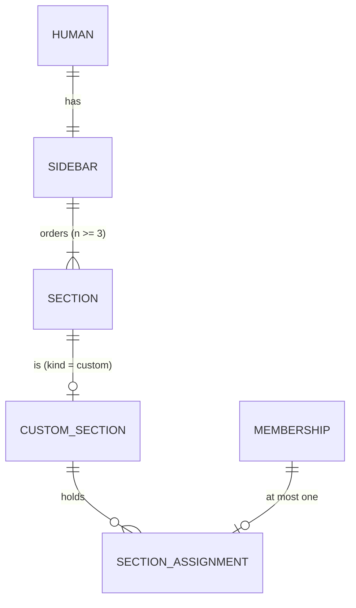

# Sidebar sections

Pass 1, for review. Context: Messaging. Decisions: sock-server ADR 57.

What changes:

- A human orders the sidebar's sections, and the order follows them to every device.
- A human creates custom sections: named sections they put conversations in. A conversation is in at most one custom section; in it, the conversation leaves its type section.
- People, Groups and Puppets stay, as type sections holding every unassigned conversation of their type.

## Language

| Term | Meaning |
|---|---|
| sidebar | A human's ordered list of sections, the same on every device |
| section | One heading in the sidebar: a type section or a custom section |
| type section | People, Groups or Puppets. Each is in every sidebar exactly once and cannot be renamed or deleted |
| custom section | A section the human created and named. Every custom section is theirs to rename, move and delete |
| assigned | A conversation the human has put in a custom section. It shows only there |

Stored: the sidebar's order, each custom section's name, each assignment. Derived on the device: a conversation's type (as today, `ConversationSection.of`) and the section it shows in (its custom section, else its type section).

## Context

Messaging (core). Both new aggregates sit beside `ReadMarker`: per-human state about conversations, never shown to another member. Identity and Moderation are unaffected.



## Sidebar

Entity, aggregate root. Identity is the human's account. A human with no stored sections has the default sidebar: People, Groups, Puppets. The first change stores it.

### Fields

| Field | Type | Meaning |
|---|---|---|
| `accountId` | UUID | The human. Never a puppet |
| `sections` | ordered list of `Section`, 3 or more | Top to bottom |

### Behaviors

- `CreateSection(name)`: adds a custom section at the top; returns it.
- `RenameSection(id, name)`.
- `DeleteSection(id)`: removes it; its conversations return to their type sections.
- `Reorder(order)`: `order` names every current section exactly once. Anything else is refused, which also refuses an order taken before another device added or deleted a custom section.

### Invariants

- Each type section appears exactly once.
- Positions run 0 to n-1 with no gaps or repeats.
- No two custom sections have names equal ignoring case. Two identical headings could not be told apart, and the assignment menu would list two of the same name.
- At most 50 custom sections, on every plan.
- Only a human has a sidebar.

### Relationships

| With | Kind | Cardinality |
|---|---|---|
| `Participant` (human) | references | 1 to 1 |
| `Section` | has-a | 1 to n, n ≥ 3 |

### States

None beyond default (no rows) and stored. The only transition is the first change, which stores the default and applies the change in one transaction.

## Section

Entity owned by `Sidebar`. A sum: exactly one of

| Variant | Fields |
|---|---|
| type section | `type`: `TypeSection` |
| custom section | `id` UUID, server-generated; `name`: `SectionName` |

A type section's identity is its `type`. Its position belongs to the sidebar.

## TypeSection

Enumeration: `people`, `groups`, `puppets`. Which conversations each holds is decided on the device, exactly as today.

## SectionName

Value object. Trimmed of leading and trailing white space, 1 to 1024 characters, no control characters. The constructor refuses anything else.

## SectionAssignment

Entity, aggregate root. Identity is (account, conversation). Separate from `Sidebar` so moving a conversation does not lock the sidebar, and because it lives and dies with a membership, like `ReadMarker`.

### Fields

| Field | Type | Meaning |
|---|---|---|
| `accountId` | UUID | The human |
| `conversationId` | UUID | The conversation assigned |
| `sectionId` | UUID | A custom section in this human's sidebar |

### Behaviors

- `Assign(sectionId)`: creates the assignment or moves it to another custom section. Idempotent.
- `Unassign()`: deletes it. Idempotent: no assignment is success.

### Invariants

- Only a member has one; leaving, removal, conversation deletion and erasure delete it.
- The custom section belongs to the same human.
- Deleting the custom section deletes it.

### Relationships

| With | Kind | Cardinality |
|---|---|---|
| `Membership` | derived-from | 0 or 1 to 1 |
| `Section` (custom section) | references | n to 1; a custom section holds 0 to n |

### States

Exists or not.

## SectionAssigning (domain service)

`Assign(account, conversation, custom section)` checks the caller is a member and the custom section is theirs, then calls `SectionAssignment.Assign`. One transaction, one aggregate written; the sidebar and membership are read.

## Caller classes

| Class | All new RPCs | `Conversation.section_id` |
|---|---|---|
| Anonymous | no | none |
| Human device | yes, own sidebar only | own assignment only |
| Puppet device | no, `CALLER_NOT_ALLOWED` | always empty |
| App Store | no | none |
| Operator | no | none |

No RPC returns another human's sidebar or assignments. Open without current terms, like `MarkRead`: nothing here creates content or contact.

## API contract

Every new RPC: `MessagingService`, Connect POST, `Authorization: Bearer sock_st_…`, human device only, puppet refused with `CALLER_NOT_ALLOWED` before any SQL, after the plan gate. Every RPC can also return `unavailable`. Every mutation runs in one transaction and returns the sidebar after it.

| RPC | Request | Response | Errors, in order | Idempotency | Domain behavior, event |
|---|---|---|---|---|---|
| `GetSidebar` | none | `sidebar` | `CALLER_NOT_ALLOWED` | read | read; none |
| `CreateSection` | `name` | `section`, `sidebar` | `CALLER_NOT_ALLOWED`, `FIELD_INVALID` (name), `SECTION_NAME_TAKEN`, `SECTION_LIMIT` | not idempotent; a retry after a lost reply gets `SECTION_NAME_TAKEN` and the client refetches | `Sidebar.CreateSection`; `SidebarChanged` |
| `RenameSection` | `section_id`, `name` | `sidebar` | `CALLER_NOT_ALLOWED`, `FIELD_INVALID` (id, name), `NOT_FOUND` (no such custom section of the caller's), `SECTION_NAME_TAKEN` (another custom section; the same one is a no-op) | idempotent | `Sidebar.RenameSection`; `SidebarChanged` when the name changed |
| `DeleteSection` | `section_id` | `sidebar` | `CALLER_NOT_ALLOWED`, `FIELD_INVALID` (id), `NOT_FOUND` | not idempotent: a repeat gets `NOT_FOUND`, which clients treat as done | `Sidebar.DeleteSection`; `SidebarChanged` |
| `ReorderSidebar` | `order`: repeated `SectionRef` | `sidebar` | `CALLER_NOT_ALLOWED`, `FIELD_INVALID` (not every current section exactly once; the client refetches) | idempotent | `Sidebar.Reorder`; `SidebarChanged` when the order changed |
| `AssignSection` | `conversation_id`, `section_id` | empty | `CALLER_NOT_ALLOWED`, `FIELD_INVALID` (ids), `NOT_FOUND` (conversation), `NOT_A_MEMBER`, `NOT_FOUND` (custom section) | idempotent | `SectionAssigning.Assign`; `SectionAssignmentChanged` when it changed |
| `UnassignSection` | `conversation_id` | empty | `CALLER_NOT_ALLOWED`, `FIELD_INVALID`, `NOT_FOUND` (conversation), `NOT_A_MEMBER` | idempotent | `SectionAssignment.Unassign`; `SectionAssignmentChanged` when a row was deleted |

`NOT_FOUND` for a custom section covers one that belongs to someone else: nothing tells a caller another human's custom section id exists. Membership precedes the custom section check in `AssignSection`, so a non-member learns nothing about the conversation.

### Changed responses (additive)

| RPC | Change | Meaning |
|---|---|---|
| `ListConversations` | `Conversation.section_id` string = 7 | The caller's custom section for it. Empty: unassigned, shown in its type section. Always empty for puppets and in the `Conversation` returned by other RPCs |
| `ExportMessagingData` | `section_id` on its `conversations`; `sidebar` = 4 | Data-subject access includes custom section names, order and assignments |
| `Subscribe` | `sidebar` = 7, `section_assignment` = 8 | See Events |

### Proto delta

```proto
// messaging.proto
rpc GetSidebar(GetSidebarRequest) returns (GetSidebarResponse) {}
rpc CreateSection(CreateSectionRequest) returns (CreateSectionResponse) {}
rpc RenameSection(RenameSectionRequest) returns (RenameSectionResponse) {}
rpc DeleteSection(DeleteSectionRequest) returns (DeleteSectionResponse) {}
rpc ReorderSidebar(ReorderSidebarRequest) returns (ReorderSidebarResponse) {}
rpc AssignSection(AssignSectionRequest) returns (AssignSectionResponse) {}
rpc UnassignSection(UnassignSectionRequest) returns (UnassignSectionResponse) {}

message GetSidebarRequest {}
message GetSidebarResponse { Sidebar sidebar = 1; }
message CreateSectionRequest { string name = 1; }
message CreateSectionResponse { CustomSection section = 1; Sidebar sidebar = 2; }
message RenameSectionRequest { string section_id = 1; string name = 2; }
message RenameSectionResponse { Sidebar sidebar = 1; }
message DeleteSectionRequest { string section_id = 1; }
message DeleteSectionResponse { Sidebar sidebar = 1; }
message ReorderSidebarRequest {
  // Every current section exactly once, top to bottom.
  repeated SectionRef order = 1;
}
message ReorderSidebarResponse { Sidebar sidebar = 1; }
message AssignSectionRequest { string conversation_id = 1; string section_id = 2; }
message AssignSectionResponse {}
message UnassignSectionRequest { string conversation_id = 1; }
message UnassignSectionResponse {}

message SubscribeResponse {
  oneof event {
    // ...1 to 6 unchanged
    // The caller's sidebar changed on one of its devices, the calling one
    // included. The whole sidebar. A hint: at most once, so clients
    // reconcile with GetSidebar when a stream opens. Human streams only.
    Sidebar sidebar = 7;
    // The caller moved a conversation into or out of a custom section. Not sent for
    // a custom section's deletion: the Sidebar event drops the custom section and
    // clients clear assignments to custom sections it no longer lists.
    SectionAssignment section_assignment = 8;
  }
}
message SectionAssignment {
  string conversation_id = 1;
  // Empty: unassigned.
  string section_id = 2;
}

// ExportMessagingDataResponse
Sidebar sidebar = 4;

// types.proto
message Sidebar {
  // Top to bottom. Each type section exactly once.
  repeated Section sections = 1;
}
message Section {
  oneof section {
    TypeSection type_section = 1;
    CustomSection custom_section = 2;
  }
}
message SectionRef {
  oneof section {
    TypeSection type_section = 1;
    string section_id = 2;
  }
}
message CustomSection {
  string id = 1;
  string name = 2;
}
enum TypeSection {
  TYPE_SECTION_UNSPECIFIED = 0;
  TYPE_SECTION_PEOPLE = 1;
  TYPE_SECTION_GROUPS = 2;
  TYPE_SECTION_PUPPETS = 3;
}
// in Conversation
// The caller's custom section for this conversation. Empty: unassigned.
// ListConversations and ExportMessagingData only; humans only.
string section_id = 7;

// errors.proto
ERROR_REASON_SECTION_NAME_TAKEN = 73;
ERROR_REASON_SECTION_LIMIT = 74;
```

## Events

Internal to Messaging, delivered to the caller's own live streams. Neither is an outbox row: clients reconcile with `GetSidebar` and `ListConversations` when a stream opens, so a dropped event delays convergence and loses nothing.

| Event | Emitting aggregate and transition | Payload | Consumers | Delivery |
|---|---|---|---|---|
| `SidebarChanged` | `Sidebar`: any of the four behaviors that changed something | `account_id`; the stream event carries the whole sidebar, read after commit | `pg_notify('sidebars', account_id)` in the transaction; each replica reads the sidebar and writes a `Sidebar` event to every human stream of the account | At most once. Whole state, so a missed or reordered event is repaired by the next |
| `SectionAssignmentChanged` | `SectionAssignment`: `Assign` that changed the row, `Unassign` that deleted one | `account_id`, `conversation_id`, `section_id` (empty: unassigned) | `pg_notify('section_assignments', payload)`; a `SectionAssignment` stream event to every human stream of the account | At most once |

Published form: the two stream events, additive. No domain service reacts: the cross-aggregate rule runs in the RPC before the event.

## Data contract

Next free migration number.

```sql
CREATE TABLE messaging.section_kinds (
    kind text PRIMARY KEY
);
INSERT INTO messaging.section_kinds VALUES ('custom'), ('people'), ('groups'), ('puppets');

CREATE TABLE messaging.sidebar_sections (
    id          uuid    PRIMARY KEY DEFAULT gen_random_uuid(),
    account_id  uuid    NOT NULL REFERENCES messaging.humans (account_id) ON DELETE CASCADE,
        -- humans only, by the FK; erasure removes the sidebar
    kind        text    NOT NULL REFERENCES messaging.section_kinds (kind),
    position    integer NOT NULL CHECK (position >= 0),
    UNIQUE (account_id, position) DEFERRABLE INITIALLY DEFERRED,
        -- deferred: a reorder rewrites every position in one transaction.
        -- Serves GetSidebar (account_id prefix, in order)
    UNIQUE (id, account_id, kind)
        -- target of messaging.custom_sections' FK, which pins kind = 'custom'
);
CREATE UNIQUE INDEX sidebar_sections_type_once
    ON messaging.sidebar_sections (account_id, kind) WHERE kind <> 'custom';
    -- a type section at most once per sidebar

CREATE TABLE messaging.custom_sections (
    section_id  uuid NOT NULL PRIMARY KEY,
    account_id  uuid NOT NULL,
    kind        text NOT NULL DEFAULT 'custom' CHECK (kind = 'custom'),
    name        text NOT NULL CHECK (char_length(name) BETWEEN 1 AND 1024 AND name = btrim(name)),
    FOREIGN KEY (section_id, account_id, kind)
        REFERENCES messaging.sidebar_sections (id, account_id, kind) ON DELETE CASCADE,
    UNIQUE (section_id, account_id)
        -- target of messaging.section_assignments' FK
);
CREATE UNIQUE INDEX custom_sections_name_once
    ON messaging.custom_sections (account_id, md5(lower(name)));
    -- serves the name-taken check on create and rename. md5, not the name:
    -- 1024 characters of UTF-8 can exceed the btree entry limit (about 2700 bytes)

CREATE TABLE messaging.section_assignments (
    account_id       uuid NOT NULL,
    conversation_id  uuid NOT NULL,
    section_id      uuid NOT NULL,
    PRIMARY KEY (account_id, conversation_id),
        -- one custom section per conversation per human; serves ListConversations
    FOREIGN KEY (conversation_id, account_id)
        REFERENCES messaging.memberships (conversation_id, account_id) ON DELETE CASCADE,
        -- lives with the membership
    FOREIGN KEY (section_id, account_id)
        REFERENCES messaging.custom_sections (section_id, account_id) ON DELETE CASCADE
        -- the custom section is the same human's; deleting it returns the conversation to its type section
);
CREATE INDEX section_assignments_section_idx
    ON messaging.section_assignments (section_id);
    -- serves the cascade from DeleteSection
```

5NF: one fact per row; the section kind lives once, on the section; nothing nullable; no derived column. STORE-ENFORCED, in the sidebar write transaction under `SELECT … FROM messaging.humans WHERE account_id = $1 FOR UPDATE` (serializes one human's sidebar writes): each type section exactly once once stored (the partial index gives at most once), positions 0 to n-1 with no gaps, at most 50 custom sections.

First change: under the lock, when the human has no rows, insert people 0, groups 1, puppets 2, then apply the change. `CreateSection` shifts every position up by one and inserts the custom section at 0.

## Cross-check

| Transition | API | Event | DDL |
|---|---|---|---|
| `Sidebar.CreateSection` | `CreateSection` | `SidebarChanged` | insert `sidebar_sections` and `custom_sections`, shift positions |
| `Sidebar.RenameSection` | `RenameSection` | `SidebarChanged` | update `custom sections.name` |
| `Sidebar.DeleteSection` | `DeleteSection` | `SidebarChanged` only; assignment removal rides it | delete `sidebar_sections`, cascade `custom_sections` then `section_assignments`, close the gap |
| `Sidebar.Reorder` | `ReorderSidebar` | `SidebarChanged` | update `sidebar_sections.position` |
| Default sidebar stored | the first mutation above | the mutation's event | insert the three type sections |
| `SectionAssignment.Assign` | `AssignSection` | `SectionAssignmentChanged` | upsert `section_assignments` |
| `SectionAssignment.Unassign` | `UnassignSection` | `SectionAssignmentChanged` | delete `section_assignments` |
| Assignment removed with a membership | `Leave`, `RemoveMember` | none: membership events cover it | cascade from `memberships` |
| Sidebar removed with an account | `EraseAccount` | `AccountErased` (existing) | cascade from `messaging.humans` |
| Reads | `GetSidebar`, `ListConversations`, `ExportMessagingData` | none | by `account_id` |

## Apple consumer

- **Model.** SockKit gains `Sidebar` (ordered sections, each `.type(ConversationSection)` or `.custom(id, name)`) with the default when the server has none. `ConversationSection.sectioned` gives way to `Sidebar.sectioned(items, …)`: a conversation goes in its custom section when the sidebar lists it, else in its type section. Empty type sections are dropped as today; empty custom sections show, so there is somewhere to put things (inferred; open question 2). Filter pills apply inside every section, unchanged.
- **Store.** `MessageStore` keeps the sidebar and each conversation's `sectionID`, written in the same transaction as the conversations from `ListConversations`.
- **Sync.** At stream open: `GetSidebar` with the existing `ListConversations`. A `Sidebar` event replaces the stored sidebar and clears assignments to custom sections it no longer lists; a `SectionAssignment` event sets or clears one.
- **Changes.** Applied locally at once, then sent. The response's sidebar replaces the local one; a failure reverts and shows the error banner. `FIELD_INVALID` on a reorder refetches and retries once. No outbox: like read markers, the server is the record and the next stream open reconciles.
- **UI, both platforms.** Section header menu: Move Up, Move Down, and for a custom section Rename… and Delete. Conversation row menu: Move to Section, listing custom sections plus New Section…, and Remove from Section when assigned. Sidebar menu: New Section… and Edit Sections…, a sheet listing every section with drag to reorder (`onMove`). SwiftUI `List` cannot drag a section header itself, which is why reordering lives in the menu and the sheet.

## Rollout

1. Contract: proto delta, this spec folded into `api.md`, `events.md`, `domain-model.md`. New RPCs and fields: a minor bump, Guy's call.
2. Server: migration, seven RPCs, two `ListConversations`/export fields, two stream events, black-box tests for each.
3. Apple: consumer above.

Additive throughout. `sock listen` and the `sock-mcp` channel act only on a message event, and puppets never receive these. Desktop and web show type sections until they adopt it (open question 4).

## Required tests

Server black-box: each RPC's success and each error in its listed order; a puppet token gets `CALLER_NOT_ALLOWED`; another human's custom section id gets `NOT_FOUND` from rename, delete and assign; duplicate name ignoring case gets `SECTION_NAME_TAKEN`, the 51st custom section `SECTION_LIMIT`; a stale reorder gets `FIELD_INVALID`; deleting a custom section returns its conversations to their type sections; `Leave` and erasure remove assignments and the sidebar; `ListConversations` and export carry `section_id` for the caller only; a stream of the same account receives both events, another account's neither. Apple: `Sidebar.sectioned` placement and order; store apply atomic with conversations; event apply, including clearing assignments to a deleted custom section; revert on failure.

## Open questions

1. Names unique per human ignoring case?
2. Show empty custom sections, and keep hiding empty type sections?
3. New custom sections at the top?
4. Desktop and web: in this pass or later?
5. Drag a conversation onto a custom section header on the Mac: v1 or later?
