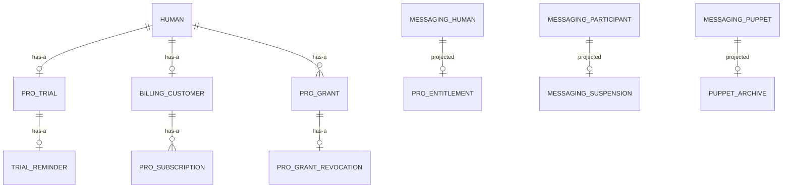
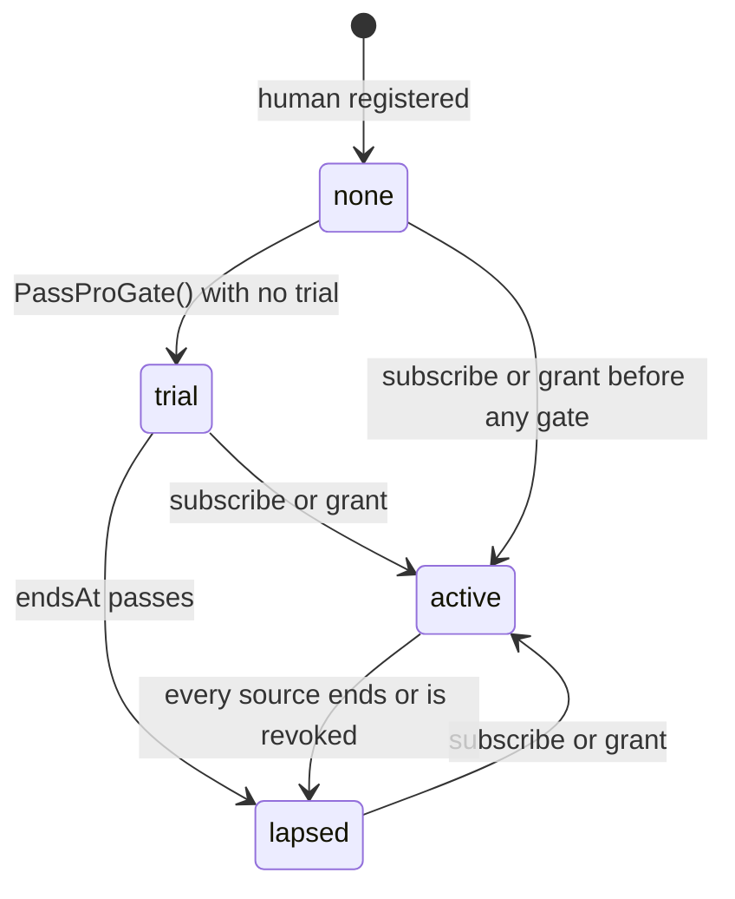

# Sock Pro billing

Pass 1, approved. Contexts: Identity, Messaging.

What changes:

- Sock Pro is sold on the web through Stripe Checkout with Managed Payments: Stripe (through Link) is the merchant of record and handles tax, fraud, disputes, receipts and payment support. $14.99 a month or $149.99 a year, tax included. The App Store subscription and its notification route are gone.
- A human gets one 7-day trial, no card, starting the first time they pass the Pro gate. Two days before it ends, a human with email sign-in gets a reminder email.
- The operator grants a human free Pro until a date from the console, and can revoke it.
- Pro is active while any of the three is: a trial, a Stripe subscription, an operator grant.
- Humans no longer talk to each other alone. A human posts only into a conversation with an active puppet in it; a conversation that loses its last active puppet stays listed, read-only.

## Ubiquitous language

| Term | Meaning | Stored or derived |
|---|---|---|
| Sock Pro | What lets a human own working puppets | Derived: active while any source below is active now |
| Pro source | One reason Pro is active: a trial, a subscription or a grant | Stored, one row per source |
| Trial | The one free 7-day period a human gets, no card | Stored |
| Subscription | A Stripe subscription bought through Checkout, as the hub last fetched it | Stored: the id and how long it keeps Pro active |
| Billing customer | The Stripe customer the hub created for a human | Stored, one per human at most |
| Grant | Free Pro the operator gave a human until a date | Stored |
| Pro active until | The latest time any of a human's sources keeps Pro active | Derived in Identity; projected to Messaging |
| Active puppet | A puppet that lets humans post: a system puppet, or one not archived, neither it nor its owner suspended, whose owner has Pro | Derived at post time in Messaging |
| Read-only conversation | A conversation with no active puppet: listed, readable, humans' posts refused | Derived |

## Domain model

Changes to [domain-model](domain-model.md). Unchanged objects are not repeated.

### Identity

#### Account (changed behaviors and invariants)

Entity, aggregate root.

Removed behavior: `ApplyAppStore(change)`. Removed relationship: `ProSubscription` (App Store).

New behaviors (humans):

- `PassProGate()`: the gate's check, run by every gated human action (`CreatePuppet`, `MintPuppetToken`, `MintMachineKey`, consent's Allow, `IssueConnectorPuppetToken` for the grant's owner). Passes when Pro is active. Otherwise, when the human has never had a trial, starts one (`ProTrial` now to now + 7 days, and its `TrialReminder`) and passes. Otherwise refuses `SUBSCRIPTION_REQUIRED`. While the gate is off it passes and starts nothing.
- `BindBillingCustomer(customerId)` (`StartCheckout`, first time): records the human's `BillingCustomer`. Refuses a second one.
- `ApplySubscription(snapshot)` (Stripe webhook): records what one fetch of a subscription says: `ProSubscription.activeUntil` from the snapshot (below). Writes the latest fetch, whatever was stored: the snapshot is Stripe's current state, not an increment. While the human is suspended, any subscription applied queues a `BillingCancellation` again: a checkout opened before the suspension can finish after it.
- `GrantPro(endsAt)` (`GrantPro`): adds a `ProGrant`. Refuses `endsAt` not after now or more than 10 years ahead.
- `RevokeProGrant(grantId)` (`RevokeProGrant`): records a `ProGrantRevocation`. Idempotent for a grant already revoked.
- `ProActiveUntil()`: the latest of the trial's `endsAt`, every subscription's `activeUntil` and every unrevoked grant's `endsAt`. Pro is active while it is after now.

Changed behavior:

- `Erase()`: also queues a `BillingCustomerDeletion` for the human's billing customer, if any. Deleting the Stripe customer cancels its subscriptions, so an erased human is never charged again.
- `Suspend()` and `Reinstate()`: emit `AccountSuspensionChanged`.
- `Suspend()`: also queues a `BillingCancellation` for the human's billing customer, if any. Suspension revokes every device and refuses sign-in, so the human can no longer reach the Customer Portal to cancel. Stripe cancels at once, with no proration and no refund; refunds are the operator's, in the Stripe dashboard.
- `Reinstate()`: drops a `BillingCancellation` not yet done. What Stripe already cancelled stays cancelled: the human subscribes again.
- `Erase()`: drops a pending `BillingCancellation`; the customer deletion cancels everything.

New invariants:

- At most one trial per human, ever. Erasing the human erases it, and a new account is a new human.
- At most one billing customer per human, and a billing customer belongs to one human.
- A subscription belongs to the human whose billing customer Stripe names on it. The hub never reads an account id from Stripe metadata.
- Every change to `ProActiveUntil()` emits `ProEntitlementChanged` in the same transaction.

#### ProTrial

Value object, owned by `Account` (humans), 0 or 1.

| Field | Type | Meaning |
|---|---|---|
| `startedAt` | Timestamp | When `PassProGate` started it |
| `endsAt` | Timestamp | `startedAt` + 7 days |

Kept after it ends: its existence is what refuses a second trial.

#### TrialReminder

Value object, owned by `ProTrial`, a queue row. Deleted once handled.

| Field | Type | Meaning |
|---|---|---|
| `availableAt` | Timestamp | When the worker may next lease it: `endsAt` − 2 days at first, pushed out by each lease and by backoff |
| `attempts` | int | Leases taken |

Handling: when the human's `ProActiveUntil()` is after the trial's `endsAt` (they subscribed or were granted Pro), or the human has no email identity, the row is deleted and nothing is sent. Otherwise the worker reads the address from WorkOS (the email identity's user) and sends "Your Sock Pro trial ends in 2 days" from `SOCK_BILLING_MAIL_FROM` through Cloudflare Email Service, then deletes the row. A timeout, 5xx or throttle from either service backs off (1 s doubling to 1 h, or `Retry-After`); a refusal for good (a bounce, a deleted WorkOS user) deletes the row and logs.

#### BillingCustomer

Value object, owned by `Account` (humans), 0 or 1.

| Field | Type | Meaning |
|---|---|---|
| `customerId` | string | Stripe's customer id, `cus_` and 1 to 64 of `[A-Za-z0-9]` |
| `createdAt` | Timestamp | When the hub created it |

Created by the hub with the Stripe idempotency key `customer-<account id>`, so a retried `StartCheckout` makes one customer. The hub sends Stripe no name, email or account id: Checkout collects the email.

#### ProSubscription (replaced)

Value object, owned by `Account` through its `BillingCustomer`, one per Stripe subscription.

| Field | Type | Meaning |
|---|---|---|
| `subscriptionId` | string | Stripe's subscription id, `sub_` and 1 to 64 of `[A-Za-z0-9]` |
| `activeUntil` | Timestamp | How long this subscription keeps Pro active, as of `fetchedAt` |
| `fetchedAt` | Timestamp | When the hub last fetched it from Stripe |

`activeUntil` from a snapshot, by Stripe status:

| Status | `activeUntil` |
|---|---|
| `active`, `trialing` | The latest `current_period_end` of its items (API version `2025-03-31.basil` and later carry the period on the items) |
| `past_due` | The latest item `current_period_start` + 7 days: a grace period while Stripe retries the card |
| `canceled`, `unpaid`, `incomplete`, `incomplete_expired`, `paused` | `fetchedAt`: ended |

A subscription set to cancel at period end stays `active` until then, so it keeps Pro until the period it was paid for ends. A Stripe refund does not by itself end Pro; a cancellation does.

#### BillingCustomerDeletion

Value object, a queue row with no owner: it outlives the erased account, as `EmailIdentityDeletion` does.

| Field | Type | Meaning |
|---|---|---|
| `customerId` | string | The Stripe customer to delete |
| `requestedAt` | Timestamp | The erasure time |
| `availableAt` | Timestamp | When the worker may next lease it |
| `attempts` | int | Leases taken |

Deleted once Stripe answers `2xx` or `404`.

#### BillingCancellation

Value object, a queue row owned by `Account` through its `BillingCustomer`, 0 or 1.

| Field | Type | Meaning |
|---|---|---|
| `customerId` | string | The Stripe customer whose billing stops |
| `requestedAt` | Timestamp | The suspension, or the webhook that applied a subscription while suspended |
| `availableAt` | Timestamp | When the worker may next lease it |
| `attempts` | int | Leases taken |

The worker asks Stripe, not the hub's rows: it expires every open Checkout session of the customer, so none completed later charges, then cancels every subscription Stripe still lists for it (every status but `canceled`, so `past_due`, `unpaid` and any the hub never recorded go too). Deleted once both listings are empty or the customer is gone (`404`). The webhook for its own cancel queues the row again, and that pass finds nothing.

#### ProGrant

Entity, owned by `Account` (humans). Identity persists across revocation.

| Field | Type | Meaning |
|---|---|---|
| `id` | UUID | Server-generated (`uuidv7`) |
| `grantedAt` | Timestamp | Server clock |
| `endsAt` | Timestamp | Pro active until this time, unless revoked. After `grantedAt`, at most 10 years after it |

Behaviors: `Revoke()`, through `Account.RevokeProGrant`.

#### ProGrantRevocation

Value object, owned by `ProGrant`, 0 or 1. Its existence ends the grant.

| Field | Type | Meaning |
|---|---|---|
| `revokedAt` | Timestamp | Server clock |

#### Billing (anti-corruption layer)

```go
// Billing is Stripe as Identity sees it. Only internal/stripe imports
// stripe-go; no Stripe type crosses this interface.
type Billing interface {
	// CreateCustomer makes the human's Stripe customer, keyed for
	// idempotency by the account id.
	CreateCustomer(ctx context.Context, accountID uuid.UUID) (customerID string, err error)
	// CheckoutURL starts a Managed Payments Checkout Session for one price.
	CheckoutURL(ctx context.Context, customerID string, plan ProPlan) (string, error)
	// PortalURL starts a Customer Portal session.
	PortalURL(ctx context.Context, customerID string) (string, error)
	// Subscription fetches one subscription's current state.
	Subscription(ctx context.Context, subscriptionID string) (SubscriptionSnapshot, error)
	// VerifyEvent checks a webhook's signature and returns what it is about.
	VerifyEvent(payload []byte, signature string, now time.Time) (BillingEvent, error)
	// DeleteCustomer deletes a customer, cancelling its subscriptions; one
	// already gone is success.
	DeleteCustomer(ctx context.Context, customerID string) error
	// CancelBilling stops a customer's billing: expires its open Checkout
	// sessions and cancels every live subscription at once. A customer
	// already gone is success.
	CancelBilling(ctx context.Context, customerID string) error
}

type ProPlan int // Monthly, Yearly: Stripe prices by lookup key pro_monthly, pro_yearly

type SubscriptionSnapshot struct {
	ID, CustomerID          string
	Status                  SubscriptionStatus // the closed set in the table above
	PeriodStart, PeriodEnd  time.Time          // latest across items
}

// BillingEvent is a verified webhook reduced to what the hub acts on.
type BillingEvent struct {
	Kind           BillingEventKind // SubscriptionChanged, CustomerDeleted, Ignored
	SubscriptionID string           // SubscriptionChanged
	CustomerID     string           // CustomerDeleted
}
```

Errors: a timeout, 5xx or `429` is `ErrUnavailable` carrying `Retry-After` when sent; any other 4xx is `ErrRefused` with Stripe's error code, never its message. `VerifyEvent` refuses a missing or malformed `Stripe-Signature`, a `t` more than 5 minutes from now, and a body whose `v1` HMAC-SHA256 over `t.payload` under `SOCK_STRIPE_WEBHOOK_SECRET` does not match, compared in constant time. Checkout sessions set `managed_payments[enabled]=true`, `mode=subscription`, the customer, the price found by lookup key, `success_url` and `cancel_url` from `SOCK_BILLING_RETURN_URL`.

### Messaging

#### Participant (changed)

Entity, aggregate root. New facts projected from Identity, each its own row:

- `ProEntitlement(activeUntil)` (humans), from `ProEntitlementChanged`. No row: no Pro.
- `Suspension` (any account), from `AccountSuspensionChanged`. The row exists while the account is suspended.
- `PuppetArchive` (puppets), from `PuppetArchiveChanged`, which Messaging relayed and stored nothing from until now. The row exists while the puppet is archived.

#### RecipientPolicy (changed)

Domain service, consulted by `Conversation.Post` and the membership factories. Answers, inside the transaction, as today whether a recipient is shielded from a sender, and now also:

- whether a conversation has an active puppet: some puppet member is the moderation or support puppet, or is not archived, neither it nor its owner is suspended, and the owner's `ProEntitlement.activeUntil` is after now (always true while `SOCK_PRO_REQUIRED` is off). The store answers it as it loads each puppet member, marking the `Participant` active, so `Conversation` decides from its members alone.

#### Conversation (changed behaviors and invariants)

Changed behaviors:

- `StartDirect(a, b)`: refuses unless `b` is `a`'s own puppet or the support puppet. A direct between two humans is no longer started; one that exists stays listed and is read-only, since it has no puppet.
- `StartGroup(creator, members)`: refuses unless `RecipientPolicy` finds an active puppet among the members.
- `Post(sender, …)`: a human sender is refused `NO_ACTIVE_PUPPET` unless `RecipientPolicy` finds an active puppet among the members. A puppet sender is not checked here: its token is already gated on its owner's Pro.

New invariant:

- A human posts only into a conversation with an active puppet. Membership changes are never refused for it (`Leave` is a safety exit path): a conversation that loses its last active puppet stays, read-only, and becomes writable again when one returns (the owner resubscribes, a puppet is unarchived or added).

### Diagrams





Pro's states are derived from the sources, not stored. Anything not drawn is refused: `lapsed` never returns to `trial`.

## Configuration

| Variable or setting | Meaning |
|---|---|
| `SOCK_PRO_REQUIRED` | Unchanged: `true` enforces the gate and the active-puppet rule's Pro clause |
| `SOCK_STRIPE_SECRET_KEY` | Restricted key: write Checkout Sessions, Customers, Customer Portal sessions; read Subscriptions, Prices. With the next two, `StartCheckout` and `OpenBillingPortal` are served and the webhook route is mounted; without them the RPCs answer `unavailable` and the route `404` |
| `SOCK_STRIPE_WEBHOOK_SECRET` | The endpoint's `whsec_` signing secret |
| `SOCK_BILLING_RETURN_URL` | Where Checkout and the portal return: `https://joinsock.com/pro` (`?checkout=success` or `?checkout=cancel` appended for Checkout) |
| `SOCK_BILLING_MAIL_FROM` | The trial reminder's sender, an address on `joinsock.com`; uses the existing `SOCK_CLOUDFLARE_ACCOUNT_ID` and `SOCK_CLOUDFLARE_EMAIL_TOKEN`. Unset: reminders wait in their queue |
| Stripe webhook endpoint | `https://<hub host>/stripe/webhook`, events `customer.subscription.created`, `.updated`, `.deleted`, `.paused`, `.resumed`, `customer.deleted`, `checkout.session.completed` |
| Stripe dashboard | Managed Payments on; product Sock Pro, tax code `txcd_10103001`, prices `pro_monthly` and `pro_yearly` tax-inclusive; Customer Portal: cancel, switch plans (shorter interval at period end), payment method, invoices |

Removed: `SOCK_APPLE_BUNDLE_ID` for notifications and `SOCK_PRO_SANDBOX_ACCOUNTS`.

## Caller classes

Removed: App Store. New: Stripe.

| Class | Authenticates with | Trusted to assert | Never trusted to assert |
|---|---|---|---|
| Stripe | `Stripe-Signature` on `POST /stripe/webhook` under `SOCK_STRIPE_WEBHOOK_SECRET`, within 5 minutes. Reaches only that route | That something about a customer or subscription changed | What changed (the hub fetches the subscription itself), any account id, anything in the payload beyond the object's id |

Human device reaches two new RPCs; the operator reaches two new RPCs and a changed one.

## API

`ERROR_REASON_NO_ACTIVE_PUPPET = 64` (`failed_precondition`), `ERROR_REASON_ALREADY_SUBSCRIBED = 65` (`failed_precondition`) and `ERROR_REASON_NO_SUBSCRIPTION = 66` (`failed_precondition`) join the taxonomy. `SUBSCRIPTION_REQUIRED` is unchanged and now means the trial is spent and no other source is active.

### Identity RPCs (IdentityService)

| RPC | Caller | Authentication | Authorization | Request | Response | Errors | Idempotency | Domain behavior |
|---|---|---|---|---|---|---|---|---|
| `StartCheckout` *terms* | Human | `sock_st_` session | Self. No subscription of the human's with `activeUntil` after now | `plan` `ProPlan` (`MONTHLY`, `YEARLY`) | `url` string: the Checkout page, valid 24 hours | `ALREADY_SUBSCRIBED` (manage it in the portal), `FIELD_INVALID` (`plan` unspecified), `CALLER_NOT_ALLOWED` (puppet, machine key), `unavailable` (Stripe unreachable or not configured) | Safe to retry: the customer is created once (Stripe idempotency key), and each call makes a new session; unused sessions expire | `Account.BindBillingCustomer` the first time, then `Billing.CheckoutURL`. Emits none |
| `OpenBillingPortal` | Human | `sock_st_` session | Self, holding a billing customer | empty | `url` string: a portal session | `NO_SUBSCRIPTION` (no billing customer), `CALLER_NOT_ALLOWED`, `unavailable` | Safe: each call makes a new portal session | `Billing.PortalURL`. Emits none |
| `GetMe` (changed) | Human, puppet | As today | Self | none | Adds `pro` `ProStatus{source, active_until}`: the source that keeps Pro active longest (`TRIAL`, `SUBSCRIPTION`, `GRANT`, or `UNSPECIFIED` with no `active_until`), and `trial_available` bool (never had one). `pro_active` unchanged | none | Read | none: reads `Account.ProActiveUntil()` |
| `CreatePuppet`, `MintPuppetToken`, `MintMachineKey`, `IssueConnectorPuppetToken` (changed) | As today | As today | As today, the Pro clause now `Account.PassProGate()` | As today | As today | As today | As today | As today, plus `PassProGate()`, which may start the trial in the same transaction and then emits `ProEntitlementChanged` |

`OpenBillingPortal` is exempt from the terms gate: it is how someone cancels, an exit path.

### Messaging RPCs (MessagingService, changed)

| RPC | Caller | Authentication | Authorization | Request | Response | Errors | Idempotency | Domain behavior |
|---|---|---|---|---|---|---|---|---|
| `CreateDirect` *terms* | Human | As today | Peer is the caller's own puppet or the support puppet | As today | As today | `PEER_NOT_ALLOWED` now also for a human peer; otherwise as today | As today | `Conversation.StartDirect` |
| `CreateGroup` *terms* | Human | As today | As today, and an active puppet is among the members | As today | As today | Adds `NO_ACTIVE_PUPPET` | As today | `Conversation.StartGroup`, consulting `RecipientPolicy` |
| `Send` *terms* | Human, puppet | As today | As today, and for a human sender an active puppet is a member | As today | As today | Adds `NO_ACTIVE_PUPPET` (human sender only) | As today; a refused send records no receipt | `Conversation.Post`, consulting `RecipientPolicy` |
| `ListConversations` | Human, puppet | As today | As today | As today | Each `Conversation` gains `humans_can_post` bool: an active puppet is a member | none | Read | none: a read through `RecipientPolicy` |

### Operator RPCs (OperatorService)

| RPC | Caller | Authentication | Authorization | Request | Response | Errors | Idempotency | Domain behavior |
|---|---|---|---|---|---|---|---|---|
| `GrantPro` | Operator | `sock_ot_` bearer | `full` scope. A human | `account_id`, `ends_at` Timestamp | `grant` `ProGrant{id, granted_at, ends_at}` | `FIELD_INVALID` (malformed id, `ends_at` not after now or more than 10 years ahead), `NOT_FOUND` (no such human) | Not idempotent: each call adds a grant. The console shows the human's grants, so a retry is visible and revocable | `Account.GrantPro(endsAt)`, with `OperatorAction(grantPro)` in the same transaction. Emits `ProEntitlementChanged` when it moves `ProActiveUntil()` |
| `RevokeProGrant` | Operator | `sock_ot_` bearer | `full` scope. A grant that exists | `grant_id` | empty | `FIELD_INVALID`, `NOT_FOUND` | Idempotent: revoking a revoked grant succeeds and still records an action | `Account.RevokeProGrant(grantId)`, with `OperatorAction(revokeProGrant)`. Emits `ProEntitlementChanged` when it moves `ProActiveUntil()` |
| `GetHuman` (changed) | Operator | As today | As today | As today | Adds `pro` `ProStatus`, `trial` (`started_at`, `ends_at`, absent when never started), `subscriptions` (`subscription_id`, `active_until`), `grants` (each `ProGrant` with `revoked_at` when revoked) | As today | Read | none: a read |

`OperatorActionKind` gains `grantPro` and `revokeProGrant`, their target `ProGrantTarget(grantId)`.

### Routes

| Route | Caller | Authentication | Authorization | Request | Response | Errors | Idempotency | Domain behavior |
|---|---|---|---|---|---|---|---|---|
| `POST /stripe/webhook` | Stripe | `Stripe-Signature` (Billing above) | None beyond the signature | Stripe's event JSON, at most 64 KiB; only `type` and the object's `id` (and `customer` for `customer.deleted`) are read | `200`, empty, once applied or ignored. `400` for a bad signature. `500` when the fetch from Stripe or the write fails, so Stripe retries (it retries for 3 days) | Unknown event types `200` and ignored. A subscription whose customer is no human's `200` and ignored | Idempotent: each delivery fetches the current state and writes it; duplicates and out-of-order deliveries converge | `SubscriptionChanged` (the `customer.subscription.*` types, and `checkout.session.completed` for its `subscription`): one transaction takes `pg_advisory_xact_lock` on the subscription id, fetches it (`Billing.Subscription`, 10 s), then `Account.ApplySubscription(snapshot)`, so two deliveries for one subscription never write an older fetch over a newer one. `CustomerDeleted`: deletes the billing customer and its subscriptions. Each emits `ProEntitlementChanged` when it moves `ProActiveUntil()` |

Removed: `POST /apple/notifications`. Logs carry the Stripe event id, type and outcome; never the body.

## Domain events

| Event | Emitting aggregate | Transition | Payload | Consumers | Delivery | Boundary | Domain service |
|---|---|---|---|---|---|---|---|
| `ProEntitlementChanged` | Account | Any write that moves a human's `ProActiveUntil()`: `PassProGate` starting a trial, `ApplySubscription`, the webhook's customer deletion, `GrantPro`, `RevokeProGrant` | `account_id` UUID, `active_until` Timestamp (the epoch when no source exists) | Messaging: upsert `ProEntitlement(activeUntil)` | Identity outbox: at least once, in commit order per account, replayable | Published | none: Messaging's own projection row |
| `AccountSuspensionChanged` | Account | `Suspend` when the suspension is written, `Reinstate` when it is deleted. Never on a no-op | `account_id` UUID, `suspended` bool | Messaging: insert or delete `Suspension` | As above | Published | none: Messaging's own projection row |
| `PuppetArchiveChanged` (existing, new reaction) | Account | Unchanged | Unchanged | Messaging: also insert or delete `PuppetArchive` | Unchanged | Published | none |

A trial or grant ending needs no event: `activeUntil` is a time, and Messaging compares it with now at post. The trial reminder, billing customer deletion and billing cancellation are queues, not events: `PassProGate`, `Erase`, and `Suspend` or `ApplySubscription` insert the row and notify `trial_reminders`, `billing_customer_deletions` or `billing_cancellations` in the same transaction, and each worker leases rows as `identity.email_identity_deletions` does.

## Data layer

Migration `00027_sock_pro_billing.sql`. Drops `identity.pro_subscriptions` and `identity.app_store_environments` (beta sandbox rows only, never enforced). Seeds the three Messaging projections from Identity's tables once, in the migration: the one place Messaging's tables are filled from Identity's directly, recorded here.

### `identity.pro_trials`

Owning aggregate: Account.

| Column | Type | Null |
|---|---|---|
| `account_id` | `uuid` | NOT NULL |
| `started_at` | `timestamptz` | NOT NULL, default `now()` |
| `ends_at` | `timestamptz` | NOT NULL |

- Primary key `account_id`: one trial per human, ever.
- Foreign key `account_id` → `identity.humans (account_id)` ON DELETE CASCADE.
- Check `ends_at = started_at + interval '7 days'`.

### `identity.trial_reminders`

Owning aggregate: Account (through its trial).

| Column | Type | Null |
|---|---|---|
| `account_id` | `uuid` | NOT NULL |
| `available_at` | `timestamptz` | NOT NULL |
| `attempts` | `integer` | NOT NULL, default `0` |

- Primary key `account_id`; foreign key → `identity.pro_trials (account_id)` ON DELETE CASCADE.
- Check `attempts >= 0`.
- Index `trial_reminders_lease_idx (available_at, account_id)`: serves the lease, `WHERE available_at <= now() ORDER BY available_at FOR UPDATE SKIP LOCKED`, and the sleep until the earliest.

### `identity.billing_customers`

Owning aggregate: Account.

| Column | Type | Null |
|---|---|---|
| `account_id` | `uuid` | NOT NULL |
| `customer_id` | `text` | NOT NULL |
| `created_at` | `timestamptz` | NOT NULL, default `now()` |

- Primary key `account_id`: one customer per human.
- Unique `customer_id`: serves the webhook's lookup from Stripe's customer to the human; a customer belongs to one human.
- Foreign key `account_id` → `identity.humans (account_id)` ON DELETE CASCADE.
- Check `customer_id ~ '^cus_[A-Za-z0-9]{1,64}$'`.

### `identity.pro_subscriptions` (replaced)

Owning aggregate: Account.

| Column | Type | Null |
|---|---|---|
| `subscription_id` | `text` | NOT NULL |
| `account_id` | `uuid` | NOT NULL |
| `active_until` | `timestamptz` | NOT NULL |
| `fetched_at` | `timestamptz` | NOT NULL |

- Primary key `subscription_id`.
- Foreign key `account_id` → `identity.billing_customers (account_id)` ON DELETE CASCADE: a subscription exists only under a human's customer, and goes with it.
- Check `subscription_id ~ '^sub_[A-Za-z0-9]{1,64}$'`.
- Index `pro_subscriptions_account_idx (account_id, active_until)`: serves `ProActiveUntil()` and the gate's `EXISTS (… account_id = $1 AND active_until > now())`.

### `identity.billing_customer_deletions`

Owning aggregate: none (outlives the account).

| Column | Type | Null |
|---|---|---|
| `customer_id` | `text` | NOT NULL |
| `requested_at` | `timestamptz` | NOT NULL, default `now()` |
| `available_at` | `timestamptz` | NOT NULL, default `now()` |
| `attempts` | `integer` | NOT NULL, default `0` |

- Primary key `customer_id`. No foreign key: the account and its customer row are deleted in the transaction that queues this one.
- Check `customer_id ~ '^cus_[A-Za-z0-9]{1,64}$'`, check `attempts >= 0`. No cap: a customer left behind keeps charging the card, so the row retries at the 1 h ceiling until Stripe answers `2xx` or `404`, and logs every other 4xx.
- Index `billing_customer_deletions_lease_idx (available_at, customer_id)`: serves the lease.

### `identity.billing_cancellations`

Owning aggregate: Account, through `BillingCustomer`. Migration `00028_billing_cancellations.sql`.

| Column | Type | Null |
|---|---|---|
| `customer_id` | `text` | NOT NULL |
| `requested_at` | `timestamptz` | NOT NULL, default `now()` |
| `available_at` | `timestamptz` | NOT NULL, default `now()` |
| `attempts` | `integer` | NOT NULL, default `0` |

- Primary key `customer_id`. No foreign key: Stripe deleting the customer cancels everything and the worker's next listing answers `404`; a foreign key would make `Suspend` fail when a `customer.deleted` webhook commits under it. `Reinstate` and `Erase` delete the row.
- Check `customer_id ~ '^cus_[A-Za-z0-9]{1,64}$'`, check `attempts >= 0`. No cap, as `billing_customer_deletions`: a live subscription keeps charging the card.
- Index `billing_cancellations_lease_idx (available_at, customer_id)`: serves the lease.

`ApplySubscription` takes the account row `FOR SHARE` before the human's Pro lock, and `Reinstate` takes it `FOR UPDATE` as `Suspend` does, so a webhook either sees the suspension committed or commits before the suspension (which then queues the customer) or the reinstatement (which then drops the row).

### `identity.pro_grants`

Owning aggregate: Account.

| Column | Type | Null |
|---|---|---|
| `id` | `uuid` | NOT NULL, default `uuidv7()` |
| `account_id` | `uuid` | NOT NULL |
| `granted_at` | `timestamptz` | NOT NULL, default `now()` |
| `ends_at` | `timestamptz` | NOT NULL |

- Primary key `id`.
- Foreign key `account_id` → `identity.humans (account_id)` ON DELETE CASCADE.
- Check `ends_at > granted_at AND ends_at <= granted_at + interval '10 years'`.
- Index `pro_grants_account_idx (account_id, ends_at)`: serves `ProActiveUntil()` and `GetHuman`.

### `identity.pro_grant_revocations`

Owning aggregate: Account (through the grant).

| Column | Type | Null |
|---|---|---|
| `grant_id` | `uuid` | NOT NULL |
| `revoked_at` | `timestamptz` | NOT NULL, default `now()` |

- Primary key `grant_id`; foreign key → `identity.pro_grants (id)` ON DELETE CASCADE.

### `identity.operator_action_pro_grants`

Owning aggregate: OperatorAction. The target of `grantPro` and `revokeProGrant`.

| Column | Type | Null |
|---|---|---|
| `action_id` | `bigint` | NOT NULL |
| `grant_id` | `uuid` | NOT NULL |

- Primary key `action_id`; foreign key → `identity.operator_actions (id)` ON DELETE CASCADE.
- Foreign key `grant_id` → `identity.pro_grants (id)` ON DELETE CASCADE: erasing the human deletes the actions targeting it, as today.
- Append-only by the existing trigger; the action/target match function gains both kinds. `identity.operator_action_kinds` gains `grantPro` and `revokeProGrant`.

### `messaging.pro_entitlements`

Owning aggregate: Participant.

| Column | Type | Null |
|---|---|---|
| `account_id` | `uuid` | NOT NULL |
| `active_until` | `timestamptz` | NOT NULL |

- Primary key `account_id`: serves `RecipientPolicy`'s owner lookup.
- Foreign key `account_id` → `messaging.humans (account_id)` ON DELETE CASCADE.

### `messaging.suspensions`

Owning aggregate: Participant.

| Column | Type | Null |
|---|---|---|
| `account_id` | `uuid` | NOT NULL |

- Primary key `account_id`; foreign key → `messaging.participants (account_id)` ON DELETE CASCADE.

### `messaging.puppet_archives`

Owning aggregate: Participant.

| Column | Type | Null |
|---|---|---|
| `puppet_id` | `uuid` | NOT NULL |

- Primary key `puppet_id`; foreign key → `messaging.puppets (account_id)` ON DELETE CASCADE.

`RecipientPolicy`'s active-puppet query joins `messaging.memberships` (by conversation) to `messaging.puppets`, anti-joins `messaging.puppet_archives` and `messaging.suspensions` and reads `messaging.pro_entitlements`, all by primary key; no new index.

### Normal form

Every new table is 5NF: one fact per row, keyed by what it is about, each column readable alone, no nullable column. Later facts (a revocation, a trial's reminder, an archive, a suspension) are their own rows. The hub stores no email address and no card data.

## Apps and console

- Mac app and CLI: "Subscribe" opens `StartCheckout`'s URL in the browser, monthly or yearly; "Manage subscription" opens `OpenBillingPortal`. After return, the app re-reads `GetMe`. `sock subscribe [--yearly]` and `sock billing` do the same from the CLI.
- iOS app: shows Pro status from `GetMe` and offers no purchase or link out.
- Every client: a conversation with `humans_can_post` false shows its history and replaces the composer with "No active puppet here". A human never sees a "new direct with a person" action.
- Console, human page: Pro status and source, the trial, subscriptions, and grants with Revoke. "Grant Pro" takes an end date (presets 1 month, 1 year, 10 years) and calls `GrantPro`.
- `joinsock.com/pro`: the return page. It says "Return to the Sock app" and reads `checkout=success|cancel`; it holds no account state.

## Cross-check

| Transition | API | Event | DDL |
|---|---|---|---|
| `Account.PassProGate` (starts a trial) | `CreatePuppet`, `MintPuppetToken`, `MintMachineKey`, `IssueConnectorPuppetToken`, consent Allow | `ProEntitlementChanged` | `identity.pro_trials`, `identity.trial_reminders` insert |
| `TrialReminder` handled | none: queue worker | none | `identity.trial_reminders` delete |
| `Account.BindBillingCustomer` | `StartCheckout` | none: Identity's own row, nothing else reacts | `identity.billing_customers` insert |
| `Account.ApplySubscription` | `POST /stripe/webhook` | `ProEntitlementChanged` when moved | `identity.pro_subscriptions` upsert |
| Billing customer deleted by Stripe | `POST /stripe/webhook` (`customer.deleted`) | `ProEntitlementChanged` when moved | `identity.billing_customers` delete, cascading |
| `Account.GrantPro` | `GrantPro` | `ProEntitlementChanged` when moved | `identity.pro_grants`, `identity.operator_actions`, `identity.operator_action_pro_grants` |
| `Account.RevokeProGrant` | `RevokeProGrant` | `ProEntitlementChanged` when moved | `identity.pro_grant_revocations`, operator action rows |
| `Account.Erase` (customer deletion) | unchanged | `AccountErased` | `identity.billing_customer_deletions` insert |
| `Account.Suspend`, `Reinstate` | unchanged | `AccountSuspensionChanged` | `identity.suspensions`; `messaging.suspensions` by projection |
| `Account.Suspend` (billing cancellation) | unchanged | none: a queue | `identity.billing_cancellations` insert; `Reinstate` and `Erase` delete it |
| `BillingCancellation` handled | none: queue worker | none: Stripe's `customer.subscription.deleted` webhook then applies the end | `identity.billing_cancellations` delete |
| Projection of Pro, suspension, archive | none: events | consumes the three events above | `messaging.pro_entitlements`, `messaging.suspensions`, `messaging.puppet_archives` |
| `Conversation.StartDirect` (no human pairs) | `CreateDirect` | none, as today | none new |
| `Conversation.StartGroup` (active puppet) | `CreateGroup` | none, as today | reads the projections |
| `Conversation.Post` (active puppet) | `Send` | `MessagePosted`, as today | reads the projections |
| Read-only state | `ListConversations.humans_can_post` | none: derived at read | reads the projections |

## Completeness gate

- Every new or changed RPC and route has every field.
- Every event touched has every field.
- Every new table has every field.
- Caller classes: Stripe reaches the webhook route; a human device reaches `StartCheckout` and `OpenBillingPortal`; the operator reaches `GrantPro`, `RevokeProGrant` and the changed `GetHuman`. The App Store class is gone with its route.
- Every transition above traces through all three or says why not.

## Open questions

- Trial reminder for a human with no email sign-in (Apple only): this pass sends nothing. Alternative: a message from the support puppet to everyone, which reaches every human with no address lookup.
- `past_due` grace of 7 days after the failed renewal's period start: a guess at how long Stripe's retries take to settle; Stripe's own retry schedule is configured in the dashboard.
- Whether deleting a customer is allowed for Managed Payments customers, and whether Link's own data deletion then sends `customer.deleted`: to verify in test mode before release.
- `GrantPro` for "forever" is 10 years: chosen so every grant has an end and the check stays simple.
- The iOS app and App Review: an iOS app showing Pro bought on the web, with no in-app purchase, is allowed only while it unlocks nothing in the app; to confirm at the next review.
